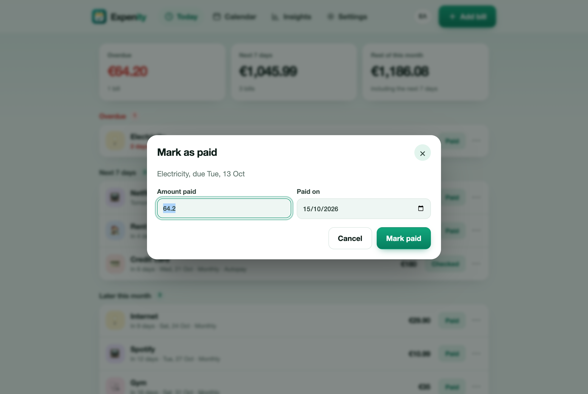

# Add bills

Every bill has a name, an optional amount, a next due date and how often it repeats. Everything else is optional.

## Type a sentence

At the top of the Add dialog, type what you pay in your own words. Expenity picks out the name, the amount, the currency, how often it repeats and the date, in English or in Greek. The chips under the box show what it understood, and the form fills as you type. Press Enter to jump to the form and check it.

| You type | You get |
|---|---|
| `Netflix 15.99 monthly on the 3rd` | Netflix, 15.99, every month, next 3rd |
| `Rent €850 every month on 1st` | Rent, 850 EUR, every month, next 1st |
| `Electricity ~60 monthly 15th` | Electricity, about 60, every month, next 15th |
| `Car insurance 420 yearly 12 march` | Car insurance, 420, every year, next 12 March |
| `Gym £35 weekly friday` | Gym, 35 GBP, every week, next Friday |
| `Phone 25 tomorrow` | Phone, 25, one-off, tomorrow |
| `Ενοίκιο 850€ κάθε μήνα στις 1` | Ενοίκιο, 850 EUR, every month, next 1st |
| `ΕΝΦΙΑ 300 τριμηνιαία 28 Φεβρουαρίου` | ΕΝΦΙΑ, 300, every 3 months, next 28 February |

Words it knows: monthly, weekly, every 2 weeks, quarterly, yearly, once, today, tomorrow, month and day names, ordinals such as 3rd, and `~` or "about" for an amount that varies. Both decimal marks work: `15.99` and `15,99`.

It is a helper, not a promise. If a chip is wrong, fix the field in the form; the form is always the final word.

## Use a template

Under the sentence box there are templates: Rent, Electricity, Water, Internet, Mobile phone, Netflix, Spotify, Car insurance, Credit card, Gym, Property tax and School fees (in Greek: Ενοίκιο, ΔΕΗ, ΕΥΔΑΠ, ΕΝΦΙΑ and so on). A template fills in the name, the category and the repeat. Then add the amount and the date.

## The form

| Field | What it does |
|---|---|
| Name, Amount, Currency | Amount is optional. Currency is a three-letter code, such as EUR. |
| Next due date | The date of the next payment. |
| Repeats | Once, every week, every 2 weeks, every month, every 3 months, every year. A bill due on the 31st stays on the last day of shorter months and returns to the 31st. |
| Category | Used for the icons and the spending chart. |
| Remind me | From the day itself up to 2 weeks before. "Default" follows the setting in Settings. |
| The amount changes each time | Marks the amount as an estimate (shown with ~). |
| Paid automatically | For direct debits. The button says "Checked" and the point is to confirm the payment went through. |
| Ends on | The last date a repeating bill is due, for example the end of a loan. |
| Payment reference | IBAN, RF code or account number. Copy it from the ⋯ menu. |
| Payment link | Opens your bank's or provider's payment page from the ⋯ menu. Expenity never pays for you. |

## Mark a bill paid

Press **Paid**. Check the amount and the date and confirm. For a repeating bill the next due date is worked out for you. A one-off bill is finished. A message offers **Undo** for a few seconds.

The payments you record feed the [insights](calendar-and-insights.md): spending by category and price changes.

## Snooze, skip, edit, delete

In the **⋯** menu:

- **Snooze** pauses the notifications for that bill for a day or three. The due date does not change.
- **Skip this time** moves a repeating bill to its next date without recording a payment.
- **Edit** and **Delete** do what they say. Deleting can be undone for a few seconds.
