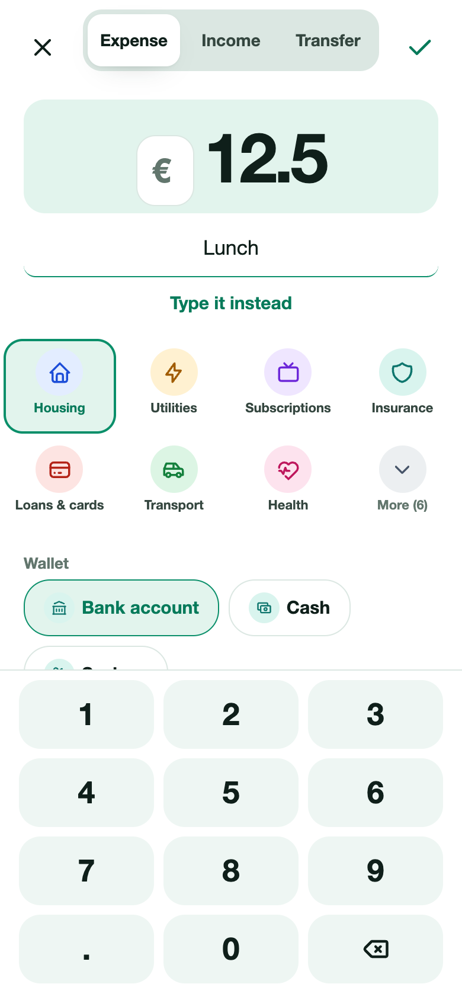
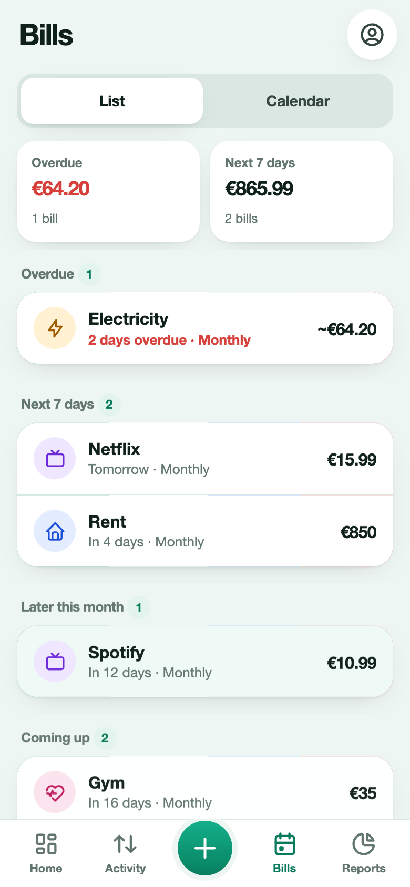
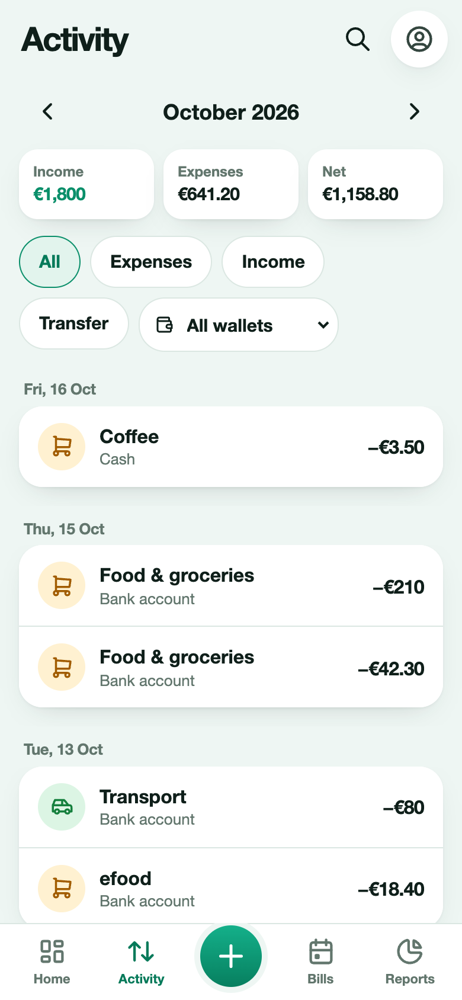
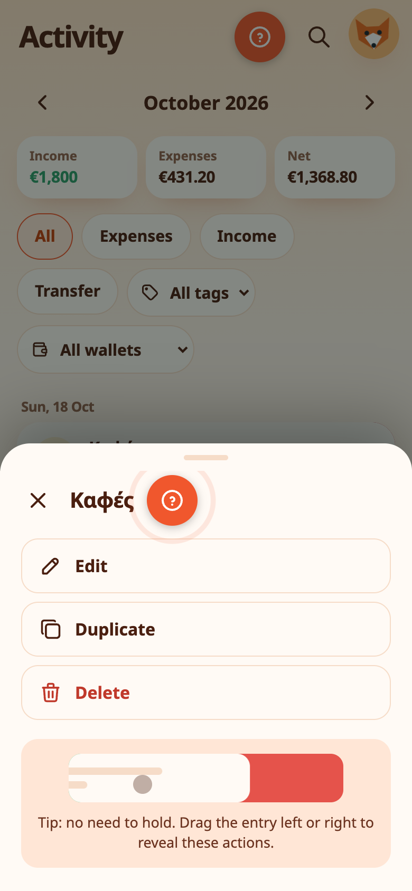

# Add expenses, income and bills

Everything starts with the green **+** button. It offers four things: an **expense**, an **income**, a **transfer** between wallets, and a **bill**.

## Add an expense or income

The sheet is built around the amount, so the most important thing comes first.

1. Choose **Expense**, **Income** or **Transfer** at the top.
2. Tap the amount to open the keypad. Enter the value, then press **✓ Done** to collapse it.
3. Add a **description** if you like, for example "Lunch".
4. Pick a **category**. Common ones are shown; **More** opens the rest, including your own categories.
5. Pick the **wallet**.
6. Pick the **date**: Today, Yesterday, or another date. **Note** adds a longer note.
7. Press the check mark.

> 💡 **Real-life example** Nikos pays €42.30 at the supermarket on his way home. He taps +, types 42.30, picks his Cash wallet and the right category, and saves. It takes about ten seconds and the day's total is already updated.

## Or type a sentence

Press **Type it instead** and write what happened, in English or Greek:

- `Coffee 3.50 yesterday`
- `Salary 1500 income`
- `Groceries 42,30`
- `Καφές 3,50 χθες`

Expenity fills the amount, description, date and type, and shows chips so you can see what it understood.

> 💡 **Real-life example** Waiting in a queue, Maria types `Coffee 3.50 yesterday` for the coffee she forgot to log. Expenity picks out the name, the amount and yesterday's date, she checks the chips and saves.

## Smart detection (Advanced)

With **Smart detection** on, type a description such as `Coffee with Anna` and Expenity fills in the category, up to two tags and the wallet for you. A line under the description says what it filled in, with an **Undo** button.

- It looks at your own earlier entries first, then at built-in words in English and Greek, then at your own category names.
- It never overwrites something you chose yourself, and after **Undo** it stays off for that entry.
- Tags come from a short shared list (Coffee, Groceries, Car, Home and so on) or your own tags, so similar things always get the same tag.
- If you have one wallet, it is picked for you.

Smart detection is part of Advanced. Turn it on or off in **More → Make it yours → Features**.

> 💡 **Real-life example** Eleni types `Pharmacy` and the Pharmacy category, a Health tag and her only wallet fill in. A week later she types `Gym membership` and gets the sport category and a Fitness tag. She never has to scroll the category list.

## When a field is missing

If you press save and something is missing, every missing field stays outlined in red until you fill it in. Once you fill one in, Expenity takes you to the next missing field, from top to bottom.

> 💡 **Real-life example** Giorgos presses Save with no amount and no category. Both stay outlined in red. He enters the amount and the screen moves to the category on its own. One tap later, the entry is saved.

## Tags

Tags are short labels you can add to any entry, such as `Coffee`, `Work` or `Trip`. **Type several at once, separated by commas**: `Coffee, Work` adds two tags. You can also tap a tag you already have. Find your entries again with the tag filter in Activity, and manage all your tags in **More → Money organisation → Tags**.

Reuse the tags you already have instead of making a new one for each variation. `Groceries` and `Grocery` would become two separate tags.

> 💡 **Real-life example** On a business trip, Petros tags each payment `Trip, Work`. At the end of the month he filters Activity by `Work` and sends his employer one list of everything to claim back.

## Transfers

A transfer moves money between two of your wallets, for example from the bank to cash. It is not an expense. If the wallets use different currencies, Expenity asks how much arrived in the second one. A transfer works between two private wallets, or between two wallets in the same [shared wallet](shared-wallets.md), not across the two.

> 💡 **Real-life example** Anna moves €200 from her bank wallet to her cash wallet before a weekend away. A transfer keeps both balances right and does not count as spending.

## Bills

A bill is something that comes up again and again, like rent or Netflix. Press **+** and choose **Bill**.

- **Type it in a sentence**: `Netflix 15.99 monthly on the 3rd`, `Rent €850 every month on 1st`, `Electricity ~60 monthly 15th` (a tilde means the amount changes each time).
- **Pick a template**: Rent, Electricity, Water, Internet, Mobile phone, Netflix, Spotify, Car insurance, Credit card, Gym, Property tax, School fees. Greek templates such as ΔΕΗ, ΕΥΔΑΠ and ΕΝΦΙΑ are included.
- **Or fill in the form**: name, the wallet it is paid from, amount, next due date, how often it repeats (once, weekly, every 2 weeks, monthly, every 3 months, yearly), category, how early to remind you.

The bill takes the currency of its wallet. Two options help with awkward bills: **The amount changes each time** treats the amount as an estimate, and **Paid automatically** reminds you to check that it went through.

### Mark a bill paid

On the Bills screen, **Paid** records the payment as an expense in the wallet and moves a repeating bill to its next date. You can **Undo** right after. For a bill with a variable amount, Expenity asks how much you paid.

Other actions, from the **⋯** menu on a bill: **Snooze** (to tomorrow or for 3 days), **Skip this time**, open the payment link, copy the payment reference, edit and delete.

> 💡 **Real-life example** The electricity bill of €64 is due on the 12th of every month. Dimitra adds it once as a monthly bill. Each month Expenity reminds her, she swipes it right to mark it Paid, and the payment is recorded as an expense.

## Swipe and pull

On a phone, swiping a row slides it to show buttons. **Nothing happens until you tap a button**. Tapping anywhere else closes the row, and a row you leave open slides back by itself after two seconds. On a tablet or computer there is no swiping: click a row and its details open with the same Edit, Delete and Paid buttons.

- On a **transaction**: swipe **left** to reveal **Edit** and **Delete**.
- On a **bill**: swipe **right** to reveal **Paid**, or **left** to reveal **Edit** and **Delete**.
- Pull the screen down to sync now (when you are signed in).

The setup shows this in a short animation.

> 💡 **Real-life example** On the bus, Petros sees he logged the wrong amount. He swipes the entry left, taps Edit and fixes it without opening any other menu.

## Edit and delete

Tap any row to see its details, edit it or delete it. On a tablet or computer the details show in a side panel. In a [shared wallet](shared-wallets.md), the details also say who added it, and a viewer can look but not change.

## Amount entry and reusable names

The number pad starts **closed**. Tap the amount, enter a value, then press **✓ Done** to keep the amount and collapse the pad. This does not save the transaction. Text fields also show a **✓ Done** control to dismiss the phone keyboard. Press the checkmark at the top only when you are ready to save the whole transaction.

To reuse a name, enter a description and tick **Save this name for next time** before saving. The next time you add the same kind of transaction, expand **Saved names** and tap one. Its name and category are reused; the amount, date and wallet remain under your control. Expenses and income have separate lists. Use the × beside a saved name to remove it. Up to 30 names are saved in total and sync with your account settings. Your own names are kept in their original language.

> 💡 **Real-life example** Sofia buys the same bakery order every morning. After the first time, she picks the saved name and the amount and category come with it.

## Reference photos

While signed in, choose **Attach photo** on an expense, income, transfer, bill, wallet, budget, goal or recurring income. JPEG, PNG and WebP work; HEIC depends on browser decoding support. The original file must be under 20 MB. Expenity re-encodes the photo as JPEG, removes original metadata, resizes the longest side to at most 1,280 pixels and compresses it to 96 KB or less. Save the item after uploading. A paperclip marks a photo; open the item and choose **View photo**. Editing also offers Replace and Remove.

Photos require an account and internet to upload or view. Up to 100 uploads fit in an account, with roughly 9.4 MiB of storage. Shared-wallet members can see attachments in that wallet; viewers cannot change them. A photo on a bill or income schedule is carried into its recorded payment.

**Account → Delete all photos** permanently removes your uploads, including your uploads in shared wallets. Other members lose access to those images. Other people's uploads and all financial records remain. The app asks for confirmation and a fresh passkey check. Deletion reaches other devices during sync; offline edits cannot restore the removed images.

Removing a photo from one item only detaches it. Unreferenced uploads older than a day are reclaimed on your next upload. JSON backups hold photo references, not image files: retain originals for an independent photo backup.

> 💡 **Real-life example** Before a trip, Kostas attaches a photo of the hotel booking to the payment, so the confirmation is always with the entry.

## Press and hold

Press and hold an entry or bill for half a second and a menu opens with **Edit**, **Duplicate** and **Delete** (and **Paid** for bills). The menu also shows a small animation: you do not have to hold, dragging the row sideways does the same.

{{tut:hold}}

> 💡 **Real-life example** At a café, Elena holds the last entry for half a second and a menu offers Edit, Duplicate and Delete. Duplicate saves her typing the same round of drinks again.

## Scan, and look before you add twice

Hold the **+** button to scan a receipt: see [Receipts, photos and your picture](receipts-and-photos.md). If you add something that matches an entry from the last few days, the **duplicate guard** asks before saving: see [Daily number, targets and streaks](spending-helpers.md#duplicate-guard). Deleted something by mistake? See [Search, filters, drafts and recently deleted](find-and-recover.md).

{{tut:quick}}

For split category amounts, partial repayments and worked examples, see [Split expenses and reimbursements](split-expenses-and-reimbursements.md).

> 💡 **Real-life example** Maria scans a supermarket receipt: the merchant, total and date are read on her phone. When she adds a near-identical entry the same day by mistake, the duplicate guard stops her and shows what it found.
