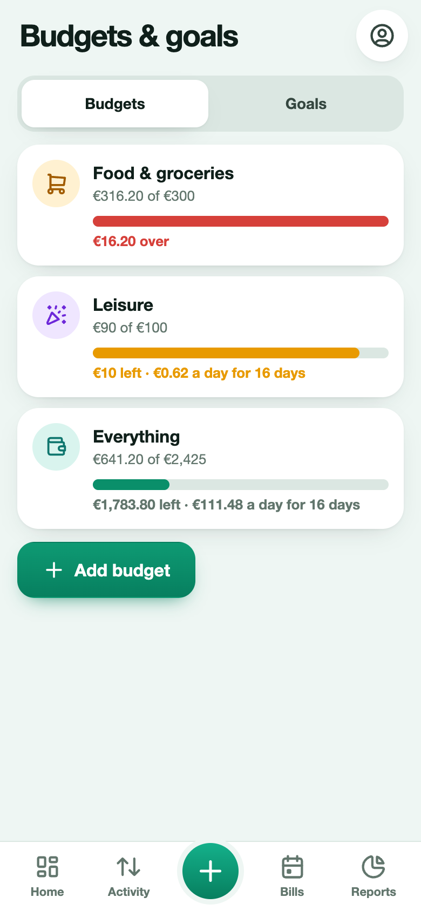
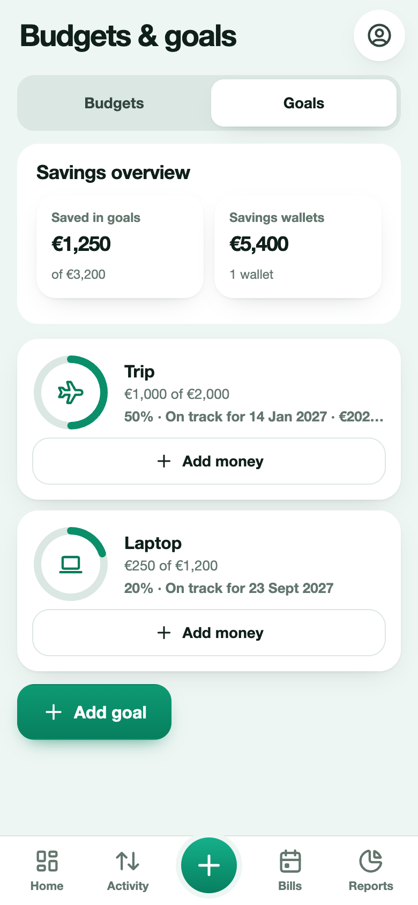
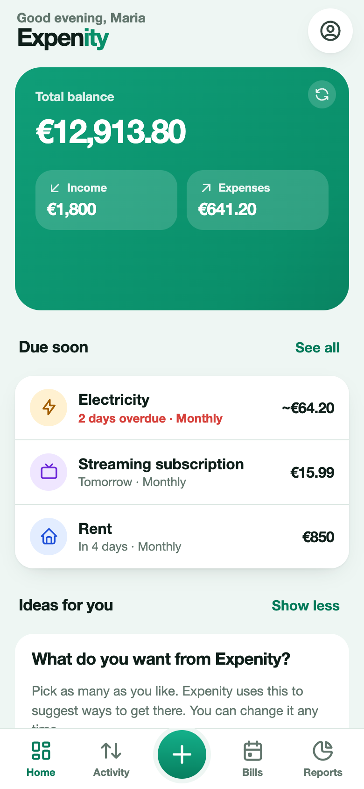

# Budgets, goals and income

**Budgets & goals** contains two tabs: **Budgets** and **Goals**. Find it on Home, in More, or in the tablet/desktop sidebar. A dot pulses briefly until your first visit. **Recurring income** lives in **Activity → Income → Recurring income**. **Ideas** lives on **Home**, with **See all** to expand the full list and change your aims.

## Budgets

A budget is a limit for a category (or for everything) over a period.

1. Open Budgets & goals → Budgets → **Add budget**.
2. Choose a category, or **Everything**.
3. Set the limit, and the period: monthly, weekly or yearly.
4. Optionally turn on **Carry over what is left from the last period**.

Each budget shows what you spent, what is left, a progress bar that turns amber at 80 percent and red at 100 percent, and an amount you can spend per day for the rest of the period.

## Goals

A goal is something you save for: a trip, a car, a gift, an emergency fund.

1. Open Budgets & goals → Goals → **Add goal**.
2. Give it a name, a target amount, an optional deadline and an icon.
3. Press **Add money** on the goal to move money in from a wallet, or **Take out** to move it back.

The ring shows progress. Expenity estimates the date you will reach the goal from how you have been saving over the last 90 days, and, when you set a deadline, how much per month would get you there. You get a small celebration at 25, 50, 75 and 100 percent. The Goals tab also shows a savings overview with your savings wallets.

## Recurring income

Open **Activity → Income → Recurring income → Add recurring income**. Add your salary or other regular income as a schedule: a name, the wallet it arrives in, the amount, the next date and how often. When it arrives, press **Received**. Expenity records the income in the wallet and moves the schedule to the next date (you can undo). Expected income feeds the [forecast](reports.md#forecast).

## Ideas for you

In the setup you can say what you want from Expenity, and you can change it any time in Home → Ideas → See all: track spending, save for something, build savings, cut subscriptions, spend less on everyday things, never miss a bill, pay off debt.

Expenity then looks at your own data, on your device, and offers specific ideas, for example:

- **A subscription** you could cancel, with what it costs a year and how much of a goal that would cover.
- **Delivery or eating out** over the last 30 days, and what cooking at home half of the time would save. Expenity recognises these from the names you type, such as efood, Wolt, delivery, restaurant or coffee.
- **A category that grew** compared with the 30 days before.
- **A budget** that is nearly used up.
- **Your savings rate**, when you kept little of your income.
- **Setting up**: a first goal, your salary, a food budget.

The two best ideas show on Home. You can hide any idea with **Not for me**. Ideas are suggestions, not financial advice.
