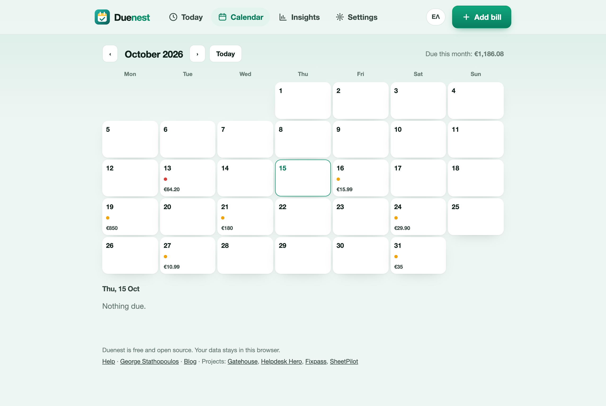
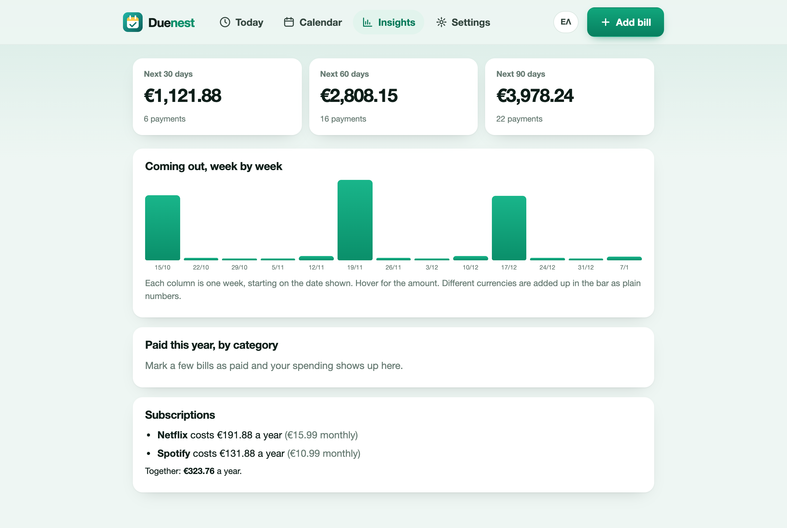

# Calendar and insights

## The calendar

The **Calendar** tab shows one month at a time. Each day with a bill due has coloured dots (amber for due, red if it is overdue, green for a payment you made) and, on wider screens, the total due that day. Press a day to see its bills below, and use the arrows to change month. The total for the month is at the top right.

Repeating bills appear on every date they fall on, not only the next one, so you can look months ahead.

## Insights

The **Insights** tab answers "what is coming, and where does it go?".

### Next 30, 60 and 90 days

Three totals of what is due, with the number of payments. They are built from your open bills and their repeats.

### Coming out, week by week

Thirteen columns, one per week, starting today. The height is the amount due that week. Hover over a column for the exact number. If you use more than one currency the columns add them together as plain numbers, so use it as a shape rather than an exact figure.

### Price changes

When the last two payments you recorded for a bill differ by 5% or more, Duenest says so, for example "Electricity went from €58 to €64 (+10%)". This only works if you record the real amount when you mark a bill paid.

### Paid this year, by category

How much you paid this year in each category, as bars with percentages. It counts the payments you marked paid in Duenest, so it grows as you use the app.

### Subscriptions

Bills in the **Subscriptions** category that repeat are shown with what they cost over a year, and the total. Fifteen euros a month is 180 a year.

## Currencies

Each bill has its own currency. Totals are shown per currency (for example "€120 + $15"). Duenest does not convert between currencies.
