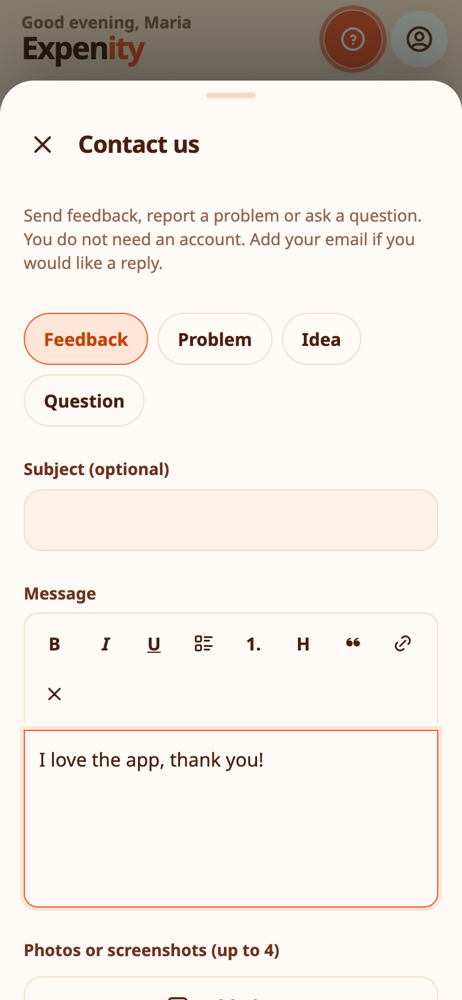

# Contact us

Found a problem, have an idea or just want to say something? **More → Help & about → Contact us** sends your message straight to the person who makes Expenity.

## What you can send

- Choose what it is about: **Feedback**, **Problem**, **Idea** or **Question**.
- Write your message with simple formatting: bold, italic, underline, lists, a heading, a quote and links.
- Attach up to **four photos or screenshots**. They are shrunk on your device before they are sent.
- Add your email if you would like a reply. It is optional.
- Leave **Include app version, language and device type** ticked: it helps us reproduce problems. Untick it if you prefer.

You do not need an account to write to us.

## What happens to it

Your message goes straight to the developer's inbox, labelled as a message from the app. It is used to read and answer feedback and fix problems, and nothing is added to your Expenity data. See [Privacy and your data](privacy-and-your-data.md).

## Other ways

Open an issue on [GitHub](https://github.com/expenity/expenity/issues). Before writing, a [tutorial](tutorials-and-help.md) may already show the answer.
