# eFriend

eFriend is a small robot who lives inside Expenity. You tell it what you want to buy, it looks at your **wallets, income, bills and the way you really spend**, and tells you, kindly and with a joke, whether you can afford it and when. It is part of the **Advanced** plan and can be switched on or off in **More → Make it yours → Features**.

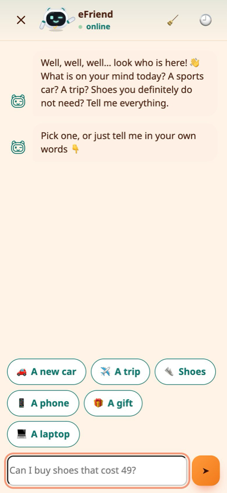

> 🔒 Everything eFriend works out is calculated **on your device**. Your numbers are not sent anywhere to be analysed.

## Ask eFriend: the chat

Tap **💬 Ask** on Home, on the eFriend page, or open the **+** menu and choose **Ask eFriend**. A full-page chat opens, and eFriend interviews you:

- 🛍️ **What** do you want to buy?
- 💶 **How much** does it cost?
- ⏰ **How soon** do you need it: right away, in a few weeks, or no rush?

You can type it all in one sentence, for example *"I want to buy a new watch for my girlfriend, 450, in 2 weeks"*. eFriend finds the **item**, the **price**, the **person** you are buying it for and the **timing**, and only asks about what is missing. Tap one of the quick answers if you prefer not to type.

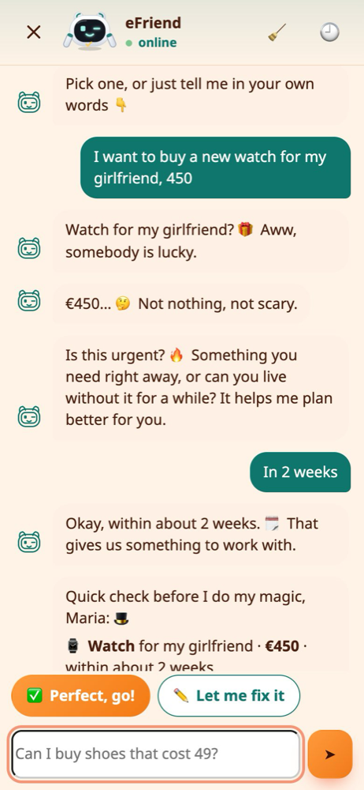

Before it starts, eFriend **says it back** and asks if it got it right. Wrong? Just type the fix in plain words, like *"no, it is 1250"* or *"in 3 weeks"*, or tap **✏️ Let me fix it**.

Then eFriend "thinks" for a few seconds and brings you back to the app with the full picture.

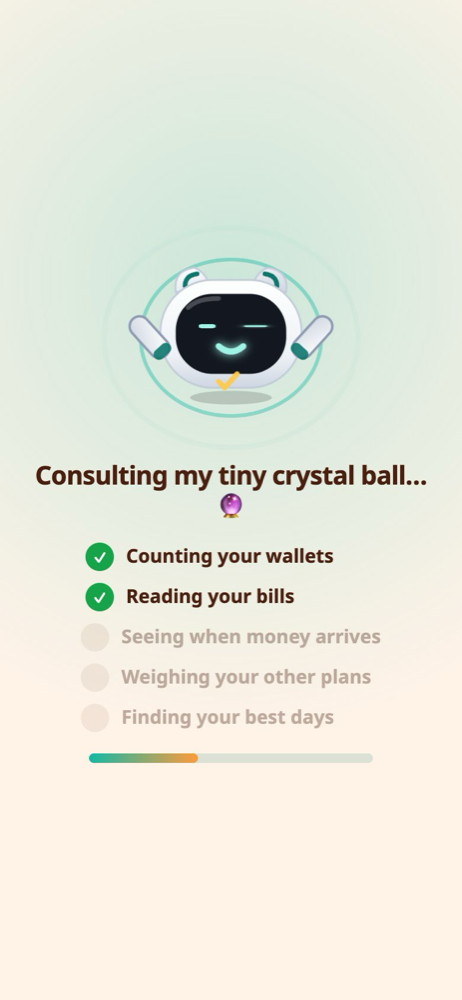

### The answer

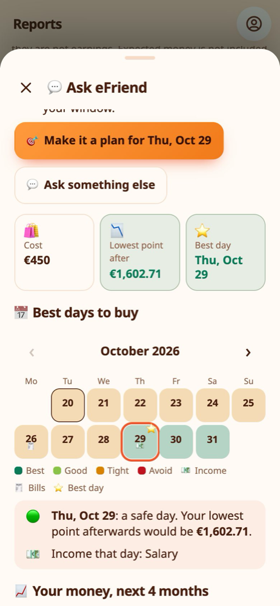

- ✅ **Today's answer:** can you buy it today, and how low would your money go afterwards?
- 🎯 **Make it a plan** sits at the top, already filled in with the item, the price and the best date.
- ⭐ **The best day:** the earliest day that fits, inside the time you asked for when possible. If nothing fits your timing, eFriend says so and shows the earliest safe day.
- 🗓️ **If no safe day exists** in the next **4 months**, eFriend shows **no date**. It explains why, for example that you spend more than you earn, and how much you would need to set aside.

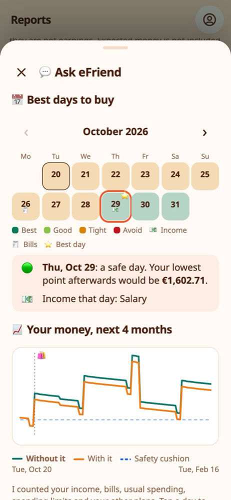

The calendar shows **one month at a time**, opened on the best day. Use the **‹ ›** arrows to go to earlier or later months. Days are coloured by how safe they are: **Best**, **Good**, **Tight** or **Avoid**. 💶 marks a payday and 🧾 a bill. Tap a day to see why it got its colour, and the plan button follows the day you pick.

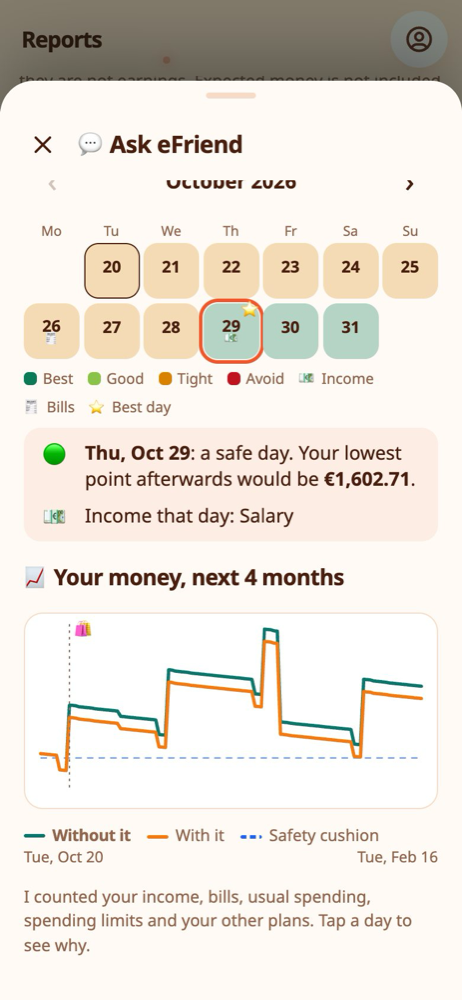

The graph shows your estimated balance, day by day, **with and without** the purchase, and your safety cushion as a dotted line.

> 💡 **Real-life example** Maria types *"laptop 900"*, then taps **In 2 weeks**. eFriend says today is tight, but the 29th, a few days after payday, is safe. She taps **Make it a plan for 29 Oct**.

### Start over and past chats

- 🧹 **Start over** (the broom at the top) wipes the chat and eFriend makes a joke about it.
- 🕘 **Past chats** keeps your last **30** chats, finished or not. Tap one to read it, then **Ask again** to check the same item with today's numbers, or delete it with the bin.

### It knows your name

If you gave Expenity your name, eFriend uses your **first name** in its jokes, questions and answers on the chat and on Home. Without a name it simply talks to you directly.

## The first time: a short tour

The first time you open eFriend, a full-screen tour introduces it. It asks only for what it still needs:

1. 💶 **Income:** when your money arrives (skipped if you already added it).
2. 📊 **Spending limits:** the most you are comfortable spending per day, week and month.
3. ✈️ **Wishes:** things you want, as plans.
4. 🧾 **Budgets,** 🏆 **priorities** and 🔁 **how eFriend may move money.**

You can skip it and come back any time from the eFriend page.

### Spending limits that fill themselves in

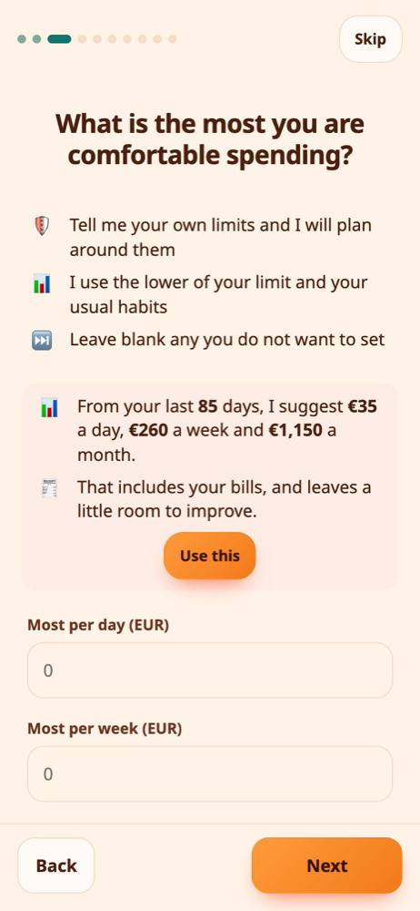

- 📈 With **two weeks or more** of history, eFriend suggests a day, week and month limit from your real spending, including bills, and a little below what you usually spend. Tap **Use this**.
- 🌱 With less history, type a limit in any one box and tap **Use this** to fill the other two from it.
- ✏️ You can always change the numbers yourself.

## Plans and verdicts

A **plan** is something you want to buy by a date. eFriend gives each plan one of five verdicts:

| Verdict | Meaning |
|---|---|
| **Comfortable** | It fits easily and leaves your safety cushion untouched. |
| **On track** | It fits. |
| **Tight** | It fits, but with little room. |
| **At risk** | It may not fit unless something changes. |
| **Unlikely** | It does not fit by that date. |

The verdict names stay in English in every language. If you **spend more than you earn**, eFriend says so plainly and looks at **how long what is left would last**, so a plan can no longer look comfortable on a salary that does not cover your spending.

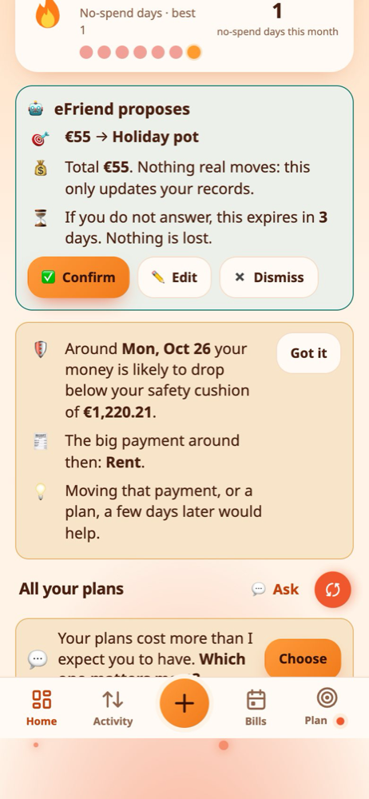

Tap a plan for the **full analysis**:

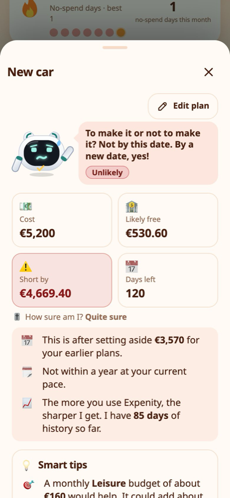

- 💰 how much you are expected to have free by the date
- 🛡️ how much is kept as your safety cushion
- 📅 the earliest safe date
- 💡 smart tips, for example a small monthly budget that would help

## Priorities and the safety cushion

When several plans compete for the same money, eFriend asks **which matters most**. Drag the plans into the order you want (on a phone, press and hold a row). Your order is always yours: eFriend never drops a plan by itself.

**✨ Let eFriend suggest** asks what it may change:

- 📋 **Only the order** of your plans, cheapest first.
- 🛡️ **The order and the safety cushion,** for the best outcome. eFriend tries several cushions and keeps the biggest one that still lets as many plans as possible work.

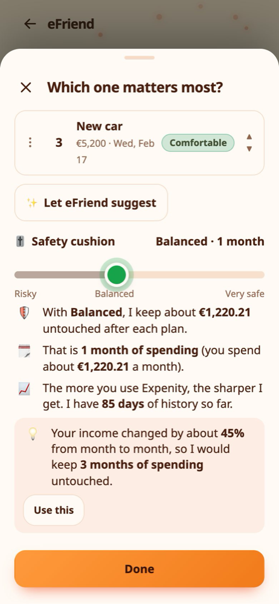

The **safety cushion** is how many months of your usual spending should still be left after a plan. If your income changes a lot from month to month (with about **two months** of history), eFriend suggests a bigger cushion and shows why.

## Warnings that save you a surprise

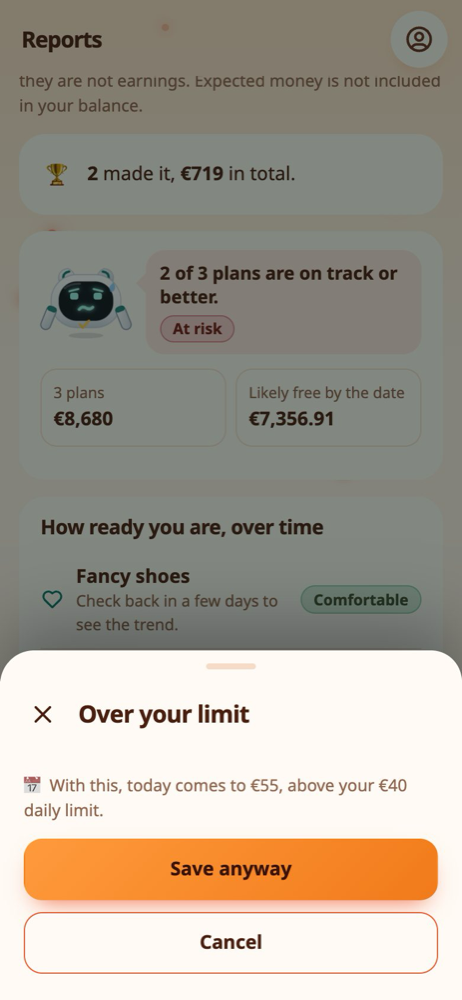

- ✋ **Before you save an expense** that would take you over your daily, weekly or monthly limit, eFriend asks first. **Save anyway** is always one tap away.
- ⚠️ **On Home,** if your money is likely to **run out** or drop below your cushion in the next two months, eFriend tells you the day and the payment behind it, and suggests moving that payment or a plan a few days later.

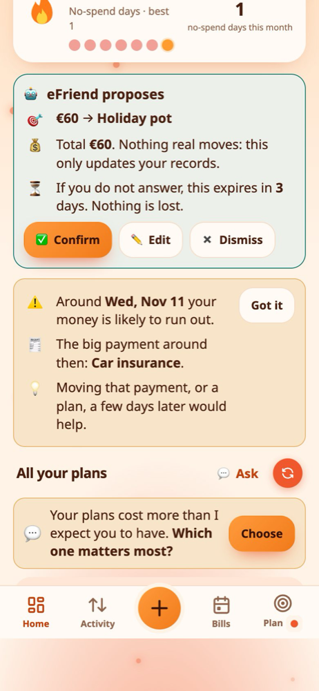

## Budget ideas

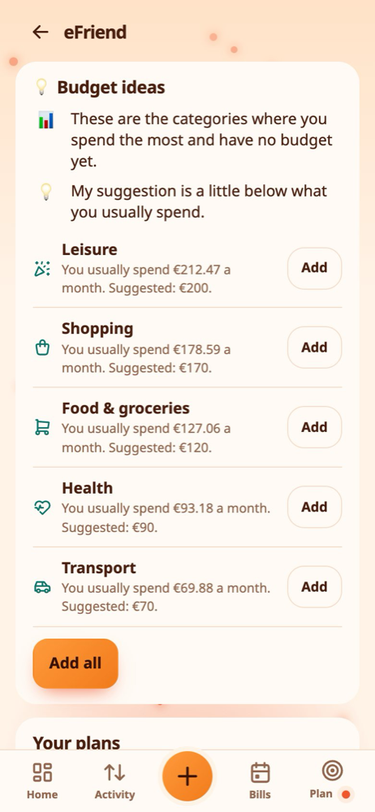

After about **six weeks** of history, the eFriend page suggests budgets for the categories where you spend most and have no budget yet, a little below what you usually spend. Tap **Add** for one, or **Add all**.

## Helping with your goals

If you keep savings goals, eFriend can help fund them. Choose a mode in the eFriend page:

- 💡 **Suggest:** it shows what is safe to move.
- 🙋 **Ask first:** it proposes, and an unanswered proposal expires after **3 days**.
- 🤖 **Automatic:** it records the moves for you. With less than about a month of history, it warns you first.

No real money moves in any mode. It is a tracking system that updates your records.

## Reports

**Reports → eFriend** shows how ready you were for each plan over time, with a mark every time you changed something and how it moved the line.

## Questions

**Does eFriend give financial advice?**
No. It is a helper that does arithmetic on your own entries. It cannot see your bank, and its answers are only as good as the information in Expenity.

**Why did it not suggest a date?**
Because no day in the next 4 months keeps your money safe. Open the explanation: it tells you why and what would help.

**Can I turn it off?**
Yes, in **More → Make it yours → Features**. Your data stays.
