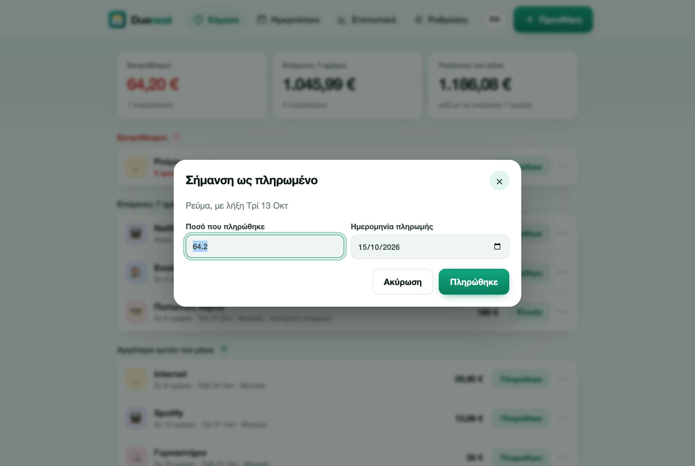

# Προσθήκη λογαριασμών

Κάθε λογαριασμός έχει όνομα, προαιρετικό ποσό, επόμενη ημερομηνία πληρωμής και συχνότητα επανάληψης. Όλα τα υπόλοιπα είναι προαιρετικά.

## Γράψτε μια πρόταση

Στην κορυφή του παραθύρου προσθήκης, γράψτε με δικά σας λόγια τι πληρώνετε. Το Duenest βρίσκει όνομα, ποσό, νόμισμα, συχνότητα και ημερομηνία, σε ελληνικά ή αγγλικά. Τα σήματα κάτω από το πεδίο δείχνουν τι κατάλαβε και η φόρμα συμπληρώνεται καθώς γράφετε. Πατήστε Enter για να πάτε στη φόρμα και να τα ελέγξετε.

| Γράφετε | Παίρνετε |
|---|---|
| `Netflix 15,99 μηνιαία στις 3` | Netflix, 15,99, κάθε μήνα, επόμενη 3η |
| `Ενοίκιο 850€ κάθε μήνα στις 1` | Ενοίκιο, 850 EUR, κάθε μήνα, επόμενη 1η |
| `Ρεύμα ΔΕΗ ~60 ευρώ κάθε μήνα την 15η` | Ρεύμα ΔΕΗ, περίπου 60, κάθε μήνα, επόμενη 15η |
| `Ασφάλεια αυτοκινήτου 420 ετήσια 12 Μαρτίου` | Ασφάλεια αυτοκινήτου, 420, κάθε χρόνο, επόμενη 12 Μαρτίου |
| `Γυμναστήριο 35 εβδομαδιαία Παρασκευή` | Γυμναστήριο, 35, κάθε εβδομάδα, επόμενη Παρασκευή |
| `ΕΝΦΙΑ 300 τριμηνιαία 28 Φεβρουαρίου` | ΕΝΦΙΑ, 300, κάθε 3 μήνες, επόμενη 28 Φεβρουαρίου |
| `Τηλέφωνο 25 αύριο` | Τηλέφωνο, 25, εφάπαξ, αύριο |
| `Netflix 15.99 monthly on the 3rd` | Λειτουργούν και οι αγγλικές προτάσεις |

Λέξεις που καταλαβαίνει: μηνιαία, εβδομαδιαία, κάθε 2 εβδομάδες, τριμηνιαία, ετήσια, εφάπαξ, σήμερα, αύριο, ονόματα μηνών και ημερών, τακτικά όπως 3η, και `~` ή «περίπου» για ποσό που αλλάζει. Δουλεύουν και οι δύο υποδιαστολές: `15.99` και `15,99`.

Είναι βοηθός, όχι υπόσχεση. Αν ένα σήμα είναι λάθος, διορθώστε το πεδίο στη φόρμα: η φόρμα έχει πάντα τον τελευταίο λόγο.

## Χρησιμοποιήστε πρότυπο

Κάτω από το πεδίο της πρότασης υπάρχουν πρότυπα: Ενοίκιο, Ρεύμα (ΔΕΗ), Νερό (ΕΥΔΑΠ), Internet, Κινητό, Netflix, Spotify, Ασφάλεια αυτοκινήτου, Πιστωτική κάρτα, Γυμναστήριο, ΕΝΦΙΑ και Δίδακτρα. Ένα πρότυπο συμπληρώνει όνομα, κατηγορία και επανάληψη. Εσείς βάζετε το ποσό και την ημερομηνία.

## Η φόρμα

| Πεδίο | Τι κάνει |
|---|---|
| Όνομα, Ποσό, Νόμισμα | Το ποσό είναι προαιρετικό. Το νόμισμα είναι τριψήφιος κωδικός, π.χ. EUR. |
| Επόμενη ημερομηνία πληρωμής | Η ημερομηνία της επόμενης πληρωμής. |
| Επανάληψη | Μία φορά, κάθε εβδομάδα, κάθε 2 εβδομάδες, κάθε μήνα, κάθε 3 μήνες, κάθε χρόνο. Ένας λογαριασμός με λήξη στις 31 μένει στην τελευταία ημέρα των μικρότερων μηνών και επιστρέφει στις 31. |
| Κατηγορία | Χρησιμοποιείται για τα εικονίδια και το γράφημα εξόδων. |
| Υπενθύμιση | Από την ίδια ημέρα έως 2 εβδομάδες πριν. Η «Προεπιλογή» ακολουθεί τη ρύθμιση στις Ρυθμίσεις. |
| Το ποσό αλλάζει κάθε φορά | Σημαίνει το ποσό ως εκτίμηση (εμφανίζεται με ~). |
| Πληρώνεται αυτόματα | Για πάγιες εντολές. Το κουμπί γράφει «Έλεγξα» και στόχος είναι να επιβεβαιώσετε ότι η πληρωμή έγινε. |
| Λήγει στις | Η τελευταία ημερομηνία ενός επαναλαμβανόμενου λογαριασμού, π.χ. το τέλος ενός δανείου. |
| Κωδικός πληρωμής | IBAN, κωδικός RF ή αριθμός λογαριασμού. Αντιγράφεται από το μενού ⋯. |
| Σύνδεσμος πληρωμής | Ανοίγει τη σελίδα πληρωμής της τράπεζας ή του παρόχου από το μενού ⋯. Το Duenest δεν πληρώνει ποτέ για εσάς. |

## Σήμανση ως πληρωμένο

Πατήστε **Πληρώθηκε**. Ελέγξτε το ποσό και την ημερομηνία και επιβεβαιώστε. Σε έναν επαναλαμβανόμενο λογαριασμό η επόμενη ημερομηνία υπολογίζεται μόνη της. Ένας εφάπαξ λογαριασμός ολοκληρώνεται. Ένα μήνυμα προσφέρει **Αναίρεση** για λίγα δευτερόλεπτα.

Οι πληρωμές που καταγράφετε τροφοδοτούν τα [στατιστικά](calendar-and-insights.md): έξοδα ανά κατηγορία και αλλαγές τιμών.

## Αναβολή, παράλειψη, επεξεργασία, διαγραφή

Στο μενού **⋯**:

- Η **Αναβολή** σταματά τις ειδοποιήσεις του λογαριασμού για μία ή τρεις ημέρες. Η ημερομηνία πληρωμής δεν αλλάζει.
- Η **Παράλειψη αυτή τη φορά** μεταφέρει έναν επαναλαμβανόμενο λογαριασμό στην επόμενη ημερομηνία χωρίς να καταγράψει πληρωμή.
- Η **Επεξεργασία** και η **Διαγραφή** κάνουν ό,τι λένε. Η διαγραφή αναιρείται για λίγα δευτερόλεπτα.
