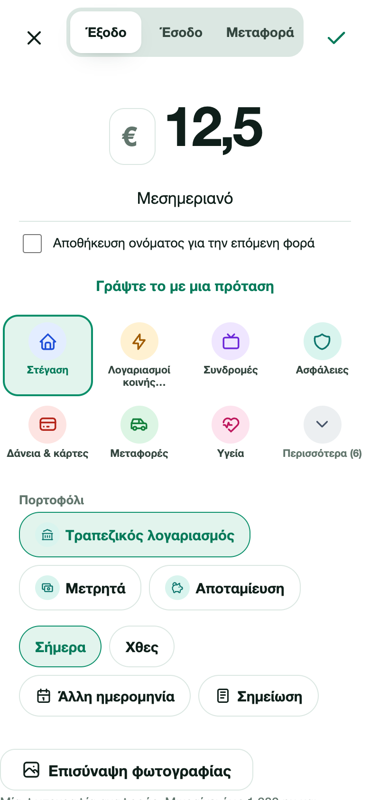
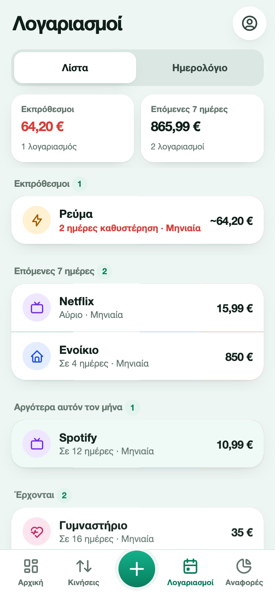
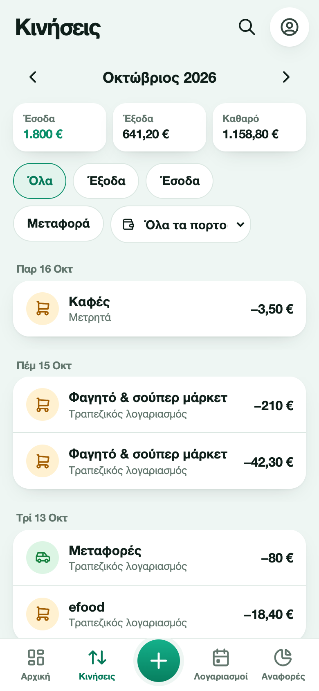
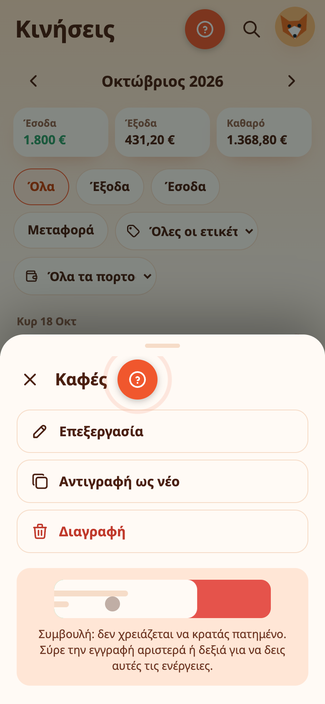

# Προσθήκη εξόδων, εσόδων και λογαριασμών

Όλα ξεκινούν από το πράσινο κουμπί **+**. Προσφέρει τέσσερα πράγματα: ένα **έξοδο**, ένα **έσοδο**, μια **μεταφορά** μεταξύ πορτοφολιών και έναν **λογαριασμό**.

## Προσθήκη εξόδου ή εσόδου

Η φόρμα χτίζεται γύρω από το ποσό, ώστε το πιο σημαντικό να έρχεται πρώτο.

1. Επιλέξτε **Έξοδο**, **Έσοδο** ή **Μεταφορά** στην κορυφή.
2. Πατήστε το ποσό για να ανοίξει το πληκτρολόγιο. Γράψτε την τιμή και πατήστε **✓ Έτοιμο** για να κλείσει.
3. Προσθέστε **περιγραφή** αν θέλετε, π.χ. «Μεσημεριανό».
4. Διαλέξτε **κατηγορία**. Εμφανίζονται οι συνηθισμένες. Το **Περισσότερα** ανοίγει τις υπόλοιπες, μαζί με τις δικές σας κατηγορίες.
5. Διαλέξτε το **πορτοφόλι**.
6. Διαλέξτε την **ημερομηνία**: Σήμερα, Χθες ή άλλη ημερομηνία. Η **Σημείωση** προσθέτει μεγαλύτερο σχόλιο.
7. Πατήστε το σημάδι ✓.

## Ή γράψτε μια πρόταση

Πατήστε **Γράψτε το με μια πρόταση** και γράψτε τι έγινε, στα ελληνικά ή στα αγγλικά:

- `Καφές 3,50 χθες`
- `Μισθός 1500 έσοδο`
- `Σούπερ μάρκετ 42,30`
- `Coffee 3.50 yesterday`

Το Expenity συμπληρώνει το ποσό, την περιγραφή, την ημερομηνία και τον τύπο και δείχνει σήματα, ώστε να βλέπετε τι κατάλαβε.

## Έξυπνη ανίχνευση (Advanced)

Με ενεργή την **Έξυπνη ανίχνευση**, γράψτε μια περιγραφή όπως `Καφές με την Άννα` και το Expenity συμπληρώνει την κατηγορία, έως δύο ετικέτες και το πορτοφόλι. Μια γραμμή κάτω από την περιγραφή λέει τι συμπληρώθηκε, με κουμπί **Αναίρεση**.

- Κοιτάζει πρώτα τις δικές σας προηγούμενες εγγραφές, μετά ενσωματωμένες λέξεις στα αγγλικά και στα ελληνικά και, τέλος, τα δικά σας ονόματα κατηγοριών.
- Δεν αλλάζει ποτέ κάτι που επιλέξατε οι ίδιοι και, μετά την **Αναίρεση**, μένει απενεργοποιημένη για εκείνη την εγγραφή.
- Οι ετικέτες προέρχονται από μια σύντομη κοινή λίστα (Καφές, Σούπερ μάρκετ, Αυτοκίνητο, Σπίτι κ.ά.) ή από τις δικές σας, ώστε παρόμοια πράγματα να παίρνουν πάντα την ίδια ετικέτα.
- Αν έχετε ένα πορτοφόλι, επιλέγεται αυτόματα.

Η Έξυπνη ανίχνευση ανήκει στο Advanced. Ενεργοποιήστε ή απενεργοποιήστε την από **Περισσότερα → Προσαρμογή εφαρμογής → Λειτουργίες**.

## Όταν λείπει ένα πεδίο

Αν πατήσετε αποθήκευση και λείπει κάτι, κάθε πεδίο που λείπει παραμένει σε κόκκινο περίγραμμα μέχρι να το συμπληρώσετε. Μόλις συμπληρώσετε ένα, το Expenity σας μεταφέρει στο επόμενο που λείπει, από πάνω προς τα κάτω.

## Μεταφορές

Μια μεταφορά μετακινεί χρήματα μεταξύ δύο πορτοφολιών σας, για παράδειγμα από την τράπεζα σε μετρητά. Δεν είναι έξοδο. Αν τα πορτοφόλια έχουν διαφορετικό νόμισμα, το Expenity ρωτά πόσα έφτασαν στο δεύτερο. Η μεταφορά γίνεται μεταξύ δύο ιδιωτικών πορτοφολιών ή μεταξύ δύο πορτοφολιών του ίδιου [κοινού πορτοφολιού](shared-wallets.md), όχι ανάμεσα στα δύο είδη.

## Λογαριασμοί

Λογαριασμός είναι κάτι που έρχεται ξανά και ξανά, όπως το ενοίκιο ή το Netflix. Πατήστε **+** και επιλέξτε **Λογαριασμός**.

- **Γράψτε τον με μια πρόταση**: `Netflix 15,99 μηνιαία στις 3`, `Ενοίκιο 850€ κάθε μήνα στις 1`, `Ρεύμα ~60 μηνιαία 15` (το ~ σημαίνει ότι το ποσό αλλάζει κάθε φορά).
- **Διαλέξτε ένα πρότυπο**: Ενοίκιο, Ρεύμα (ΔΕΗ), Νερό (ΕΥΔΑΠ), Internet, Κινητό, Netflix, Spotify, Ασφάλεια αυτοκινήτου, Πιστωτική κάρτα, Γυμναστήριο, ΕΝΦΙΑ, Δίδακτρα.
- **Ή συμπληρώστε τη φόρμα**: όνομα, πορτοφόλι από το οποίο πληρώνεται, ποσό, επόμενη ημερομηνία, κάθε πότε επαναλαμβάνεται (μία φορά, κάθε εβδομάδα, κάθε 2 εβδομάδες, κάθε μήνα, κάθε 3 μήνες, κάθε χρόνο), κατηγορία και πόσο νωρίς να σας υπενθυμίζει.

Ο λογαριασμός παίρνει το νόμισμα του πορτοφολιού του. Δύο επιλογές βοηθούν στους δύσκολους λογαριασμούς: το **Το ποσό αλλάζει κάθε φορά** θεωρεί το ποσό εκτίμηση και το **Πληρώνεται αυτόματα** σας υπενθυμίζει να ελέγξετε ότι πληρώθηκε.

### Σήμανση πληρωμής

Στην οθόνη Λογαριασμοί, το **Πληρώθηκε** καταγράφει την πληρωμή ως έξοδο στο πορτοφόλι και μεταφέρει έναν επαναλαμβανόμενο λογαριασμό στην επόμενη ημερομηνία. Μπορείτε να πατήσετε **Αναίρεση** αμέσως μετά. Για λογαριασμό με μεταβλητό ποσό, το Expenity ρωτά πόσα πληρώσατε.

Άλλες ενέργειες, από το μενού **⋯** του λογαριασμού: **Αναβολή** (για αύριο ή για 3 ημέρες), **Παράλειψη αυτή τη φορά**, άνοιγμα συνδέσμου πληρωμής, αντιγραφή κωδικού πληρωμής, επεξεργασία και διαγραφή.

## Σύρσιμο και τράβηγμα

Στο κινητό, όταν σύρετε μια γραμμή, αυτή γλιστρά και δείχνει κουμπιά. **Τίποτα δεν γίνεται μέχρι να πατήσετε ένα κουμπί**. Αν πατήσετε οπουδήποτε αλλού, η γραμμή κλείνει ξανά και όποια γραμμή αφήσετε ανοιχτή επιστρέφει μόνη της μετά από δύο δευτερόλεπτα. Σε tablet ή υπολογιστή δεν υπάρχει σύρσιμο: πατήστε μια γραμμή και ανοίγουν οι λεπτομέρειές της με τα ίδια κουμπιά Επεξεργασία, Διαγραφή και Πληρώθηκε.

- Σε μια **κίνηση**: σύρετε **αριστερά** για να εμφανιστούν η **Επεξεργασία** και η **Διαγραφή**.
- Σε έναν **λογαριασμό**: σύρετε **δεξιά** για το **Πληρώθηκε** ή **αριστερά** για την **Επεξεργασία** και τη **Διαγραφή**.
- Τραβήξτε την οθόνη προς τα κάτω για άμεσο συγχρονισμό (όταν είστε συνδεδεμένοι).

Η ρύθμιση το δείχνει με μια σύντομη κίνηση.

## Επεξεργασία και διαγραφή

Πατήστε οποιαδήποτε γραμμή για να δείτε τις λεπτομέρειές της, να την επεξεργαστείτε ή να τη διαγράψετε. Σε tablet ή υπολογιστή οι λεπτομέρειες εμφανίζονται σε πλαϊνό πάνελ. Σε ένα [κοινό πορτοφόλι](shared-wallets.md) οι λεπτομέρειες γράφουν επίσης ποιος την πρόσθεσε και όποιος μπορεί μόνο να βλέπει δεν μπορεί να αλλάξει τίποτα.

## Πληκτρολόγιο ποσού και επαναχρησιμοποίηση ονομάτων

Το πληκτρολόγιο ποσού ξεκινά **κλειστό**. Πατήστε το ποσό, γράψτε την τιμή και πατήστε **✓ Έτοιμο** για να κρατηθεί και να κλείσει το πληκτρολόγιο. Αυτό δεν αποθηκεύει την κίνηση. Τα πεδία κειμένου εμφανίζουν επίσης **✓ Έτοιμο** για να κλείσει το πληκτρολόγιο του κινητού. Πατήστε το σημάδι επιβεβαίωσης στην κορυφή όταν θέλετε να αποθηκεύσετε ολόκληρη την κίνηση.

Για επαναχρησιμοποίηση περιγραφής, γράψτε ένα όνομα και επιλέξτε **Αποθήκευση ονόματος για την επόμενη φορά** πριν αποθηκεύσετε. Στην επόμενη κίνηση του ίδιου είδους ανοίξτε τα **Αποθηκευμένα ονόματα** και πατήστε ένα. Συμπληρώνονται όνομα και κατηγορία· ποσό, ημερομηνία και πορτοφόλι παραμένουν δικές σας επιλογές. Έξοδα και έσοδα έχουν χωριστές λίστες. Το × αφαιρεί ένα όνομα. Αποθηκεύονται έως 30 ονόματα συνολικά και συγχρονίζονται με τις ρυθμίσεις λογαριασμού. Τα δικά σας ονόματα διατηρούνται στη γλώσσα που τα γράψατε.

## Φωτογραφίες αναφοράς

Αφού συνδεθείτε, επιλέξτε **Επισύναψη φωτογραφίας** σε έξοδο, έσοδο, μεταφορά, λογαριασμό, πορτοφόλι, προϋπολογισμό, στόχο ή επαναλαμβανόμενο έσοδο. Υποστηρίζονται JPEG, PNG και WebP· το HEIC εξαρτάται από το πρόγραμμα περιήγησης. Το αρχικό αρχείο πρέπει να είναι μικρότερο από 20 MB. Η φωτογραφία μετατρέπεται σε JPEG χωρίς τα αρχικά μεταδεδομένα, μικραίνει έως 1.280 pixel στη μεγάλη πλευρά και συμπιέζεται έως 96 KB. Μετά την αποστολή αποθηκεύστε την καταχώριση. Ο συνδετήρας δείχνει ότι υπάρχει φωτογραφία. Στην καταχώριση επιλέξτε **Προβολή φωτογραφίας**· στην επεξεργασία μπορείτε να την αντικαταστήσετε ή να την αφαιρέσετε.

Αποστολή και προβολή χρειάζονται λογαριασμό και διαδίκτυο. Κάθε λογαριασμός χωρά έως 100 φωτογραφίες, περίπου 9,4 MiB συνολικά. Τα μέλη κοινού πορτοφολιού βλέπουν τις φωτογραφίες του· όσα έχουν μόνο προβολή δεν μπορούν να τις αλλάξουν. Η φωτογραφία λογαριασμού ή προγραμματισμένου εσόδου μεταφέρεται και στην αντίστοιχη πληρωμή ή είσπραξη.

**Λογαριασμός → Διαγραφή όλων των φωτογραφιών** διαγράφει οριστικά τις δικές σας αποστολές, μαζί με τις δικές σας στα κοινά πορτοφόλια. Τα άλλα μέλη δεν μπορούν πλέον να δουν αυτές τις εικόνες. Οι φωτογραφίες άλλων μελών και τα οικονομικά στοιχεία παραμένουν. Ζητείται επιβεβαίωση και νέα επαλήθευση με passkey. Η διαγραφή φτάνει στις άλλες συσκευές με τον συγχρονισμό· αλλαγές εκτός σύνδεσης δεν επαναφέρουν εικόνες που διαγράφηκαν.

Η αφαίρεση από μία καταχώριση αποσυνδέει μόνο τη φωτογραφία. Φωτογραφίες που δεν χρησιμοποιούνται και είναι παλαιότερες από μία ημέρα διαγράφονται στην επόμενη αποστολή σας. Το αντίγραφο JSON κρατά αναφορές, όχι αρχεία εικόνας: κρατήστε τα πρωτότυπα χωριστά για ανεξάρτητο αντίγραφο.

## Παρατεταμένο πάτημα

Κρατήστε πατημένη μια εγγραφή ή έναν λογαριασμό για μισό δευτερόλεπτο και ανοίγει μενού με **Επεξεργασία**, **Αντιγραφή** και **Διαγραφή** (και **Πληρώθηκε** για λογαριασμούς). Το μενού δείχνει και μια μικρή κινούμενη εικόνα: δεν χρειάζεται να κρατάτε, το σύρσιμο της γραμμής στο πλάι κάνει το ίδιο.

{{tut:hold}}

## Σάρωση και έλεγχος πριν προσθέσετε δύο φορές

Κρατήστε πατημένο το **+** για να σαρώσετε μια απόδειξη: δείτε [Αποδείξεις, φωτογραφίες και η εικόνα σας](receipts-and-photos.md). Αν προσθέσετε κάτι που ταιριάζει με εγγραφή των τελευταίων ημερών, ο **φρουρός διπλότυπων** ρωτά πριν αποθηκεύσει: δείτε [Ημερήσιο ποσό, στόχοι και σερί](spending-helpers.md#φρουρός-διπλότυπων). Διαγράψατε κάτι κατά λάθος; Δείτε [Αναζήτηση, φίλτρα, πρόχειρα και πρόσφατα διαγραμμένα](find-and-recover.md).

{{tut:quick}}

Για κατανομή ποσών ανά κατηγορία, τμηματικές εισπράξεις και αναλυτικά παραδείγματα, δείτε την [κατανομή εξόδων και τις επιστροφές χρημάτων από τρίτους](split-expenses-and-reimbursements.md).
