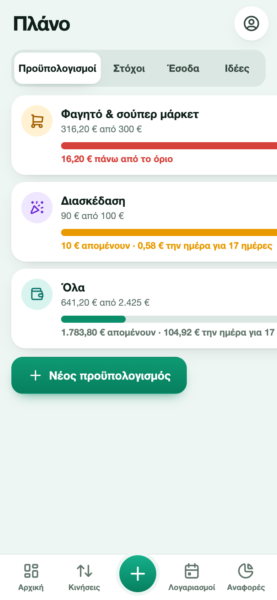
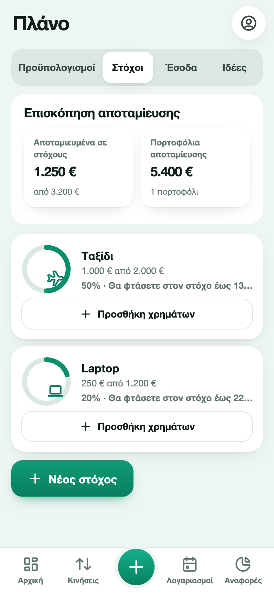
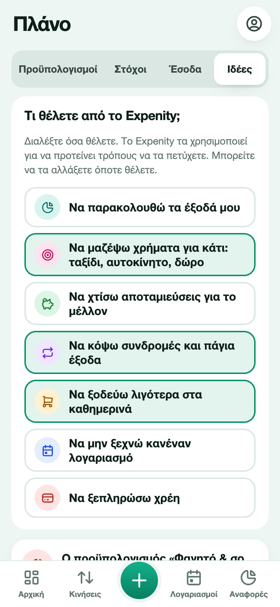

# Προϋπολογισμοί, στόχοι και έσοδα

Το **Πλάνο** έχει τέσσερις καρτέλες: **Προϋπολογισμοί**, **Στόχοι**, **Έσοδα** και **Ιδέες**. Το ανοίγετε από την πλαϊνή μπάρα σε tablet ή υπολογιστή, από την ενότητα Πλάνο στην Αρχική ή από τα **Περισσότερα**.

## Προϋπολογισμοί

Ο προϋπολογισμός είναι ένα όριο για μια κατηγορία (ή για όλα) σε μια περίοδο.

1. Ανοίξτε Πλάνο → Προϋπολογισμοί → **Νέος προϋπολογισμός**.
2. Διαλέξτε κατηγορία ή **Όλα**.
3. Ορίστε το όριο και την περίοδο: μηνιαίος, εβδομαδιαίος ή ετήσιος.
4. Προαιρετικά ενεργοποιήστε το **Μεταφορά του υπολοίπου από την προηγούμενη περίοδο**.

Κάθε προϋπολογισμός δείχνει πόσα ξοδέψατε, πόσα απομένουν, μια μπάρα προόδου που γίνεται πορτοκαλί στο 80% και κόκκινη στο 100%, και πόσα μπορείτε να ξοδεύετε την ημέρα για το υπόλοιπο της περιόδου.

## Στόχοι

Στόχος είναι κάτι για το οποίο αποταμιεύετε: ένα ταξίδι, ένα αυτοκίνητο, ένα δώρο, ένα αποθεματικό έκτακτης ανάγκης.

1. Ανοίξτε Πλάνο → Στόχοι → **Νέος στόχος**.
2. Δώστε όνομα, ποσό στόχου, προαιρετικά προθεσμία και ένα εικονίδιο.
3. Πατήστε **Προσθήκη χρημάτων** στον στόχο για να μεταφέρετε χρήματα από ένα πορτοφόλι ή **Ανάληψη** για να τα επιστρέψετε.

Ο κύκλος δείχνει την πρόοδο. Το Expenity εκτιμά πότε θα φτάσετε στον στόχο από τον ρυθμό αποταμίευσης των τελευταίων 90 ημερών και, αν έχετε βάλει προθεσμία, πόσα τον μήνα χρειάζονται για να τη φτάσετε. Στο 25%, 50%, 75% και 100% εμφανίζεται ένα μικρό μήνυμα επιτυχίας. Η καρτέλα Στόχοι δείχνει και μια επισκόπηση αποταμίευσης με τα πορτοφόλια αποταμίευσής σας.

## Επαναλαμβανόμενα έσοδα

Προσθέστε τον μισθό σας ή άλλα τακτικά έσοδα ως πρόγραμμα: όνομα, πορτοφόλι στο οποίο κατατίθενται, ποσό, επόμενη ημερομηνία και κάθε πότε. Όταν έρθουν, πατήστε **Εισπράχθηκε**. Το Expenity καταγράφει το έσοδο στο πορτοφόλι και μεταφέρει το πρόγραμμα στην επόμενη ημερομηνία (μπορείτε να αναιρέσετε). Τα αναμενόμενα έσοδα τροφοδοτούν την [πρόβλεψη](reports.md).

## Ιδέες για εσάς

Στη ρύθμιση μπορείτε να πείτε τι θέλετε από το Expenity και να το αλλάξετε όποτε θέλετε στο Πλάνο → Ιδέες: να παρακολουθείτε τα έξοδά σας, να μαζέψετε χρήματα για κάτι, να χτίσετε αποταμιεύσεις, να κόψετε συνδρομές, να ξοδεύετε λιγότερα στα καθημερινά, να μην ξεχνάτε κανέναν λογαριασμό, να ξεπληρώσετε χρέη.

Το Expenity κοιτάζει τότε τα δικά σας δεδομένα, στη συσκευή σας, και προτείνει συγκεκριμένες ιδέες, για παράδειγμα:

- **Μια συνδρομή** που θα μπορούσατε να ακυρώσετε, με το κόστος της τον χρόνο και πόσο από έναν στόχο θα κάλυπτε.
- **Ντελίβερι ή φαγητό έξω** τις τελευταίες 30 ημέρες και πόσα θα γλιτώνατε αν μαγειρεύατε στο σπίτι τις μισές φορές. Το Expenity τα αναγνωρίζει από τα ονόματα που γράφετε, όπως efood, Wolt, delivery, εστιατόριο ή καφέ.
- **Μια κατηγορία που αυξήθηκε** σε σχέση με τις προηγούμενες 30 ημέρες.
- **Έναν προϋπολογισμό** που εξαντλείται.
- **Το ποσοστό αποταμίευσής σας**, όταν κρατήσατε λίγα από τα έσοδά σας.
- **Ρύθμιση**: ένας πρώτος στόχος, ο μισθός σας, ένας προϋπολογισμός για φαγητό.

Οι δύο καλύτερες ιδέες εμφανίζονται στην Αρχική. Μπορείτε να κρύψετε οποιαδήποτε με **Όχι για μένα**. Οι ιδέες είναι προτάσεις και όχι οικονομική συμβουλή.
