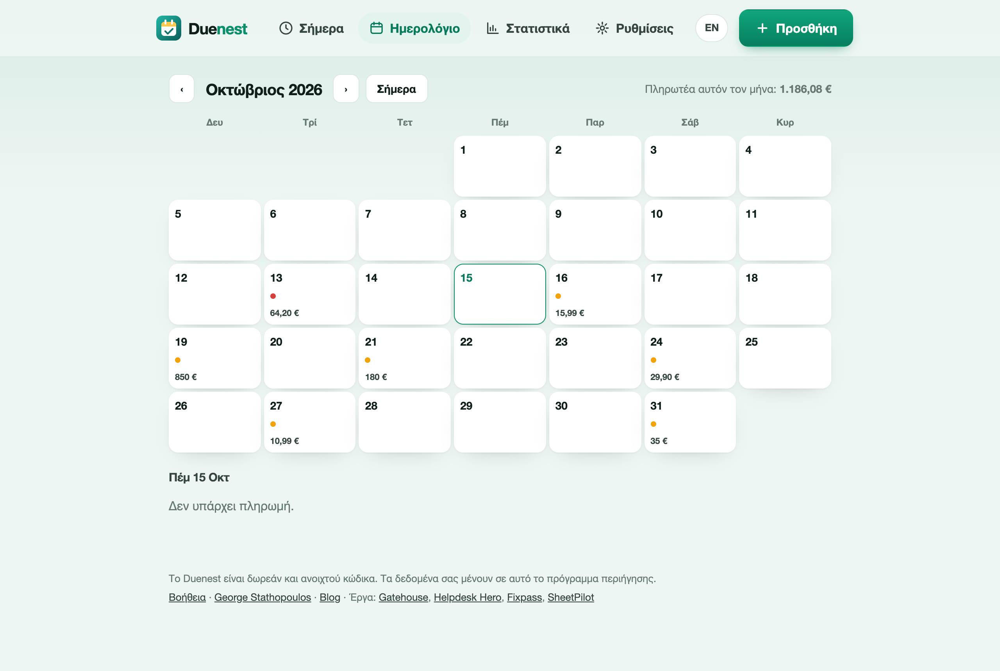
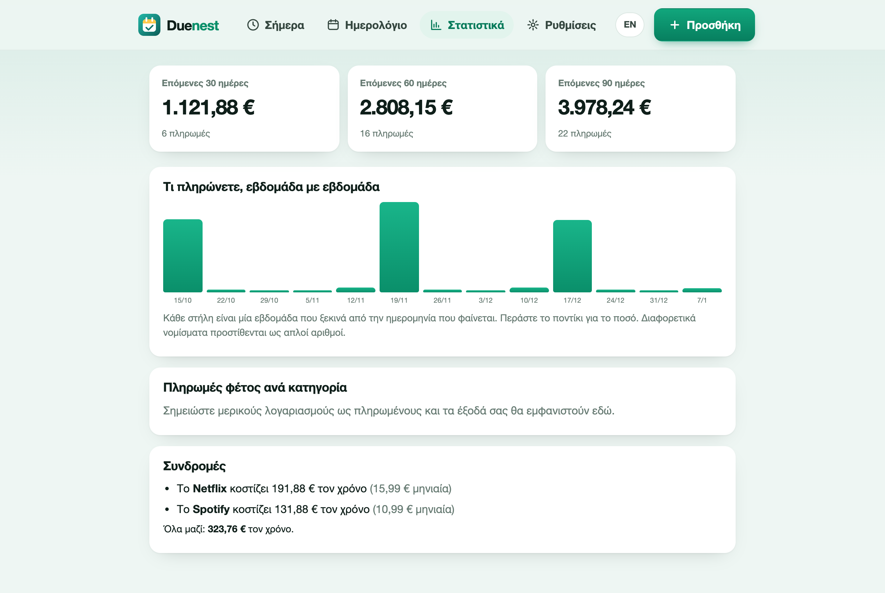

# Ημερολόγιο και στατιστικά

## Το ημερολόγιο

Η καρτέλα **Ημερολόγιο** δείχνει έναν μήνα τη φορά. Κάθε ημέρα με λογαριασμό έχει χρωματιστές τελείες (πορτοκαλί για προς πληρωμή, κόκκινη αν είναι εκπρόθεσμο, πράσινη για πληρωμή που κάνατε) και, σε πλατύτερες οθόνες, το σύνολο της ημέρας. Πατήστε μια ημέρα για να δείτε τους λογαριασμούς της από κάτω και χρησιμοποιήστε τα βέλη για να αλλάξετε μήνα. Το σύνολο του μήνα είναι πάνω δεξιά.

Οι επαναλαμβανόμενοι λογαριασμοί εμφανίζονται σε κάθε ημερομηνία που πέφτουν, όχι μόνο στην επόμενη, ώστε να κοιτάτε μήνες μπροστά.

## Στατιστικά

Η καρτέλα **Στατιστικά** απαντά στο «τι έρχεται και πού πάνε τα χρήματα;».

### Επόμενες 30, 60 και 90 ημέρες

Τρία σύνολα όσων λήγουν, με τον αριθμό πληρωμών. Βασίζονται στους ανοιχτούς λογαριασμούς και τις επαναλήψεις τους.

### Τι πληρώνετε, εβδομάδα με εβδομάδα

Δεκατρείς στήλες, μία ανά εβδομάδα, ξεκινώντας από σήμερα. Το ύψος είναι το ποσό που λήγει την εβδομάδα εκείνη. Περάστε το ποντίκι πάνω από μια στήλη για το ακριβές ποσό. Αν χρησιμοποιείτε περισσότερα από ένα νομίσματα, οι στήλες τα προσθέτουν ως απλούς αριθμούς, οπότε δείτε το ως σχήμα και όχι ως ακριβές νούμερο.

### Αλλαγές τιμών

Όταν οι δύο τελευταίες πληρωμές που καταγράψατε για έναν λογαριασμό διαφέρουν κατά 5% ή περισσότερο, το Duenest το λέει, π.χ. «Το Ρεύμα πήγε από 58 € σε 64 € (+10%)». Αυτό δουλεύει μόνο αν καταγράφετε το πραγματικό ποσό όταν σημειώνετε έναν λογαριασμό ως πληρωμένο.

### Πληρωμές φέτος ανά κατηγορία

Πόσα πληρώσατε φέτος σε κάθε κατηγορία, ως μπάρες με ποσοστά. Μετρά τις πληρωμές που σημειώσατε στο Duenest, άρα μεγαλώνει όσο χρησιμοποιείτε την εφαρμογή.

### Συνδρομές

Οι επαναλαμβανόμενοι λογαριασμοί της κατηγορίας **Συνδρομές** εμφανίζονται με το κόστος τους τον χρόνο και το σύνολο. Τα δεκαπέντε ευρώ τον μήνα είναι 180 τον χρόνο.

## Νομίσματα

Κάθε λογαριασμός έχει το δικό του νόμισμα. Τα σύνολα εμφανίζονται ανά νόμισμα (π.χ. «120 € + 15 $»). Το Duenest δεν κάνει μετατροπές.
