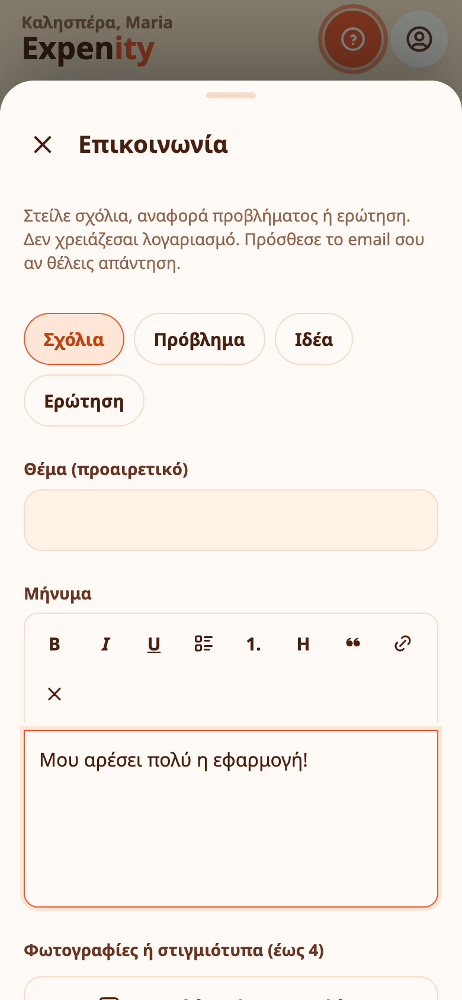

# Επικοινωνία

Βρήκατε πρόβλημα, έχετε ιδέα ή θέλετε απλώς να πείτε κάτι; Το **Περισσότερα → Βοήθεια → Επικοινωνία** στέλνει το μήνυμά σας κατευθείαν σε αυτόν που φτιάχνει το Expenity.

## Τι μπορείτε να στείλετε

- Διαλέξτε περί τίνος πρόκειται: **Σχόλια**, **Πρόβλημα**, **Ιδέα** ή **Ερώτηση**.
- Γράψτε το μήνυμά σας με απλή μορφοποίηση: έντονα, πλάγια, υπογράμμιση, λίστες, επικεφαλίδα, παράθεση και συνδέσμους.
- Επισυνάψτε έως **τέσσερις φωτογραφίες ή στιγμιότυπα**. Μικραίνουν στη συσκευή σας πριν σταλούν.
- Προσθέστε το email σας αν θέλετε απάντηση. Είναι προαιρετικό.
- Αφήστε επιλεγμένο το **Συμπερίλαβε έκδοση εφαρμογής, γλώσσα και τύπο συσκευής**: βοηθά να αναπαράγουμε προβλήματα. Ξε-επιλέξτε το αν προτιμάτε.

Δεν χρειάζεστε λογαριασμό για να μας γράψετε.

## Τι γίνεται με το μήνυμα

Το μήνυμά σας πηγαίνει κατευθείαν στο εισερχόμενο του δημιουργού, σημειωμένο ως μήνυμα από την εφαρμογή. Χρησιμοποιείται για να διαβάσουμε σχόλια, να απαντήσουμε και να διορθώσουμε προβλήματα και δεν προστίθεται τίποτα στα δεδομένα σας στο Expenity. Δείτε [Απόρρητο και τα δεδομένα σας](privacy-and-your-data.md).

## Άλλοι τρόποι

Ανοίξτε ένα issue στο [GitHub](https://github.com/expenity/expenity/issues). Πριν γράψετε, ένας [οδηγός](tutorials-and-help.md) μπορεί να δείχνει ήδη την απάντηση.
