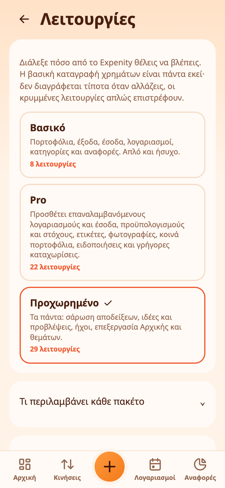
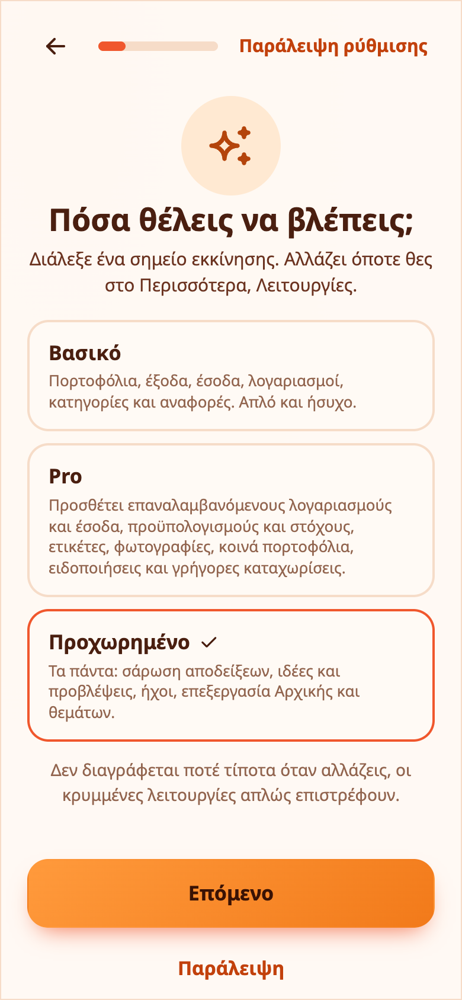

# Λειτουργίες και πακέτα

Το Expenity κάνει πολλά. Εσύ αποφασίζετε πόσα βλέπετε. Στο **Περισσότερα → Κάν’ το δικό σας → Λειτουργίες** διαλέγετε ένα έτοιμο πακέτο, τα συγκρίνετε σε πίνακα ή φτιάχνετε δικό σας συνδυασμό με διακόπτες.

## Τα τρία πακέτα

- **Basic**: πορτοφόλια, έξοδα, έσοδα, λογαριασμοί, κατηγορίες και αναφορές. Απλό και ήσυχο.
- **Pro**: όλα του Basic, συν επαναλαμβανόμενους λογαριασμούς και έσοδα, προϋπολογισμούς και στόχους, ετικέτες, γρήγορες καταχωρίσεις, φωτογραφίες σε εγγραφές, εικόνα προφίλ, ειδοποιήσεις, κοινά πορτοφόλια, φρουρό διπλότυπων, ημερήσιο ποσό, φίλτρα αναζήτησης, πρόσφατα διαγραμμένα, ειδοποιήσεις αύξησης τιμής και υπενθυμίσεις προχείρων.
- **Advanced**: όλα του Pro, συν κατανομή εξόδων, επιστροφές χρημάτων από τρίτους, σάρωση αποδείξεων, ιδέες, ασφαλή για δαπάνη ποσά, ήχους, επεξεργασία Αρχικής, επεξεργασία θεμάτων και σερί. Δείτε επίσης το [eFriend](efriend.md), το ρομπότ που ελέγχει αν το αντέχετε.

Η πρώτη ρύθμιση σε ρωτά ποιο θέλετε και προεπιλέγεται το **Advanced**, ώστε να μην κρύβεται τίποτα αν δεν το επιλέξετε. Η αλλαγή δεν διαγράφει ποτέ τίποτα: μια κρυμμένη λειτουργία απλώς εξαφανίζεται από τις οθόνες και όσα έχετε καταχωρίσει επιστρέφουν όταν την ενεργοποιήσετε ξανά.

> 💡 **Παράδειγμα από την καθημερινότητα** Ένας νέος χρήστης διαλέγει το Basic για απλότητα και περνά στο Pro έναν μήνα αργότερα, όταν οι προϋπολογισμοί αρχίζουν να έχουν σημασία.

## Όλες οι λειτουργίες ανά πακέτο

<!-- features:start -->
Το Basic έχει **8** λειτουργίες, το Pro **23** και το Advanced **34**. Το ✓ σημαίνει ότι η λειτουργία περιλαμβάνεται. Στο δικό σας μείγμα μπορείτε να ενεργοποιήσετε ή να απενεργοποιήσετε κάθε προαιρετική λειτουργία.

| Λειτουργία | Basic | Pro | Advanced |
|---|:-:|:-:|:-:|
| **Πάντα συμπεριλαμβάνονται** | | | |
| Πορτοφόλια | ✓ | ✓ | ✓ |
| Έξοδα, έσοδα και μεταφορές | ✓ | ✓ | ✓ |
| Κατηγορίες | ✓ | ✓ | ✓ |
| Λογαριασμοί με ημερομηνία λήξης | ✓ | ✓ | ✓ |
| Κινήσεις και αναζήτηση | ✓ | ✓ | ✓ |
| Αναφορές | ✓ | ✓ | ✓ |
| Θέματα και γλώσσες | ✓ | ✓ | ✓ |
| Αντίγραφο και εξαγωγή | ✓ | ✓ | ✓ |
| **Προστίθενται στο Pro** | | | |
| Επαναλαμβανόμενοι λογαριασμοί και έσοδα | – | ✓ | ✓ |
| Προϋπολογισμοί και στόχοι | – | ✓ | ✓ |
| Ετικέτες | – | ✓ | ✓ |
| Γρήγορες καταχωρίσεις | – | ✓ | ✓ |
| Φωτογραφίες σε εγγραφές | – | ✓ | ✓ |
| Εικόνα προφίλ | – | ✓ | ✓ |
| Ειδοποιήσεις | – | ✓ | ✓ |
| Κοινά πορτοφόλια | – | ✓ | ✓ |
| Υπενθυμίσεις προχείρων | – | ✓ | ✓ |
| Φρουρός διπλότυπων | – | ✓ | ✓ |
| Ημερήσιο ποσό | – | ✓ | ✓ |
| Φίλτρα αναζήτησης | – | ✓ | ✓ |
| Πρόσφατα διαγραμμένα | – | ✓ | ✓ |
| Ειδοποιήσεις αύξησης τιμής | – | ✓ | ✓ |
| Μενού δεξιού κλικ | – | ✓ | ✓ |
| **Προστίθενται στο Advanced** | | | |
| Κατανομή εξόδων | – | – | ✓ |
| Έξυπνη ανίχνευση | – | – | ✓ |
| Επιστροφές χρημάτων από τρίτους | – | – | ✓ |
| Σάρωση αποδείξεων | – | – | ✓ |
| Σερί | – | – | ✓ |
| Ιδέες | – | – | ✓ |
| Ασφαλή για δαπάνη | – | – | ✓ |
| Ήχοι | – | – | ✓ |
| Επεξεργασία Αρχικής | – | – | ✓ |
| eFriend | – | – | ✓ |
| Επεξεργασία θεμάτων | – | – | ✓ |
<!-- features:end -->

## Σύγκριση και προσαρμογή

- Το **Τι περιλαμβάνει κάθε πακέτο** ανοίγει πίνακα με ένα σημάδι για κάθε λειτουργία σε κάθε πακέτο.
- Το **Φτιάξτε το δικό σας** έχει διακόπτη για κάθε προαιρετική λειτουργία. Αλλάξτε οποιαδήποτε και το πακέτο σας γίνεται **Προσαρμοσμένο**.
- Κάποια πράγματα είναι πάντα ενεργά: πορτοφόλια, έξοδα, έσοδα και μεταφορές, κατηγορίες, λογαριασμοί με ημερομηνία λήξης, Κινήσεις και αναζήτηση, Αναφορές, θέματα και γλώσσες, αντίγραφο και εξαγωγή.

> 💡 **Παράδειγμα από την καθημερινότητα** Η Ελένη θέλει τα πάντα του Advanced εκτός από τους ήχους, οπότε απενεργοποιεί αυτή τη λειτουργία στον δικό της συνδυασμό. Τίποτα δεν διαγράφεται.

## Πακέτα και οδηγοί

Οι οδηγοί και τα εικονίδια βοήθειας ακολουθούν το πακέτο σας: μια λειτουργία που είναι κρυμμένη δεν έχει οδηγό ούτε εικονίδιο. Δείτε [Οδηγοί και βοήθεια](tutorials-and-help.md).

## Νέα στο Advanced

Η [κατανομή εξόδων και οι επιστροφές χρημάτων από τρίτους](split-expenses-and-reimbursements.md) υποστηρίζουν επιμερισμό σε κατηγορίες και τμηματικές εισπράξεις, με κινούμενα παραδείγματα στην αρχική ρύθμιση και στους Οδηγούς.
