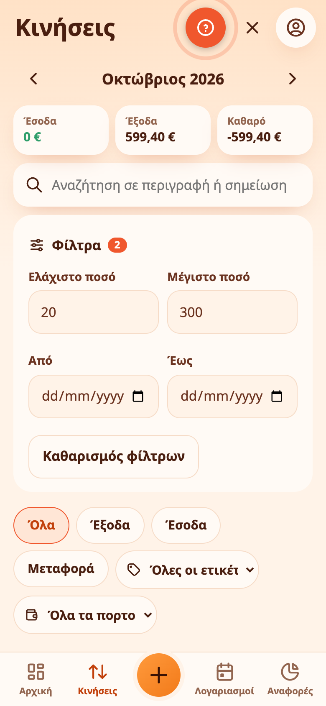
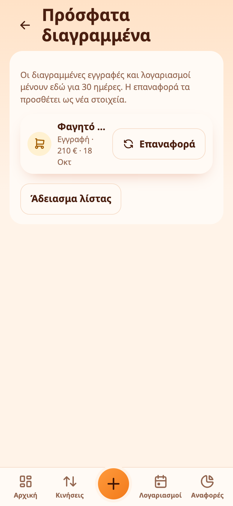
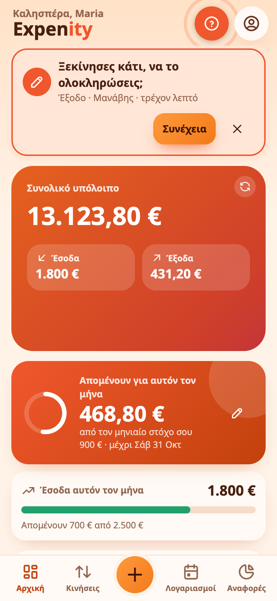

# Αναζήτηση, φίλτρα, πρόχειρα και πρόσφατα διαγραμμένα

## Αναζήτηση και φίλτρα

Στις **Κινήσεις**, πατήστε τον μεγεθυντικό φακό για αναζήτηση με όνομα, σημείωση, ετικέτα ή κατηγορία. Κάτω από το πεδίο, τα **Φίλτρα** περιορίζουν τη λίστα περαιτέρω:

- **ελάχιστο και μέγιστο ποσό**·
- **εύρος ημερομηνιών**. Όταν ορίζεται εύρος, η λίστα καλύπτει αυτές τις ημερομηνίες σε πολλούς μήνες αντί για έναν μήνα τη φορά·
- **ετικέτα**, καθώς και τα κουμπιά τύπου και πορτοφολιού όπως πριν.

Ο αριθμός δίπλα στα **Φίλτρα** δείχνει πόσα είναι ενεργά και το **Καθαρισμός φίλτρων** τα αφαιρεί όλα.

{{tut:filters}}

## Πρόσφατα διαγραμμένα

Διαγράψατε κατά λάθος μια εγγραφή ή έναν λογαριασμό; Το **Περισσότερα → Λογαριασμός & δεδομένα → Πρόσφατα διαγραμμένα** τα κρατά για **30 ημέρες**. Πατήστε **Επαναφορά** για να τα φέρετε πίσω. Ένα στοιχείο που επανέρχεται προστίθεται ως νέο με τις ίδιες λεπτομέρειες. Μπορείτε επίσης να αδειάσετε τη λίστα.

{{tut:trash}}

## Πρόχειρα

Ξεκινήσατε ένα έξοδο και το κινητό σας έσβησε ή κλείσατε κατά λάθος την εφαρμογή; Το Expenity αποθηκεύει στη συσκευή σας ό,τι γράψατε μόλις αλλάξετε κάτι, όπως όταν προσθέσετε ποσό. Όταν ανοίξετε την εφαρμογή, η **Αρχική επισημαίνει την ημιτελή εγγραφή** με κουμπί **Συνέχεια** και μπορείτε να την απορρίψετε με το σταυρό.

Το **Περισσότερα → Λογαριασμός & δεδομένα → Πρόχειρα** απαριθμεί κάθε ημιτελή εγγραφή με **Συνέχεια** και **Απόρριψη**. Τα πρόχειρα μένουν για 24 ώρες και υπάρχουν μόνο στη συσκευή όπου τα ξεκινήσατε. Η Συνέχεια ανοίγει τη φόρμα με ό,τι είχατε γράψει, έτοιμη να υποβληθεί.

## Επαναφορά λογαριασμού

Αν θέλετε εντελώς καθαρή αρχή, το **Περισσότερα → Λογαριασμός και συγχρονισμός → Επαναφορά λογαριασμού** αφαιρεί όλες τις εγγραφές, τα πορτοφόλια, τους προϋπολογισμούς, τους στόχους και τις φωτογραφίες σας και επαναφέρει τις ρυθμίσεις, σαν να μόλις εγγραφήκατε. Αν έχετε λογαριασμό, αυτό γίνεται σε όλες τις συσκευές σας: κάθε μία αδειάζει στον επόμενο συγχρονισμό της και τίποτα δεν επιστρέφει. Ο λογαριασμός και τα passkeys σας παραμένουν. Ζητά επιβεβαίωση και passkey και σας πηγαίνει ξανά στη ρύθμιση, ξεκινώντας από το όνομά σας. Στην ίδια κάρτα υπάρχει το κουμπί **Κατεβάστε πρώτα αντίγραφο ασφαλείας**. Αν έχετε κοινά πορτοφόλια, το Expenity δείχνει τι θα γίνει με καθένα. Όταν συμφωνήσετε, αποχωρείτε από όσα έχετε μπει και σταματάτε την κοινοποίηση όσων σας ανήκουν (οι άλλοι χάνουν την πρόσβαση) και μετά συνεχίζεται η επαναφορά. Δεν αναιρείται, οπότε [κατεβάστε αντίγραφο ασφαλείας](privacy-and-your-data.md) πρώτα (το κουμπί είναι στην ίδια κάρτα) αν μπορεί να χρειαστείτε τα δεδομένα σας.
