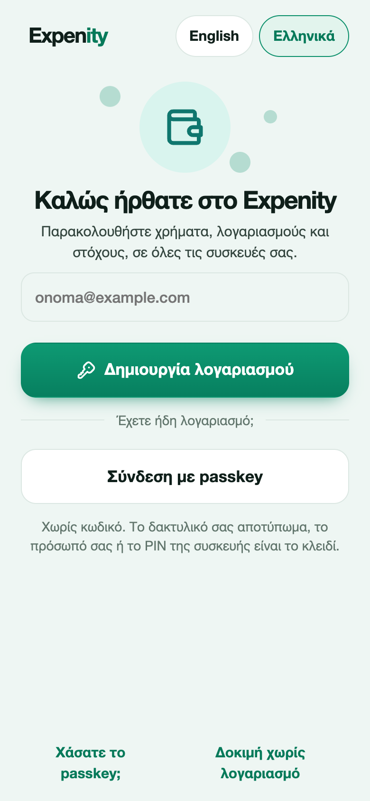
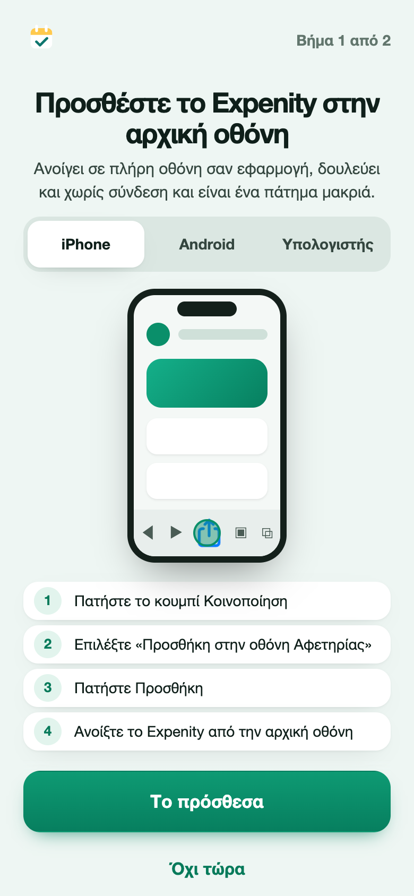
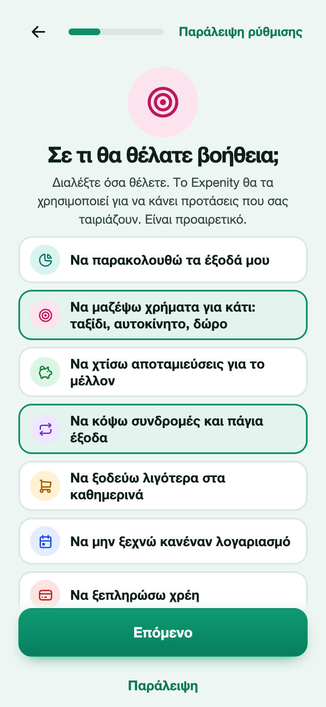
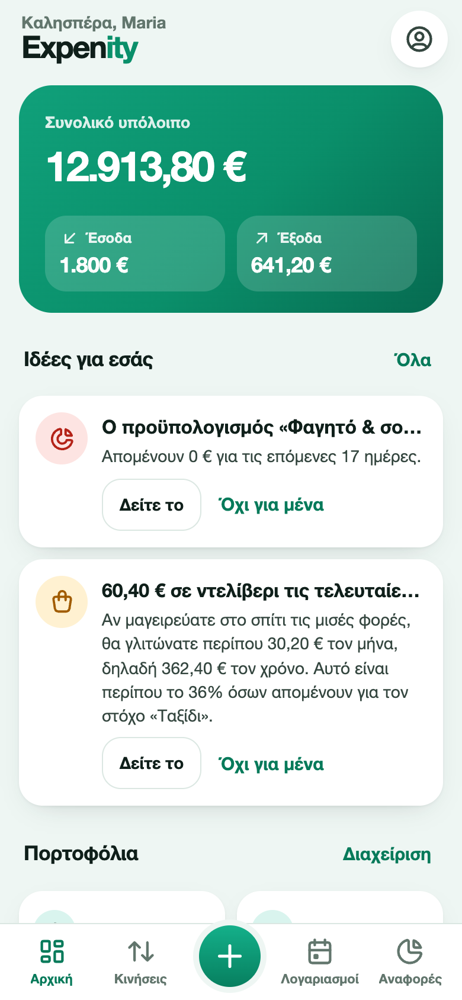

# Ξεκινώντας

Το Expenity κρατά τα χρήματά σας, τους λογαριασμούς και τους στόχους σας σε ένα μέρος, σε όλες τις συσκευές σας. Ο οδηγός αυτός χρειάζεται περίπου πέντε λεπτά και κάθε βήμα μετά τον λογαριασμό μπορεί να παραλειφθεί.

## 1. Δημιουργήστε λογαριασμό (ή συνδεθείτε)

Ανοίξτε την εφαρμογή στο [expenity.github.io/expenity/app/?lang=el](https://expenity.github.io/expenity/app/?lang=el). Η πρώτη οθόνη σας ζητά να δημιουργήσετε λογαριασμό ή να συνδεθείτε. Χρησιμοποιείτε **passkey**, δηλαδή το δακτυλικό σας αποτύπωμα, το πρόσωπό σας ή το PIN της συσκευής, οπότε δεν υπάρχει κωδικός να θυμάστε ή να χάσετε. Γράψτε το email σας, πατήστε **Δημιουργία λογαριασμού** και επιβεβαιώστε στη συσκευή σας.

Μετά το Expenity εμφανίζει δέκα **κωδικούς ανάκτησης**. Φυλάξτε τους σε ασφαλές μέρος. Είναι ο τρόπος να μπείτε ξανά αν χάσετε τα passkeys σας και εμφανίζονται μόνο μία φορά. Δείτε το [Λογαριασμός και συγχρονισμός](account-and-sync.md).

Δεν είστε έτοιμοι για λογαριασμό; Πατήστε **Δοκιμή χωρίς λογαριασμό**. Τα δεδομένα σας θα μένουν τότε μόνο σε αυτό το πρόγραμμα περιήγησης και μπορείτε να δημιουργήσετε λογαριασμό αργότερα από τα **Περισσότερα**.

## 2. Προσθέστε το Expenity στην αρχική οθόνη

Η επόμενη οθόνη δείχνει, με μια μικρή κίνηση, πώς να προσθέσετε το Expenity στην αρχική οθόνη σε iPhone, Android ή υπολογιστή, ώστε να ανοίγει σαν εφαρμογή. Διαλέξτε τη συσκευή σας, ακολουθήστε τα τέσσερα βήματα και πατήστε **Το πρόσθεσα**, ή **Όχι τώρα**. Περισσότερα στο [Εγκατάσταση στη συσκευή σας](install-on-your-device.md).

## 3. Ρυθμίστε το

Μια σύντομη ρύθμιση κάνει λίγες ερωτήσεις. Κάθε μία μπορεί να παραλειφθεί και μπορείτε να αλλάξετε κάθε απάντηση αργότερα.

- **Το όνομά σας**, για τον χαιρετισμό.
- **Το βασικό σας νόμισμα**. Τα σύνολα και οι αναφορές το χρησιμοποιούν.
- **Σε τι θέλετε βοήθεια**, όπως να παρακολουθείτε τα έξοδά σας, να μαζέψετε χρήματα για ένα ταξίδι ή να κόψετε συνδρομές. Το Expenity το χρησιμοποιεί για να προτείνει πράγματα που σας ταιριάζουν. Δείτε το [Προϋπολογισμοί, στόχοι και έσοδα](budgets-goals-income.md).
- **Έναν πρώτο στόχο**, αν επιλέξατε να αποταμιεύσετε για κάτι.
- **Τα πορτοφόλια σας**: μετρητά, τραπεζικός λογαριασμός, κάρτα, αποταμίευση, με όσα έχει το καθένα.
- **Την εμφάνιση**: ένα θέμα και αν τα κινούμενα εφέ είναι ενεργά. Δείτε το [Θέματα και κινούμενα εφέ](themes-and-look.md).

Μέχρι να ολοκληρωθεί ή να παραλειφθεί η ρύθμιση, η εφαρμογή δεν σας αφήνει να προσθέσετε δεδομένα, ώστε τίποτα να μην καταλήξει σε πορτοφόλι που δεν διαλέξατε.

## 4. Προσθέστε το πρώτο σας έξοδο

Πατήστε το πράσινο κουμπί **+**, επιλέξτε **Έξοδο**, γράψτε το ποσό στο πληκτρολόγιο, προσθέστε περιγραφή, διαλέξτε κατηγορία και πορτοφόλι και πατήστε το σημάδι ✓. [Περισσότερα για την προσθήκη χρημάτων](add-money.md).

## Γνωρίστε την εφαρμογή

- **Αρχική**: το συνολικό υπόλοιπο, έσοδα και έξοδα του μήνα, ιδέες για εσάς, πορτοφόλια, τι έρχεται σύντομα.
- **Κινήσεις**: όλες οι κινήσεις ανά μήνα, με αναζήτηση και φίλτρα.
- **Λογαριασμοί**: τι έρχεται, ως λίστα ή ημερολόγιο.
- **Αναφορές**: γραφήματα και πίνακες. Δείτε τις [Αναφορές](reports.md).
- **Πλάνο** (στην πλαϊνή μπάρα σε tablet και υπολογιστή, ή από την Αρχική και τα **Περισσότερα**): προϋπολογισμοί, στόχοι, έσοδα και ιδέες.
- **Περισσότερα**: πορτοφόλια, κατηγορίες, υπενθυμίσεις, αντίγραφο, θέματα, ο λογαριασμός σας.

## Πού να πάτε μετά

- [Προσθήκη εξόδων, εσόδων και λογαριασμών](add-money.md)
- [Πορτοφόλια και νομίσματα](wallets-and-currencies.md)
- [Προϋπολογισμοί, στόχοι και έσοδα](budgets-goals-income.md)
- [Κοινά πορτοφόλια](shared-wallets.md)
