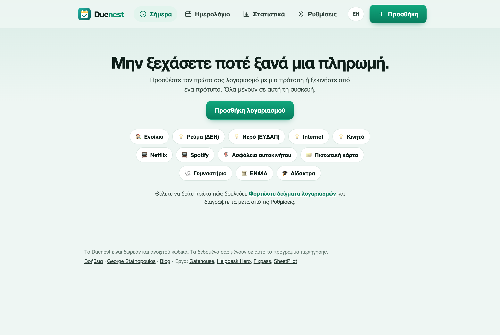
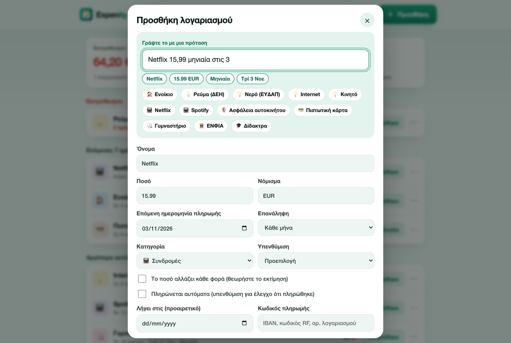
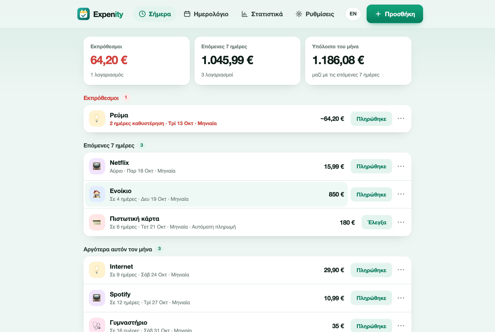

# Ξεκινώντας

Το Expenity κρατά τους λογαριασμούς και τις συνδρομές σας σε ένα μέρος και σας λέει τι έρχεται. Αυτός ο οδηγός χρειάζεται περίπου δύο λεπτά.

## Ανοίξτε το Expenity

Ανοίξτε την εφαρμογή στο [expenity.github.io/expenity/app/?lang=el](https://expenity.github.io/expenity/app/?lang=el). Δεν εγκαθιστάτε τίποτα και δεν φτιάχνετε λογαριασμό. Δουλεύει σε κάθε σύγχρονο browser, σε κινητό, tablet ή υπολογιστή. Για να την έχετε στην αρχική οθόνη σαν εφαρμογή, δείτε το [Εγκατάσταση στη συσκευή σας](install-on-your-device.md).

## Προσθέστε τον πρώτο σας λογαριασμό

Πατήστε **Προσθήκη**. Έχετε τρεις τρόπους να ξεκινήσετε:

- **Γράψτε μια πρόταση**, για παράδειγμα `Netflix 15,99 μηνιαία στις 3`. Η φόρμα από κάτω συμπληρώνεται μόνη της και τα σήματα δείχνουν τι κατάλαβε το Expenity. [Περισσότερα παραδείγματα](add-bills.md#γράψτε-μια-πρόταση).
- **Διαλέξτε ένα πρότυπο** όπως Ενοίκιο, Ρεύμα ή Ασφάλεια αυτοκινήτου. Ορίζει όνομα, κατηγορία και επανάληψη. Εσείς βάζετε το ποσό.
- **Συμπληρώστε τη φόρμα** μόνοι σας.

Ελέγξτε τη φόρμα και πατήστε **Αποθήκευση**. Ο λογαριασμός εμφανίζεται στην οθόνη Σήμερα.

Αν θέλετε πρώτα να δείτε πώς δουλεύει, πατήστε **Φορτώστε δείγματα λογαριασμών** στην αρχική οθόνη. Μπορείτε να τα διαγράψετε αργότερα με **Ρυθμίσεις → Διαγραφή όλων των δεδομένων μου**.

## Η οθόνη Σήμερα

Η οθόνη Σήμερα δείχνει τρία σύνολα (εκπρόθεσμοι, επόμενες 7 ημέρες, υπόλοιπο του μήνα) και τους λογαριασμούς ομαδοποιημένους ανάλογα με το πότε λήγουν. Οι εκπρόθεσμοι είναι κόκκινοι και εμφανίζονται πρώτοι.

Σε κάθε λογαριασμό:

- Το **Πληρώθηκε** καταγράφει την πληρωμή και μεταφέρει έναν επαναλαμβανόμενο λογαριασμό στην επόμενη ημερομηνία. [Σήμανση ως πληρωμένο](add-bills.md#σήμανση-ως-πληρωμένο).
- Το **⋯** ανοίγει αναβολή, παράλειψη, σύνδεσμο πληρωμής, αντιγραφή κωδικού, επεξεργασία και διαγραφή.
- Αν πατήσετε πάνω στον λογαριασμό, ανοίγει για επεξεργασία.

## Λάβετε υπενθυμίσεις

Το Expenity σας υπενθυμίζει με δύο τρόπους και αξίζει να ρυθμίσετε τον δεύτερο: δείτε τις [Υπενθυμίσεις](reminders.md).

## Πού να πάτε μετά

- [Προσθήκη λογαριασμών](add-bills.md): προτάσεις, πρότυπα, επαναλήψεις και μεταβλητά ποσά
- [Υπενθυμίσεις](reminders.md): ειδοποιήσεις και αρχείο ημερολογίου
- [Ημερολόγιο και στατιστικά](calendar-and-insights.md): τι λήγει και τι έρχεται
- [Ιδιωτικότητα και δεδομένα](privacy-and-your-data.md): πού ζουν οι λογαριασμοί σας και πώς κρατάτε αντίγραφο
