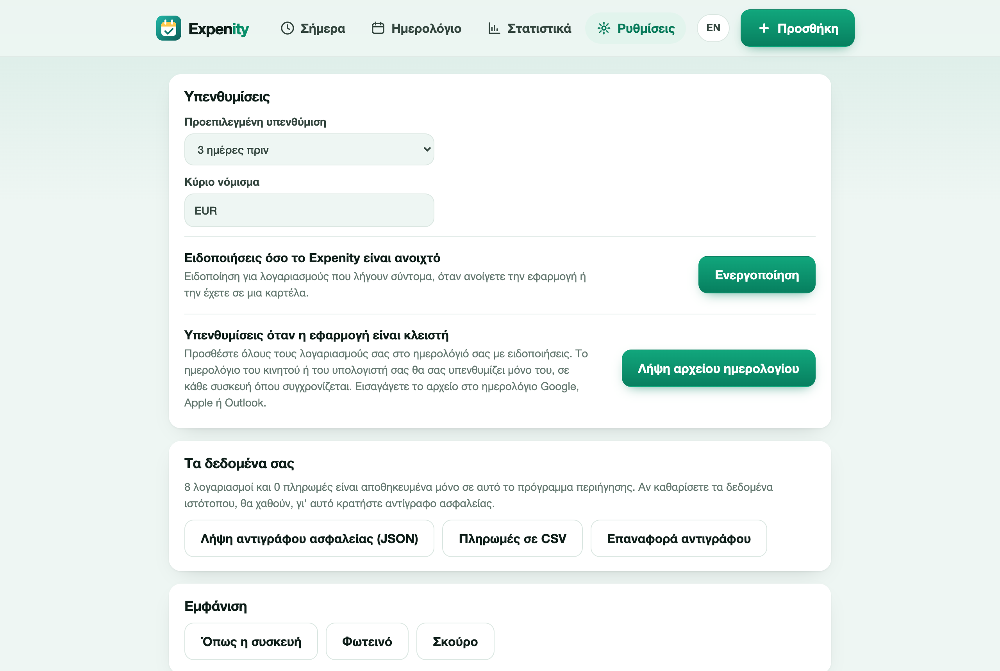

# Ιδιωτικότητα και δεδομένα

## Τα δεδομένα σας μένουν στη συσκευή σας

Οι λογαριασμοί και οι πληρωμές σας αποθηκεύονται στην τοπική αποθήκευση του browser, στη συσκευή που χρησιμοποιείτε. Δεν στέλνονται σε διακομιστή, γιατί το Expenity δεν έχει διακομιστή που να τα αποθηκεύει. Δεν υπάρχει λογαριασμός, σύνδεση ή προφίλ.

Ο ιστότοπος και η εφαρμογή μετρούν επισκέψεις ανώνυμα με το Cloudflare Web Analytics: χωρίς cookies και προσωπικά δεδομένα, και ποτέ το περιεχόμενο των λογαριασμών σας.

Το Expenity δεν ζητά ποτέ στοιχεία τράπεζας, δεν συνδέεται με τράπεζα και δεν μετακινεί χρήματα. Ο σύνδεσμος πληρωμής σε έναν λογαριασμό απλώς ανοίγει τη σελίδα που αποθηκεύσατε.

## Αντίγραφο ασφαλείας και επαναφορά

Επειδή τα δεδομένα είναι στον browser, αν καθαρίσετε τα δεδομένα του ιστότοπου (ή χάσετε τη συσκευή), χάνονται. Κρατήστε αντίγραφο ασφαλείας.

Στις **Ρυθμίσεις → Τα δεδομένα σας**:

- Η **Λήψη αντιγράφου ασφαλείας (JSON)** αποθηκεύει τα πάντα: λογαριασμούς, πληρωμές και ρυθμίσεις.
- Η **Επαναφορά αντιγράφου** διαβάζει ένα τέτοιο αρχείο και αντικαθιστά τα τρέχοντα δεδομένα (αφού επιβεβαιώσετε). Έτσι μεταφέρετε επίσης τους λογαριασμούς σας σε άλλη συσκευή.
- Οι **Πληρωμές σε CSV** εξάγουν το ιστορικό πληρωμών για λογιστικό φύλλο.

## Διαγραφή όλων

Η επιλογή **Ρυθμίσεις → Διαγραφή όλων των δεδομένων μου** αφαιρεί όλους τους λογαριασμούς και τις πληρωμές από αυτόν τον browser. Δεν αναιρείται, οπότε κατεβάστε πρώτα αντίγραφο αν ίσως τα θέλετε πίσω.

## Ειδοποιήσεις

Αν ενεργοποιήσετε τις ειδοποιήσεις, ο browser ζητά άδεια και τις εμφανίζει τοπικά. Τίποτα δεν στέλνεται πουθενά.

## Το αρχείο ημερολογίου

Το αρχείο ημερολογίου που κατεβάζετε περιέχει τα ονόματα, τα ποσά και τις σημειώσεις των λογαριασμών σας. Όταν το εισαγάγετε στο ημερολόγιο Google, Apple ή Outlook, αποθηκεύεται από αυτή την υπηρεσία με τους δικούς της όρους ιδιωτικότητας. Μη βάζετε ευαίσθητα στοιχεία στις σημειώσεις αν σας ενδιαφέρει.

## Ανοιχτός κώδικας

Ο κώδικας είναι δημόσιος, ώστε να τα ελέγξετε όλα αυτά: [github.com/expenity/expenity](https://github.com/expenity/expenity).
