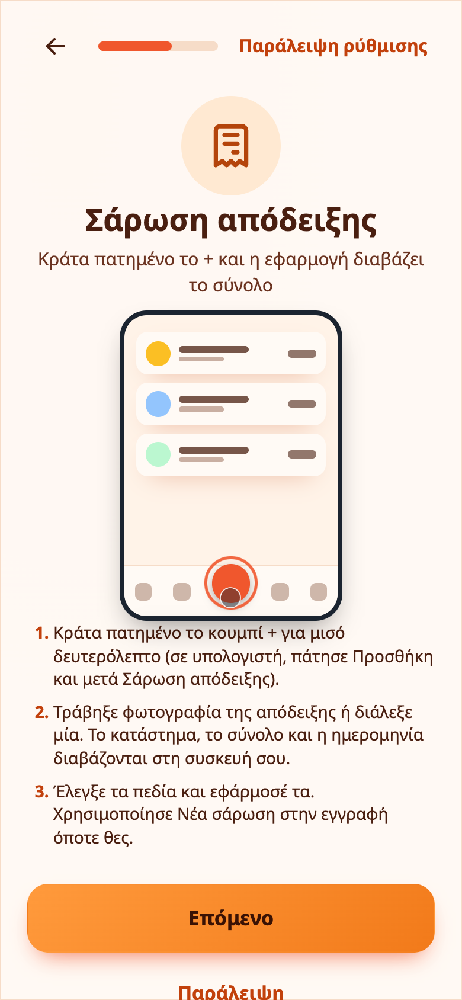
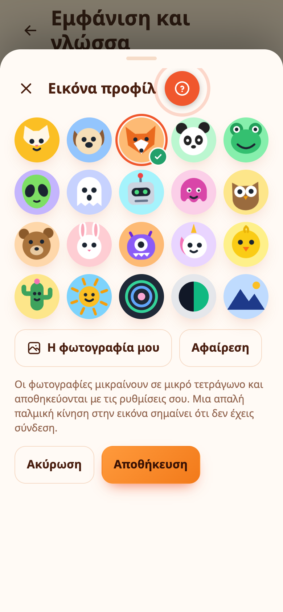

# Αποδείξεις, φωτογραφίες και η εικόνα σας

## Σάρωση απόδειξης

Φωτογράφισε μια απόδειξη και το Expenity διαβάζει το κατάστημα, το σύνολο και την ημερομηνία **στη συσκευή σας**, σε ελληνικά και αγγλικά. Τίποτα δεν ανεβαίνει για αναγνώριση.

- **Κρατήστε πατημένο το κουμπί +** για μισό δευτερόλεπτο, τραβήξτε φωτογραφία ή διαλέξτε μία από τη βιβλιοθήκη σας. Σε υπολογιστή, ανοίξτε **Προσθήκη** και μετά **Σάρωση απόδειξης**.
- Ελέγξτε τα πεδία. Διαλέγετε τι εφαρμόζεται: το όνομα, το ποσό, το νόμισμα, την ημερομηνία και αν θα κρατηθεί η φωτογραφία.
- Οι σαρωμένες εγγραφές δείχνουν ένα μικρό εικονίδιο **απόδειξης**. Ανοίξτε μία και διαλέξτε **Νέα σάρωση απόδειξης** για να τη διαβάσετε ξανά, π.χ. με καλύτερη φωτογραφία.

{{tut:scan}}

Ο σαρωτής ανήκει στο **Προχωρημένο** και το **Περισσότερα → Κάν’ το δικό σας → Σάρωση αποδείξεων** τον ενεργοποιεί ή απενεργοποιεί.

## Φωτογραφίες σε εγγραφές

Επισυνάψτε μια μικρή φωτογραφία ή στιγμιότυπο σε έξοδο, έσοδο, λογαριασμό, πορτοφόλι ή στόχο: ανοίξτε τον και μετά **Περισσότερα → Επισύναψη φωτογραφίας**. Οι φωτογραφίες μικραίνουν σε περίπου 1000 pixel και 60 KB πριν ανέβουν και ένα πράσινο σημάδι το επιβεβαιώνει. Μια εγγραφή μπορεί να δείχνει και εικονίδιο απόδειξης και εικονίδιο φωτογραφίας. Πατήστε το εικονίδιο φωτογραφίας για να τη δείτε. Οι φωτογραφίες θέλουν λογαριασμό και σύνδεση και μπορείτε να τις διαγράψετε όλες από το **Περισσότερα → Δεδομένα**.

{{tut:attach}}

## Η εικόνα προφίλ σας

Διαλέξτε **Περισσότερα → Εικόνα προφίλ** για έναν από 20 χαρακτήρες (αστείους, κινούμενους ή μινιμαλιστικούς) ή για τη δική σας φωτογραφία. Η επιλογή είναι απλώς προεπισκόπηση μέχρι να πατήσετε **Αποθήκευση** και ένα πράσινο σημάδι δείχνει αυτήν που διαλέξατε. Η φωτογραφία κόβεται σε μικρή στρογγυλή εικόνα και αποθηκεύεται με τις ρυθμίσεις σας. Όταν είστε εκτός σύνδεσης, η εικόνα έχει έναν απαλό παλμό ώστε να το καταλαβαίνετε.

