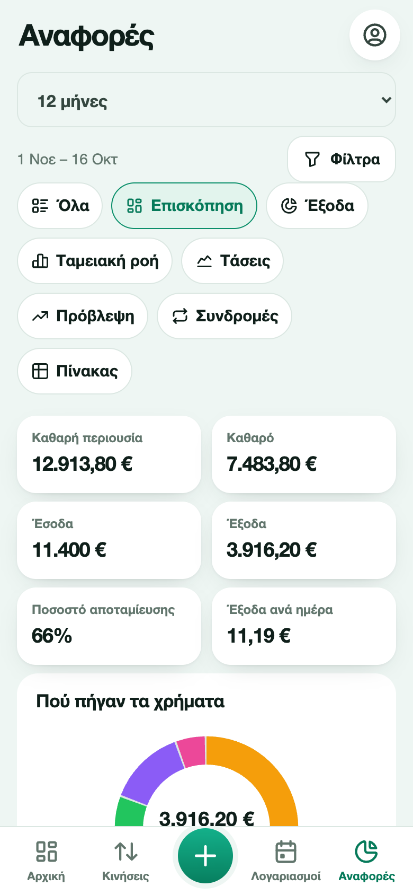
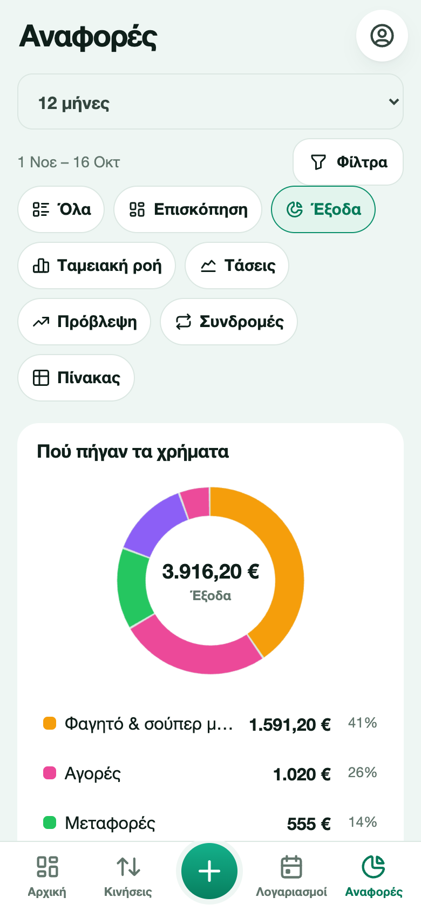
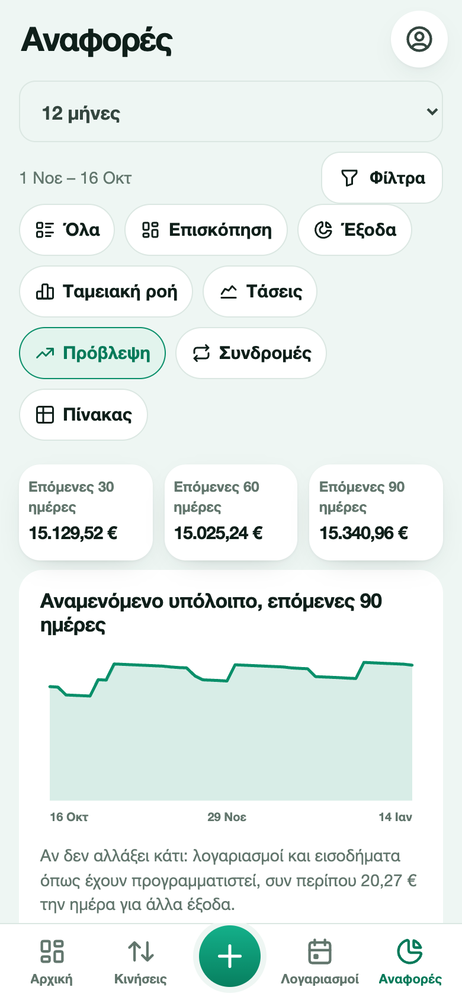
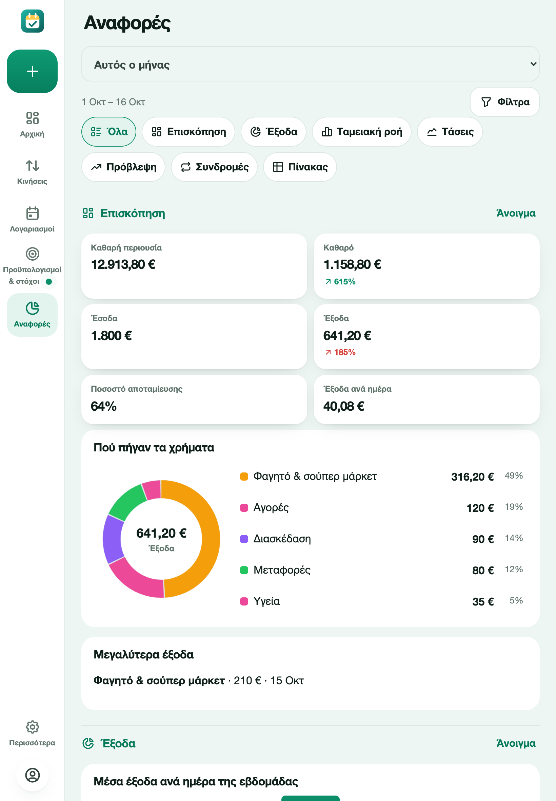

# Αναφορές

Οι αναφορές μετατρέπουν τις κινήσεις σας σε γραφήματα και πίνακες. Η προβολή **Όλα** δείχνει όλες τις αναφορές η μία μετά την άλλη, με σύνδεσμο **Άνοιγμα** στην καθεμία, ώστε να τις διατρέχετε όλες. Τα κουμπιά κάτω από τα φίλτρα (το καθένα με εικονίδιο) ανοίγουν μία αναφορά μόνη της. Διαλέξτε **περίοδο** στην κορυφή (Αυτός ο μήνας, Προηγούμενος μήνας, 3 μήνες, Φέτος, 12 μήνες ή δική σας περίοδος) και μετά μια καρτέλα. Τα **Φίλτρα** περιορίζουν τα πάντα σε ένα πορτοφόλι, μια κατηγορία, μόνο έξοδα ή μόνο έσοδα, ή μια λέξη στην περιγραφή. Τα χρήματα που έχετε βάλει στην άκρη για στόχους δεν μετρούν ως έξοδα.

## Επισκόπηση

Καθαρή περιουσία, καθαρό αποτέλεσμα, έσοδα, έξοδα, ποσοστό αποταμίευσης και έξοδα ανά ημέρα, το καθένα με ένα βέλος και ένα ποσοστό σε σχέση με την προηγούμενη περίοδο ίδιου μήκους. Από κάτω, οι κορυφαίες κατηγορίες και το μεγαλύτερο έξοδό σας.

## Έξοδα

Ένα κυκλικό γράφημα ανά κατηγορία. Πατήστε μια φέτα ή μια γραμμή του υπομνήματος για να δείτε τις κινήσεις αυτής της κατηγορίας. Επίσης: μέσα έξοδα ανά ημέρα της εβδομάδας, πού πάνε τα χρήματα (ανά περιγραφή) και τα μεγαλύτερα έξοδα.

## Ταμειακή ροή

Έσοδα και έξοδα μήνα με μήνα, σωρευτική ταμειακή ροή και ποσοστό αποταμίευσης ανά μήνα.

## Τάσεις

Τα έξοδα ανά μήνα στοιβαγμένα ανά κατηγορία (οι πέντε κορυφαίες και οι υπόλοιπες) και πώς πάει αυτός ο μήνας σε σχέση με τον προηγούμενο.

## Πρόβλεψη

Το αναμενόμενο υπόλοιπο σε 30, 60 και 90 ημέρες, ως γραμμή. Χρησιμοποιεί τους λογαριασμούς σας, τα επαναλαμβανόμενα έσοδά σας και ένα τυπικό ημερήσιο έξοδο που υπολογίζεται από τις τελευταίες 60 ημέρες, και το γράφει κάτω από το γράφημα. Δείχνει επίσης **πόσα μπορείτε να ξοδεύετε την ημέρα** μέχρι το τέλος του μήνα, το χαμηλότερο σημείο του υπολοίπου σας και τις μεγαλύτερες πληρωμές που έρχονται.

## Συνδρομές

Ένας πίνακας με τις συνδρομές σας, το κόστος ανά μήνα και ανά έτος και την επόμενη χρέωση, το σύνολο ανά έτος και μια σημείωση όταν μια τιμή ανέβηκε.

## Πίνακας

Όλες οι κινήσεις της περιόδου σε πίνακα που ταξινομείτε πατώντας μια επικεφαλίδα και ομαδοποιείτε ανά κατηγορία, πορτοφόλι ή μήνα, με σύνολα. Το **CSV** το κατεβάζει για υπολογιστικό φύλλο.

Κάθε γράφημα έχει **Προβολή ως πίνακα**, ώστε οι αριθμοί να είναι πάντα διαθέσιμοι ως κείμενο.

Σε tablet ή υπολογιστή τα γραφήματα και οι κάρτες αξιοποιούν τον επιπλέον χώρο.

Για κατανομή ποσών ανά κατηγορία, τμηματικές εισπράξεις και αναλυτικά παραδείγματα, δείτε την [κατανομή εξόδων και τις επιστροφές χρημάτων από τρίτους](split-expenses-and-reimbursements.md).
