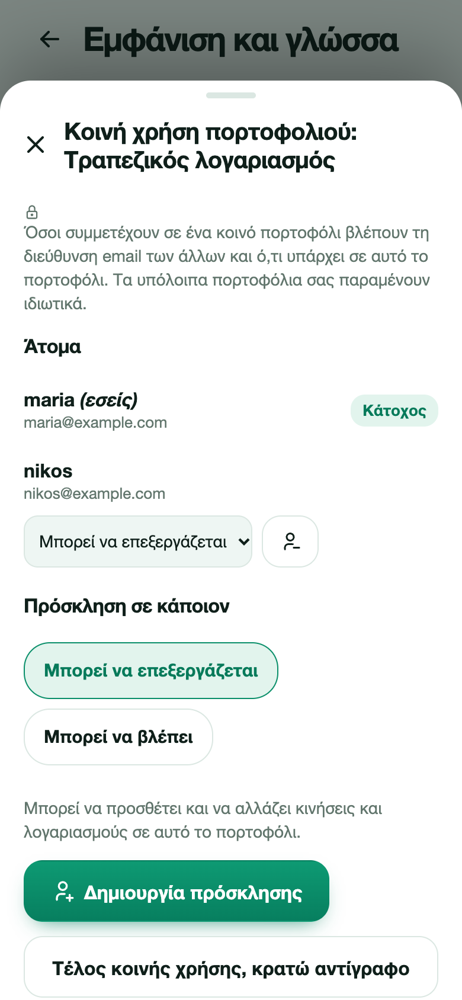

# Κοινά πορτοφόλια

Ένα κοινό πορτοφόλι αφήνει την οικογένεια ή φίλους να βλέπουν και να προσθέτουν κινήσεις στο ίδιο πορτοφόλι από τις δικές τους συσκευές: για έναν οικογενειακό προϋπολογισμό, ένα ταξίδι ή έναν κοινό λογαριασμό. Οι άλλοι βλέπουν μόνο το πορτοφόλι που μοιράζεστε. Τα υπόλοιπα πορτοφόλια, οι προϋπολογισμοί και οι στόχοι σας μένουν ιδιωτικά.

## Μοιραστείτε ένα πορτοφόλι

Χρειάζεστε λογαριασμό (όχι λειτουργία χωρίς λογαριασμό).

1. Ανοίξτε **Περισσότερα → Πορτοφόλια** και πατήστε το πορτοφόλι.
2. Πατήστε **Κοινή χρήση πορτοφολιού** και μετά **Έναρξη κοινής χρήσης**.
3. Διαλέξτε ρόλο για το άτομο που καλείτε: **Μπορεί να επεξεργάζεται** ή **Μπορεί να βλέπει**.
4. Πατήστε **Δημιουργία πρόσκλησης**. Παίρνετε έναν κωδικό και έναν σύνδεσμο. Στείλτε έναν από τους δύο στο άτομο, με μήνυμα ή από κοντά.

Η πρόσκληση ισχύει μία φορά και λήγει σε 7 ημέρες. Βλέπετε τις ανοιχτές προσκλήσεις και μπορείτε να τις ακυρώσετε. Μπορείτε να μοιραστείτε έως 5 πορτοφόλια, με έως 12 άτομα το καθένα.

## Μπείτε σε ένα κοινό πορτοφόλι

Ανοίξτε τον σύνδεσμο που σας έστειλαν ή πηγαίνετε στο **Περισσότερα → Πορτοφόλια → Συμμετοχή σε κοινό πορτοφόλι** και γράψτε τον κωδικό. Χρειάζεστε λογαριασμό και το Expenity σας ζητά πρώτα να συνδεθείτε ή να δημιουργήσετε έναν, αν δεν έχετε. Το πορτοφόλι και το ιστορικό του εμφανίζονται τότε στη συσκευή σας.

## Ρόλοι

| Ρόλος | Τι μπορεί να κάνει |
|---|---|
| **Κάτοχος** | Τα πάντα: να καλεί άτομα, να αλλάζει ρόλους, να αφαιρεί άτομα, να σταματά την κοινή χρήση |
| **Μπορεί να επεξεργάζεται** | Να βλέπει τα πάντα στο πορτοφόλι, να προσθέτει και να αλλάζει κινήσεις και λογαριασμούς |
| **Μπορεί να βλέπει** | Να βλέπει τα πάντα στο πορτοφόλι, αλλά όχι να τα αλλάζει |

Ο διακομιστής ελέγχει τον ρόλο σε κάθε αλλαγή και όχι μόνο η εφαρμογή. Κάθε κίνηση και κάθε λογαριασμός δείχνει ποιος τον πρόσθεσε.

## Τι μοιράζεται

Το πορτοφόλι, οι κινήσεις του και οι λογαριασμοί του. Οι προϋπολογισμοί, οι στόχοι, τα επαναλαμβανόμενα έσοδα και οι ρυθμίσεις σας δεν μοιράζονται. Οι μεταφορές γίνονται μόνο μεταξύ δύο ιδιωτικών πορτοφολιών ή μεταξύ δύο πορτοφολιών του ίδιου κοινού πορτοφολιού.

## Ιδιωτικότητα

Όσοι συμμετέχουν σε ένα κοινό πορτοφόλι βλέπουν τη διεύθυνση email των άλλων και ό,τι υπάρχει σε αυτό το πορτοφόλι. Πείτε σε όσους καλείτε τι θα βλέπουν.

## Αποχώρηση, αφαίρεση, τέλος κοινής χρήσης

- Ένα μέλος μπορεί να πατήσει **Αποχώρηση από το πορτοφόλι**. Αφαιρείται από τη συσκευή του και οι υπόλοιποι το κρατούν.
- Ο κάτοχος μπορεί να **Αφαιρέσει** κάποιον, που χάνει την πρόσβαση και τα δεδομένα στη συσκευή του.
- Ο κάτοχος μπορεί να πατήσει **Τέλος κοινής χρήσης, κρατώ αντίγραφο**: όλοι οι υπόλοιποι χάνουν την πρόσβαση και εσείς κρατάτε το πορτοφόλι και όλες τις κινήσεις του ως ιδιωτικό πορτοφόλι.

Αν διαγράψετε τον λογαριασμό σας, τα πορτοφόλια που κατέχετε και μοιράζεστε διαγράφονται για όλους.
