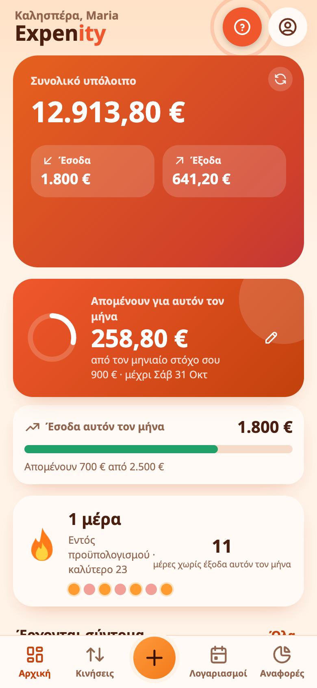
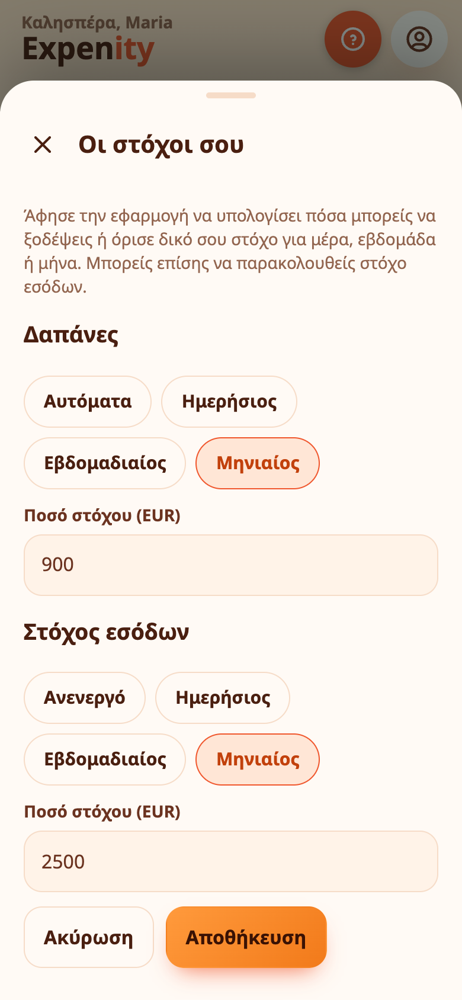

# Ημερήσιο ποσό, στόχοι και σερί

Το Expenity σκέφτεται λίγο για σένα. Αυτοί οι βοηθοί μετατρέπουν τις εγγραφές σας σε κάτι που μπορείτε να χρησιμοποιήσετε σήμερα.

## Μπορείτε να ξοδέψετε σήμερα

Η κάρτα **ημερήσιου ποσού** στην Αρχική απαντά σε μία ερώτηση: πόσα μπορώ να ξοδέψω σήμερα χωρίς άγχος; Ξεκινά από το υπόλοιπό σας, αφαιρεί τους λογαριασμούς μέχρι το επόμενο έσοδο, τους προϋπολογισμούς και όποιο απόθεμα έχετε ορίσει και μοιράζει ό,τι μένει στις επόμενες μέρες. Ο κύκλος αδειάζει όσο ξοδεύετε. Πατήστε το βέλος για την πλήρη ανάλυση ή ανοίξτε τις λεπτομέρειες του **Ασφαλές για δαπάνη**.

## Ορίστε δικούς σας στόχους

Το αυτόματο ποσό είναι πρόταση. Πατήστε το **μολύβι** στην κάρτα για να ορίσετε δικό σας.

- **Δαπάνες:** κρατήστε το **Αυτόματα** ή διαλέξτε **Ημερήσιο**, **Εβδομαδιαίο** ή **Μηνιαίο** στόχο και ποσό. Η κάρτα δείχνει τότε πόσα απομένουν για εκείνη την περίοδο ή πόσο το ξεπεράσατε. Οι εβδομάδες τρέχουν από Δευτέρα έως Κυριακή.
- **Στόχος εσόδων:** προαιρετικός. Διαλέξτε ημερήσιο, εβδομαδιαίο ή μηνιαίο και ποσό και μια μπάρα δείχνει τι έχετε εισπράξει μέχρι τώρα, με «Ο στόχος επιτεύχθηκε» όταν φτάσετε.

Οι στόχοι αποθηκεύονται με τις ρυθμίσεις σας, άρα ακολουθούν τις άλλες συσκευές σας. Μετρούν έξοδα και έσοδα στο βασικό σας νόμισμα και τα χρήματα που πάνε σε στόχους αποταμίευσης δεν μετρούν ως δαπάνη.

{{tut:daily}}

## Σερί

Η φλόγα μετρά **διαδοχικές μέρες εντός προϋπολογισμού**. Αν δεν έχετε προϋπολογισμούς, μετρά μέρες που δεν ξοδέψατε τίποτα. Οι επτά τελείες δείχνουν την τελευταία εβδομάδα και το Expenity κρατά το καλύτερο σερί σας και τις μέρες χωρίς έξοδα του μήνα. Ξεπέρασε το όριο μία φορά και η φλόγα μηδενίζεται: ξεκινήστε ξανά αύριο.

{{tut:streak}}

## Φρουρός διπλότυπων

Πριν αποθηκεύσει ένα έξοδο ή έσοδο, το Expenity ελέγχει τις τελευταίες μέρες για πανομοιότυπη εγγραφή: ίδιο όνομα, ποσό και πορτοφόλι. Αν βρει, σταματά και σας δείχνει τι βρήκε, με την ημερομηνία. Διαλέξτε **Προσθήκη ούτως ή άλλως** αν είναι αληθινή ή ακυρώστε.

{{tut:dup}}

## Ειδοποιήσεις αύξησης τιμής

Όταν πληρώνετε έναν λογαριασμό και το ποσό είναι μεγαλύτερο από την προηγούμενη πληρωμή, το Expenity σας λέει κατά πόσο και ένα μικρό κόκκινο σήμα όπως **+12%** μένει στον λογαριασμό για να τον ελέγξετε. Συγκρίνει πληρωμές που έχετε καταγράψει, άρα οι μεταβλητοί λογαριασμοί όπως το ρεύμα είναι ακριβώς εκεί που βοηθά.

{{tut:price}}

## Ενεργοποίηση και απενεργοποίηση

Το ημερήσιο ποσό, ο φρουρός διπλότυπων και οι ειδοποιήσεις τιμής ανήκουν στο **Pro** και τα σερί στο **Προχωρημένο**. Δείτε [Λειτουργίες και πακέτα](features-and-plans.md).
