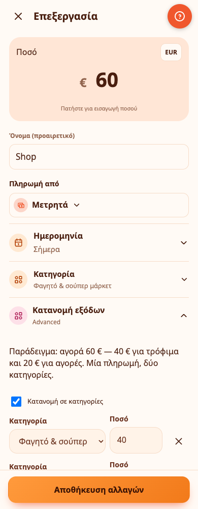
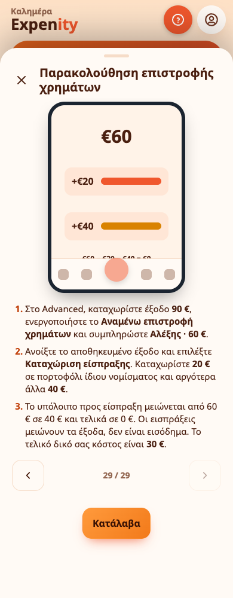

# Κατανομή εξόδων και επιστροφές χρημάτων από τρίτους

Οι δύο λειτουργίες περιλαμβάνονται στο **Advanced**. Μπορείτε επίσης να τις ενεργοποιήσετε ξεχωριστά σε ένα **Custom** σύνολο από Περισσότερα → Δυνατότητες. Είναι δωρεάν· δεν πρόκειται για συνδρομές. Η απενεργοποίησή τους δεν διαγράφει εγγραφές ούτε αλλάζει τους υπολογισμούς.

## Μία πληρωμή, περισσότερες κατηγορίες

Παράδειγμα: πληρώνετε **60 €** στο σουπερμάρκετ: **40 €** για τρόφιμα και **20 €** για άλλες αγορές.

1. Προσθέστε έξοδο με ολόκληρο το ποσό των **60 €**, το πορτοφόλι και την ημερομηνία.
2. Ανοίξτε την **Κατανομή εξόδων** και ενεργοποιήστε την **Κατανομή σε κατηγορίες**.
3. Συμπληρώστε **Φαγητό & σούπερ μάρκετ · 40 €** και **Αγορές · 20 €**. Προσθέστε ή αφαιρέστε γραμμές κατηγοριών, αν χρειάζεται.
4. Αποθηκεύστε. Κάθε ποσό πρέπει να είναι θετικό και το άθροισμα ακριβώς 60 €. Ακόμη και διαφορά ενός λεπτού εμποδίζει την αποθήκευση.

Το πορτοφόλι χρεώνεται **μία φορά με 60 €**. Στις Κινήσεις εμφανίζεται ένα έξοδο με ένδειξη κατανομής. Ανοίξτε το για να δείτε τα επιμέρους ποσά. Αναφορές και προϋπολογισμοί υπολογίζουν 40 € και 20 € στις αντίστοιχες κατηγορίες. Η απόδειξη, η φωτογραφία και οι ετικέτες ανήκουν σε ολόκληρη την πληρωμή. Αλλάξτε την κατανομή από την επεξεργασία του αρχικού εξόδου.

Η **Δοκιμή παραδείγματος** αλλάζει το ποσό και τις κατηγορίες μόνο στο πρόχειρο. Τίποτα δεν αποθηκεύεται αυτόματα. Η κατανομή αφορά καταχωρισμένα έξοδα: για προγραμματισμένο λογαριασμό, καταχωρίστε πρώτα την πληρωμή και μετά επεξεργαστείτε το έξοδο. Δεν δημιουργούνται ξεχωριστές επαναλήψεις.

> 💡 **Παράδειγμα από την καθημερινότητα** Μια απόδειξη σούπερ μάρκετ των 86 € περιλαμβάνει 60 € τρόφιμα, 16 € είδη καθαρισμού και 10 € τροφή κατοικιδίων. Η Μαρία την κατανέμει σε τρεις κατηγορίες με μία πληρωμή από το πορτοφόλι της και κάθε αναφορά δείχνει τη σωστή κατηγορία.

## Παρακολουθήστε όσα σας οφείλονται

Πρόκειται για χρήματα που πληρώσατε για λογαριασμό κάποιου προσώπου ή οργανισμού. Δεν είναι επιστροφή από κατάστημα ούτε μισθός.

Παράδειγμα: πληρώνετε **90 €** για δείπνο. Ο Αλέξης σάς οφείλει **60 €**. Το τελικό δικό σας κόστος θα είναι **30 €**.

1. Προσθέστε το έξοδο των 90 €. Ανοίξτε τις **Επιστροφές χρημάτων από τρίτους**, ενεργοποιήστε το **Αναμένω επιστροφή χρημάτων** και συμπληρώστε **Αλέξης · 60 €**. Αποθηκεύστε.
2. Όταν λάβετε 20 €, ανοίξτε το αρχικό έξοδο και επιλέξτε **Καταχώριση είσπραξης**. Ελέγξτε ποσό, πορτοφόλι και ημερομηνία πριν επιβεβαιώσετε.
3. Το πορτοφόλι αυξάνεται κατά 20 € και εμφανίζονται **Εισπράχθηκαν 20 € · Υπόλοιπο προς είσπραξη 40 €**.
4. Καταχωρίστε τα υπόλοιπα 40 € μόνο όταν τα λάβετε. Το ανεξόφλητο υπόλοιπο μηδενίζεται.

Δείτε όλες τις εκκρεμότητες από **Κινήσεις → Ποσά που σας οφείλονται**. Τα αναμενόμενα χρήματα δεν αυξάνουν το υπόλοιπο του πορτοφολιού ούτε το διαθέσιμο ποσό για δαπάνες. Η είσπραξη μπορεί να γίνει σε άλλο επεξεργάσιμο πορτοφόλι ίδιου νομίσματος, στο ίδιο πλαίσιο κοινής χρήσης. Δεν γίνεται αυτόματη μετατροπή νομίσματος. Κάθε νέα είσπραξη περιορίζεται στο υπόλοιπο που γνωρίζει εκείνη τη στιγμή η συσκευή.

Οι εισπράξεις εμφανίζονται στις Κινήσεις ως συνδεδεμένες εγγραφές. Από το **Ιστορικό εισπράξεων** του αρχικού εξόδου μπορείτε να αφαιρέσετε μια λανθασμένη είσπραξη: το ποσό αφαιρείται από το πορτοφόλι και εμφανίζεται ξανά ως οφειλόμενο. Οι υπάρχουσες επιλογές αναίρεσης και ανάκτησης παραμένουν διαθέσιμες. Δεν μπορείτε να μειώσετε το αναμενόμενο ποσό κάτω από όσα έχουν ήδη εισπραχθεί.

> 💡 **Παράδειγμα από την καθημερινότητα** Ο Νίκος πληρώνει 120 € για ένα δείπνο της ομάδας και οι συνάδελφοί του του οφείλουν 90 €. Παρακολουθεί όσα του οφείλονται και, όσο τον εξοφλούν, στα έξοδά του μένει μόνο το δικό του μερίδιο.

## Αναφορές, ημερομηνίες και ασφάλεια δεδομένων

Οι εισπράξεις εμφανίζονται στις αναφορές ως **μείωση εξόδων την ημέρα είσπραξης**, όχι ως εισόδημα. Αν το έξοδο έχει κατανομή, η μείωση επιμερίζεται αναλογικά στις κατηγορίες· τυχόν διαφορά στρογγυλοποίησης αποδίδεται στην τελευταία κατηγορία. Είσπραξη σε επόμενο μήνα μειώνει τα έξοδα εκείνου του μήνα. Μπορεί επομένως να προκύψει αρνητικό καθαρό έξοδο για μια περίοδο, ορατό στους πίνακες.

Αν αφαιρέσετε το αρχικό έξοδο, οι ήδη καταχωρισμένες εισπράξεις δεν διαγράφονται. Διατηρούν τις κατηγορίες τους και εμφανίζεται σχετική εξήγηση. Ανακτήστε το αρχικό έξοδο από τα πρόσφατα διαγραμμένα, όπου είναι διαθέσιμο.

Τα αντίγραφα JSON διατηρούν κατανομές, αναμενόμενα ποσά και συνδέσεις εισπράξεων. Το CSV κινήσεων περιλαμβάνει τα πρόσθετα στοιχεία, ενώ το CSV αναφορών δείχνει την κατανομή ανά κατηγορία. Ισχύουν ο υπάρχων συγχρονισμός και η λειτουργία χωρίς σύνδεση. Ταυτόχρονες εισπράξεις από δύο συσκευές χωρίς σύνδεση μπορεί, μετά τον συγχρονισμό, να ξεπεράσουν το αναμενόμενο ποσό. Ελέγξτε το ιστορικό και αφαιρέστε τυχόν λανθασμένη εγγραφή. Η εφαρμογή δεν απορρίπτει σιωπηρά μια καταχωρισμένη είσπραξη.

Κινούμενα παραδείγματα υπάρχουν στους **Οδηγούς** και στην αρχική ρύθμιση Advanced. Τηρούνται οι προτιμήσεις κίνησης.

