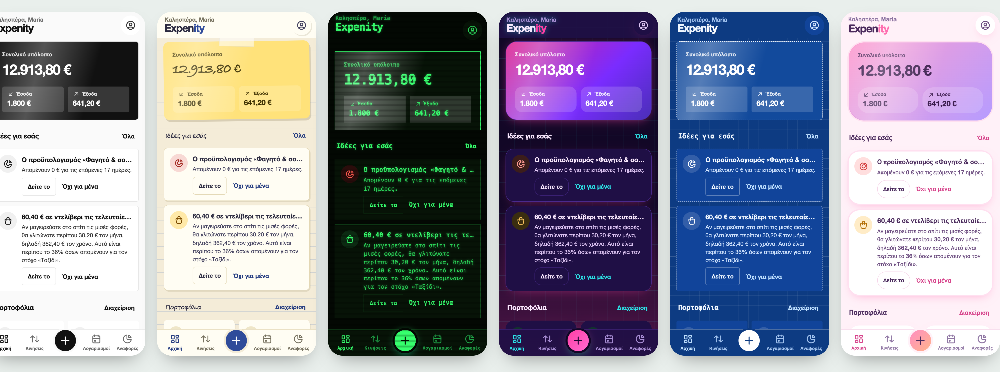
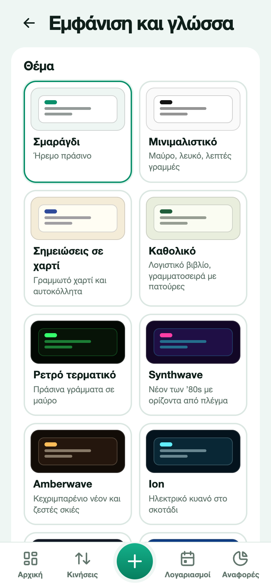
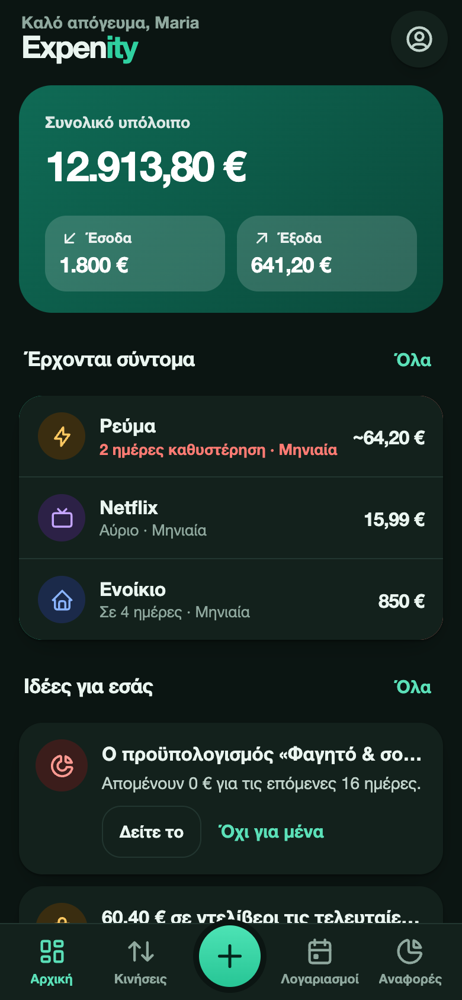
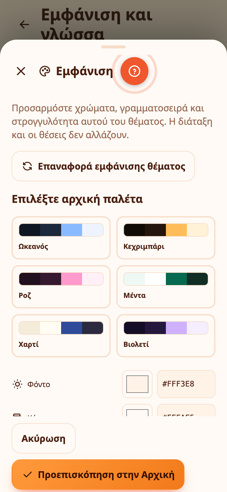

# Θέματα και κινούμενα εφέ

Το Expenity έχει δεκαοχτώ θέματα και κάθε ένα έχει ένα μολύβι για να προσαρμόσετε χρώματα, γραμματοσειρά και στρογγυλότητα. Ένα θέμα αλλάζει περισσότερα από το χρώμα: σχήματα, γραμματοσειρές, περιγράμματα και μικρές λεπτομέρειες. Διαλέξτε ένα στο **Περισσότερα → Εμφάνιση και γλώσσα**, ή κατά τη ρύθμιση.

| Θέμα | Εμφάνιση |
|---|---|
| **Σμαράγδι** | Το προεπιλεγμένο: φρέσκο πράσινο, απαλές κάρτες |
| **Μινιμαλιστικό** | Μαύρο, λευκό και λεπτές γραμμές |
| **Σημειώσεις σε χαρτί** | Γραμμωτό χαρτί, χειρόγραφα γράμματα, αυτοκόλλητο για το υπόλοιπό σας |
| **Καθολικό** | Λογιστικό βιβλίο, γραμματοσειρά με πατούρες, διπλές γραμμές |
| **Ρετρό τερματικό** | Πράσινα γράμματα σε μαύρο, γραμματοσειρά τερματικού, γραμμές σάρωσης |
| **Synthwave** | Νέον ροζ και κυανό με ορίζοντα από πλέγμα |
| **Σχέδιο μηχανικού** | Λευκές γραμμές σε μπλε χαρτί σχεδίασης |
| **Γλυκό παστέλ** | Απαλό, στρογγυλό και παιχνιδιάρικο |
| **Μεσάνυχτα** | Πραγματικό μαύρο για οθόνες OLED |
| **Γυαλί** | Θολωτές κάρτες σε απαλή διαβάθμιση |
| **Ηλιοβασίλεμα** | Ζεστά πορτοκαλιά και κοραλλί |
| **Πίνακας κιμωλίας** | Κιμωλία σε σκούρο πράσινο πίνακα |

Το **Σμαράγδι** και το **Μινιμαλιστικό** έχουν επίσης φωτεινή και σκούρα εκδοχή. Διαλέξτε **Όπως η συσκευή**, **Φωτεινό** ή **Σκούρο** κάτω από τις κάρτες των θεμάτων. Τα υπόλοιπα θέματα κρατούν τη δική τους εμφάνιση.

## Κινούμενα εφέ

Το Expenity κινείται λίγο. Η κάρτα υπολοίπου στην Αρχική **γυρίζει** όταν την πατάτε και δείχνει συνοπτικά τον μήνα. Οι αριθμοί ανεβαίνουν, οι γραμμές και τα πορτοφόλια εμφανίζονται το ένα μετά το άλλο, οι μπάρες, οι κύκλοι και οι φέτες σχεδιάζονται μόνες τους, μια γραμμή που διαγράφετε σβήνει σταδιακά, η καρτέλα που πατάτε αναπηδά και όταν πετύχετε έναν στόχο πέφτει κομφετί. Στα **Κινούμενα εφέ** μπορείτε να επιλέξετε:

- **Όπως η συσκευή**: ακολουθεί τη ρύθμιση «μείωση κίνησης» της συσκευής σας.
- **Πλήρη**: όλα τα εφέ.
- **Μειωμένα**: πολύ σύντομη εκδοχή του καθενός.
- **Κλειστά**: καθόλου εφέ.

Το θέμα, το φωτεινό ή σκούρο και τα κινούμενα εφέ θυμούνται ξεχωριστά σε κάθε συσκευή. Το ίδιο και η γλώσσα: αλλάξτε την όποτε θέλετε στο Περισσότερα → Εμφάνιση και γλώσσα ή από την οθόνη υποδοχής.

## Amberwave, Ion και η δική σας παλέτα

Το Amberwave συνδυάζει κεχριμπαρένιο νέον με ζεστές σκιές. Το Ion χρησιμοποιεί ηλεκτρικό κυανό σε βαθύ μπλε. Μαζί με το Synthwave έχουν αραιές φωτεινές κουκκίδες με λεπτές γραμμές. Το εφέ σταματά όταν η εφαρμογή κρύβεται και ακολουθεί τις ρυθμίσεις μειωμένης ή κλειστής κίνησης.

Επιλέξτε **Το θέμα σας → Δημιουργήστε το θέμα σας** για χρώματα φόντου, καρτών, έμφασης και κειμένου, γωνίες και γραμματοσειρά. Το κείμενο πρέπει να έχει επαρκή αντίθεση και στα δύο φόντα. Οι φωτεινές γραμμές είναι προαιρετικές. Το δικό σας θέμα αποθηκεύεται ανά συσκευή.

Η κίνηση του υπολοίπου ξεκινά στο άνοιγμα και στην αλλαγή οθόνης, μένει μεταξύ μηδενός και πραγματικού ποσού και καταλήγει στην ακριβή τιμή.

## Προσαρμόστε οποιοδήποτε θέμα με το μολύβι

Κάθε κάρτα θέματος έχει ένα μικρό **μολύβι**. Πατήστε το για να αλλάξετε τα **χρώματα, τη γραμματοσειρά και τη στρογγυλότητα** του θέματος. Η διάταξη και οι θέσεις δεν αλλάζουν ποτέ, μόνο η εμφάνιση, και οι αλλαγές αποθηκεύονται αμέσως για εκείνο το θέμα. Το παλιό ξεχωριστό προσαρμοσμένο θέμα αντικαταστάθηκε από αυτό.

{{tut:themes}}

## Γραμματοσειρές

Οι γραμματοσειρές συνοδεύουν την εφαρμογή, ώστε να φαίνεται ίδια σε κάθε κινητό, tablet και υπολογιστή, με πλήρη υποστήριξη ελληνικών.

## Η εικόνα σας και οι ήχοι

Διαλέξτε έναν χαρακτήρα ή τη δική σας φωτογραφία ως εικόνα σας: δείτε [Αποδείξεις, φωτογραφίες και η εικόνα σας](receipts-and-photos.md). Προαιρετικά ηχητικά εφέ ενεργοποιούνται στο **Περισσότερα → Κάν’ το δικό σας → Ήχοι** (μέρος του Προχωρημένου πακέτου).

## Δοκιμάστε τα θέματα ζωντανά

Ο [ιστότοπος του Expenity](https://expenity.github.io/expenity/el/#try) έχει την πραγματική εφαρμογή σε πλαίσιο iPhone, iPad και υπολογιστή, ώστε να αλλάζετε θέματα και να τα βλέπετε σε δράση πριν ανοίξετε την εφαρμογή.
