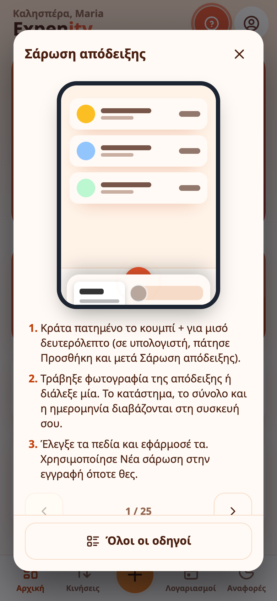
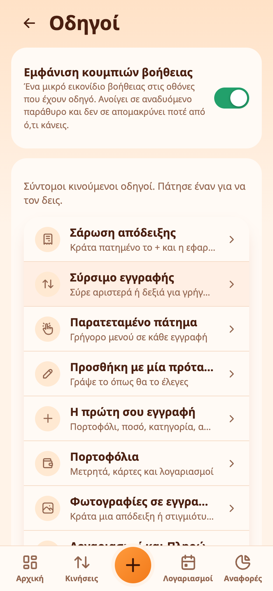
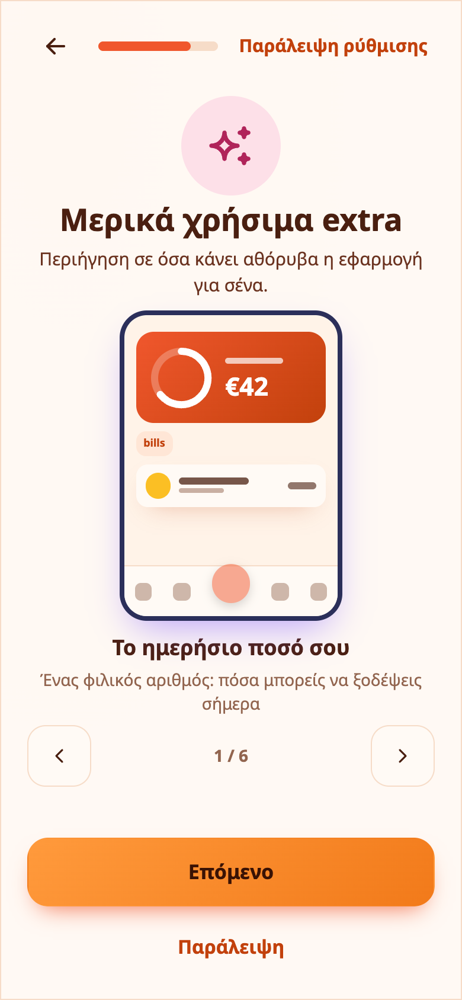
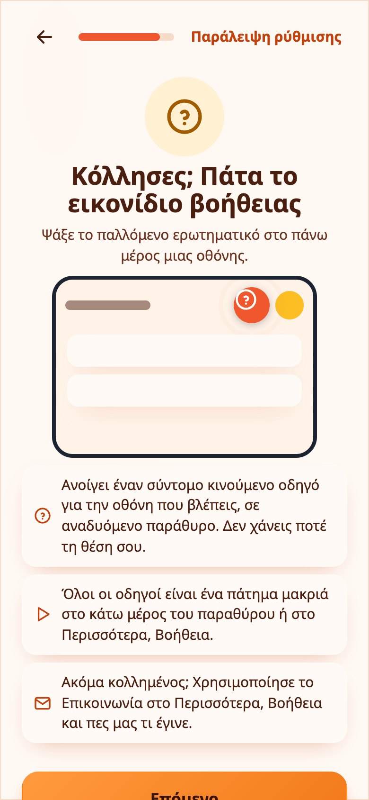

# Οδηγοί και βοήθεια

Το Expenity μαθαίνεται μόνο του. Κάθε λειτουργία έχει έναν σύντομο **κινούμενο οδηγό** που μπορείτε να δείτε όποτε θέλετε και ένα μικρό **εικονίδιο βοήθειας** που ανοίγει τον σωστό χωρίς να σε απομακρύνει από ό,τι κάνετε.

## Το εικονίδιο βοήθειας

Στις οθόνες που έχουν οδηγό θα δείτε ένα στρογγυλό, παλλόμενο **;** στο πάνω μέρος της οθόνης (και στην κεφαλίδα των παραθύρων, όπως η φόρμα εγγραφής). Κουνιέται σαν καμπανάκι κάθε λίγα δευτερόλεπτα, ώστε να φαίνεται εύκολα.

Πατήστε το και ο οδηγός ανοίγει σε **αναδυόμενο παράθυρο πάνω από την οθόνη σας**. Τίποτα δεν κλείνει και τίποτα δεν χάνεται: αν ήσασταν στη μέση ενός εξόδου, είναι ακόμα εκεί όταν κλείσετε το παράθυρο. Στο κάτω μέρος μπορείτε να:

- ανοίξετε **Όλοι οι οδηγοί** και να διαλέξετε άλλον χωρίς να φύγετε από το παράθυρο, ή να τους περάσετε με τα βέλη·
- διαλέξετε **Να μην εμφανιστεί ξανά αυτό το εικονίδιο βοήθειας**. Αυτό κρύβει το εικονίδιο μόνο σε εκείνη την οθόνη. Οι άλλες οθόνες κρατούν το δικό τους μέχρι να τα κρύψετε κι αυτά.

> 💡 **Παράδειγμα από την καθημερινότητα** Κολλημένη στα φίλτρα, η Μαρία πατά το εικονίδιο βοήθειας που πάλλεται και βλέπει τη σύντομη κινούμενη εικόνα χωρίς να φύγει από την οθόνη της.

## Ενεργοποίηση και απενεργοποίηση εικονιδίων

Στο **Περισσότερα → Βοήθεια → Εικονίδια βοήθειας** υπάρχει ένας διακόπτης για όλα τα εικονίδια, ένας για κάθε οθόνη και το **Εμφάνιση όλων των εικονιδίων βοήθειας ξανά** για να επανέλθουν όλα. Ο ίδιος κεντρικός διακόπτης υπάρχει και στη σελίδα Οδηγοί.

## Η σελίδα Οδηγοί

Στο **Περισσότερα → Βοήθεια → Οδηγοί** βλέπετε όλους τους οδηγούς με μια σύντομη περιγραφή. Οι νέοι έχουν ετικέτα **ΝΕΟ**. Ανοίξτε έναν για να τον δείτε σε επανάληψη, διαβάστε τα τρία βήματα από κάτω και χρησιμοποιήστε τα βέλη για να τους δείτε όλους με τη σειρά.

Οι οδηγοί καλύπτουν σάρωση αποδείξεων, σύρσιμο γραμμών, παρατεταμένο πάτημα, προσθήκη με μία πρόταση, την πρώτη σας εγγραφή, πορτοφόλια, λογαριασμούς, επαναλαμβανόμενα έσοδα, προϋπολογισμούς και στόχους, αναφορές, ειδοποιήσεις, θέματα και μολύβι, λειτουργίες και πακέτα, εικόνα προφίλ, επεξεργασία Αρχικής, φρουρό διπλότυπων, ημερήσιο ποσό, αναζήτηση και φίλτρα, πρόσφατα διαγραμμένα, σερί, ειδοποιήσεις αύξησης τιμής, φωτογραφίες σε εγγραφές, συγχρονισμό, κοινά πορτοφόλια και αντίγραφο ασφαλείας με επαναφορά λογαριασμού.

## Η περιήγηση καλωσορίσματος

Η πρώτη ρύθμιση περιλαμβάνει κινούμενα βήματα για όσα ρωτούν οι περισσότεροι: σάρωση απόδειξης, προσθήκη εγγραφής με μία πρόταση, μερικά χρήσιμα extra και το ίδιο το εικονίδιο βοήθειας.

Μπορείτε να την παραλείψετε ή να την ξαναδείς από τη σελίδα Οδηγοί: **Επανάληψη της περιήγησης καλωσορίσματος**.

## Μενού δεξιού κλικ

Σε υπολογιστή, κάντε δεξί κλικ σε μια εγγραφή ή σε έναν λογαριασμό για να εμφανιστεί ένα μικρό μενού με **Επεξεργασία**, **Διπλασιασμός** και **Διαγραφή** (και **Πληρωμένο** για λογαριασμό). Κάντε δεξί κλικ σε κενό χώρο για να προσθέσετε **Έξοδο**, **Έσοδο** ή **Λογαριασμό**, ή για να ανοίξετε την **Αναζήτηση** ή τις **Αναφορές**. Τα πεδία κειμένου κρατούν το μενού του browser και το ίδιο συμβαίνει αν κρατήσετε πατημένο το **Shift** ενώ κάνετε δεξί κλικ. Απενεργοποιήστε το μενού από **Περισσότερα → Προσαρμογή εφαρμογής → Λειτουργίες**.

## Τι νέο υπάρχει

Μετά από μια ενημέρωση, ένα μικρό παράθυρο δείχνει τι άλλαξε. Πατήστε **Κατάλαβα** για να κλείσει ή **Δείτε τις αλλαγές** για την πλήρη λίστα.

## Κολλήσατε ακόμα;

Χρησιμοποιήστε το **Περισσότερα → Βοήθεια → Επικοινωνία**. Δείτε [Επικοινωνία](contact-us.md).

Για κατανομή ποσών ανά κατηγορία, τμηματικές εισπράξεις και αναλυτικά παραδείγματα, δείτε την [κατανομή εξόδων και τις επιστροφές χρημάτων από τρίτους](split-expenses-and-reimbursements.md).
