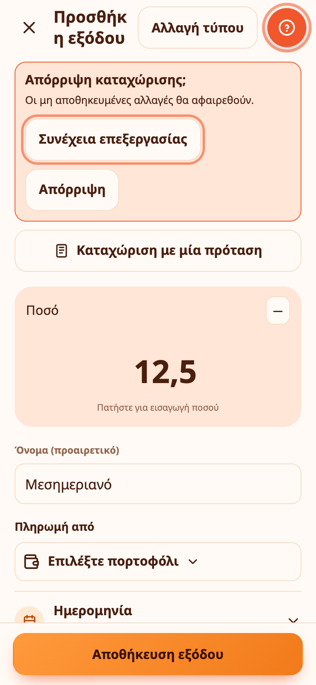

# Πορτοφόλια και νομίσματα

Πορτοφόλι είναι ένα μέρος όπου βρίσκονται χρήματα: μετρητά, τραπεζικός λογαριασμός, κάρτα, λογαριασμός αποταμίευσης. Κάθε κίνηση ανήκει σε ένα πορτοφόλι και το υπόλοιπό του είναι το αρχικό υπόλοιπο συν τα έσοδα, μείον τα έξοδα, με τις μεταφορές προς και από αυτό.

## Προσθήκη και επεξεργασία πορτοφολιών

Ανοίξτε **Περισσότερα → Πορτοφόλια** ή πατήστε ένα πορτοφόλι στην Αρχική. Κάθε πορτοφόλι έχει όνομα, τύπο (μετρητά, τραπεζικός λογαριασμός, κάρτα, αποταμίευση, άλλο), νόμισμα και **αρχικό υπόλοιπο**, δηλαδή όσα είχε όταν ξεκινήσατε. Μπορείτε να αρχειοθετήσετε ένα πορτοφόλι για να το κρύψετε. Αν ένα πορτοφόλι έχει ήδη κινήσεις, αρχειοθετείται αντί να διαγραφεί, ώστε να μη χαθεί το ιστορικό.

> 💡 **Παράδειγμα από την καθημερινότητα** Η Μαρία έχει ένα πορτοφόλι Μετρητά, ένα Τράπεζα και ένα Αποταμίευση, το καθένα με τα χρήματα που πράγματι έχει, ώστε κάθε πληρωμή να καταγράφεται στο σωστό.

## Το βασικό σας νόμισμα

Διαλέγετε **βασικό νόμισμα** στη ρύθμιση και μπορείτε να το αλλάξετε στο **Περισσότερα → Υπενθυμίσεις και ημερολόγιο → Κύριο νόμισμα**. Τα σύνολα στην Αρχική και στις Αναφορές εμφανίζονται σε αυτό.

> 💡 **Παράδειγμα από την καθημερινότητα** Η Δήμητρα ζει στην Ελλάδα και ορίζει το ευρώ ως κύριο νόμισμα, ώστε τα σύνολα και οι αναφορές να είναι πάντα σε ευρώ.

## Πορτοφόλια σε άλλα νομίσματα

Ένα πορτοφόλι μπορεί να έχει οποιοδήποτε νόμισμα. Ένας λογαριασμός ή μια κίνηση παίρνει το νόμισμα του πορτοφολιού της. Όταν τα πορτοφόλια σας έχουν πολλά νομίσματα, τα σύνολα μετατρέπονται στο βασικό σας νόμισμα με καθημερινές ισοτιμίες και εμφανίζονται με **≈**, για να φαίνεται ότι είναι κατά προσέγγιση. Το Expenity δεν προσθέτει ποτέ διαφορετικά νομίσματα σαν απλούς αριθμούς.

Οι ισοτιμίες είναι οι τιμές αναφοράς της Ευρωπαϊκής Κεντρικής Τράπεζας και φορτώνονται μέσω του API του Expenity μία φορά την ημέρα. Ζητούνται μόνο οι δημόσιες ισοτιμίες: δεν στέλνεται τίποτα για εσάς. Αν οι ισοτιμίες δεν φορτωθούν, τα άλλα νομίσματα εμφανίζονται σε ξεχωριστές γραμμές αντί να μετατραπούν.

> 💡 **Παράδειγμα από την καθημερινότητα** Ο Νίκος έχει ένα πορτοφόλι σε λίρες για ένα ταξίδι στο Λονδίνο. Όσα ξοδεύει εκεί καταγράφονται σε λίρες και μετατρέπονται σε ευρώ στα σύνολά του.

## Μεταφορές

Για να μετακινήσετε χρήματα μεταξύ πορτοφολιών, πατήστε **+** και επιλέξτε **Μεταφορά**. Αν τα δύο πορτοφόλια έχουν διαφορετικό νόμισμα, γράφετε και το ποσό που λήφθηκε. Οι μεταφορές δεν μετρούν ως έσοδα ή έξοδα.

## Χρήματα που έχετε βάλει στην άκρη για στόχους

Όταν προσθέτετε χρήματα σε έναν [στόχο](budgets-goals-income.md), αφαιρούνται από ένα πορτοφόλι της επιλογής σας και το υπόλοιπο του πορτοφολιού μειώνεται. Αυτά τα χρήματα δεν μετρούν ως έξοδα στις αναφορές και στους προϋπολογισμούς σας.

> 💡 **Παράδειγμα από την καθημερινότητα** Η Ελένη βάζει στην άκρη 50 € τον μήνα για έναν στόχο διακοπών. Ο κύκλος του στόχου γεμίζει ενώ τα χρήματα αυτά μένουν χωριστά από το καθημερινό της υπόλοιπο.

## Χρώματα πορτοφολιών

Κάθε πορτοφόλι έχει χρώμα. Από προεπιλογή ακολουθεί το θέμα σας: το πρώτο πορτοφόλι παίρνει το βασικό χρώμα του θέματος και τα υπόλοιπα προχωρούν γύρω από τον χρωματικό κύκλο, άρα αλλάζουν όταν αλλάξετε θέμα. Για να διαλέξετε δικό σας, ανοίξτε **Περισσότερα → Πορτοφόλια**, επιλέξτε ένα πορτοφόλι και διαλέξτε χρώμα (ή **Χρώμα θέματος** για να επιστρέψετε στο προεπιλεγμένο, ή το **+** για οποιοδήποτε χρώμα θέλετε).

> 💡 **Παράδειγμα από την καθημερινότητα** Η Άννα δίνει στην κάρτα εργασίας της μπλε χρώμα και στην προσωπική της πράσινο, ώστε να βλέπει με μια ματιά σε ποιο πορτοφόλι ανήκει κάθε εγγραφή.
