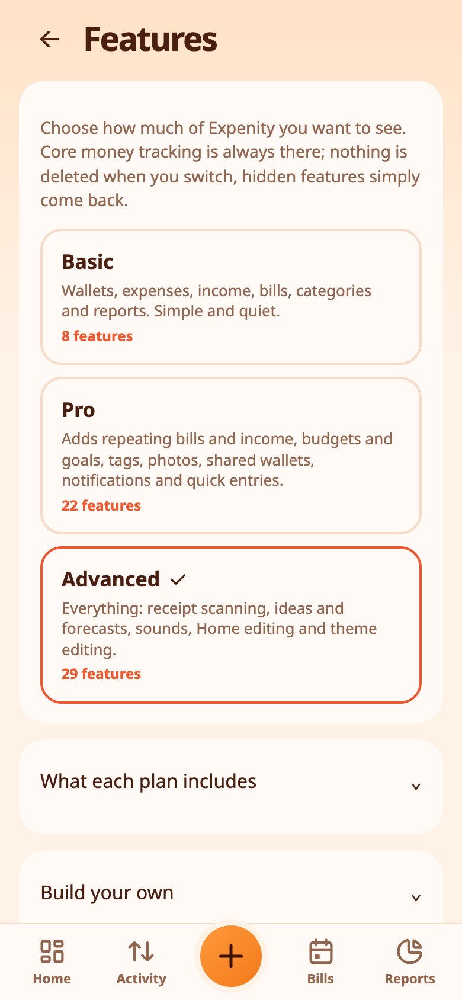
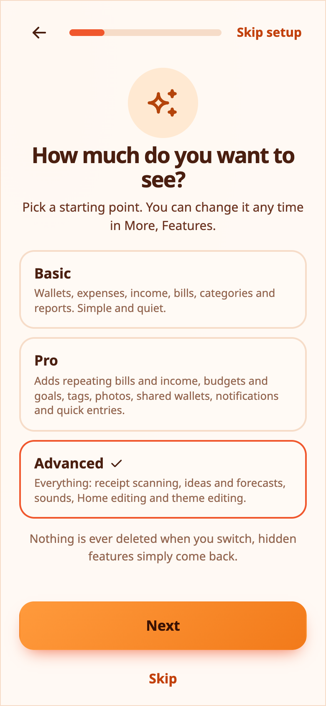

# Features and plans

Expenity does a lot. You decide how much of it you see. **More → Make it yours → Features** lets you pick a ready-made plan, compare them in a table, or build your own mix with toggles.

## The three plans

- **Basic**: wallets, expenses, income, bills, categories and reports. Simple and quiet.
- **Pro**: everything in Basic, plus repeating bills and income, budgets and goals, tags, quick entries, photos on entries, profile picture, notifications, shared wallets, the duplicate guard, the daily number, search filters, recently deleted, price-change alerts and draft reminders.
- **Advanced**: everything in Pro, plus split expenses, reimbursements, receipt scanning, ideas, safe to spend, sounds, Home editing, theme editing and streaks.

The first-run setup asks you to pick one, and **Advanced** is selected to start with, so nothing is hidden unless you choose to. Switching never deletes anything: a hidden feature simply disappears from the screens, and everything you entered comes back when you turn it on again.

> 💡 **Real-life example** A new user picks Basic to keep things simple and moves to Pro a month later, when budgets start to matter.

## All features by plan

<!-- features:start -->
Basic has **8** features, Pro **23** and Advanced **34**. A tick means the feature is included. In your own mix you can switch any optional feature on or off.

| Feature | Basic | Pro | Advanced |
|---|:-:|:-:|:-:|
| **Always included** | | | |
| Wallets | ✓ | ✓ | ✓ |
| Expenses, income and transfers | ✓ | ✓ | ✓ |
| Categories | ✓ | ✓ | ✓ |
| Bills with due dates | ✓ | ✓ | ✓ |
| Activity and search | ✓ | ✓ | ✓ |
| Reports | ✓ | ✓ | ✓ |
| Themes and languages | ✓ | ✓ | ✓ |
| Backup and export | ✓ | ✓ | ✓ |
| **Added in Pro** | | | |
| Repeating bills and income | – | ✓ | ✓ |
| Budgets and goals | – | ✓ | ✓ |
| Tags | – | ✓ | ✓ |
| Quick entries | – | ✓ | ✓ |
| Photos on entries | – | ✓ | ✓ |
| Profile picture | – | ✓ | ✓ |
| Notifications | – | ✓ | ✓ |
| Shared wallets | – | ✓ | ✓ |
| Draft reminders | – | ✓ | ✓ |
| Duplicate guard | – | ✓ | ✓ |
| Daily number | – | ✓ | ✓ |
| Search filters | – | ✓ | ✓ |
| Recently deleted | – | ✓ | ✓ |
| Price-change alerts | – | ✓ | ✓ |
| Right-click menu | – | ✓ | ✓ |
| **Added in Advanced** | | | |
| Split expenses | – | – | ✓ |
| Smart detection | – | – | ✓ |
| Reimbursements | – | – | ✓ |
| Receipt scanning | – | – | ✓ |
| Streaks | – | – | ✓ |
| Ideas | – | – | ✓ |
| Safe to spend | – | – | ✓ |
| Sounds | – | – | ✓ |
| Home editing | – | – | ✓ |
| eFriend | – | – | ✓ |
| Theme editing | – | – | ✓ |
<!-- features:end -->

## Compare and customise

- **What each plan includes** opens a table with a tick for every feature in every plan.
- **Build your own** has a toggle for every optional feature. Flip any of them and your plan becomes **Custom**.
- Some things are always on: wallets, expenses, income and transfers, categories, bills with due dates, Activity and search, Reports, themes and languages, and backup and export.

> 💡 **Real-life example** Elena likes everything in Advanced except sounds, so she switches that one feature off in her own mix. Nothing is deleted.

## Plans and tutorials

Tutorials and help icons follow your plan: a feature that is switched off has no tutorial and no help icon. See [Tutorials and help](tutorials-and-help.md).

## New in Advanced

[Split expenses and reimbursements](split-expenses-and-reimbursements.md) add category allocations and partial repayments, with animated examples in setup and Tutorials. [Smart detection](add-money.md#smart-detection-advanced) fills in the category, tags and wallet from what you type.
