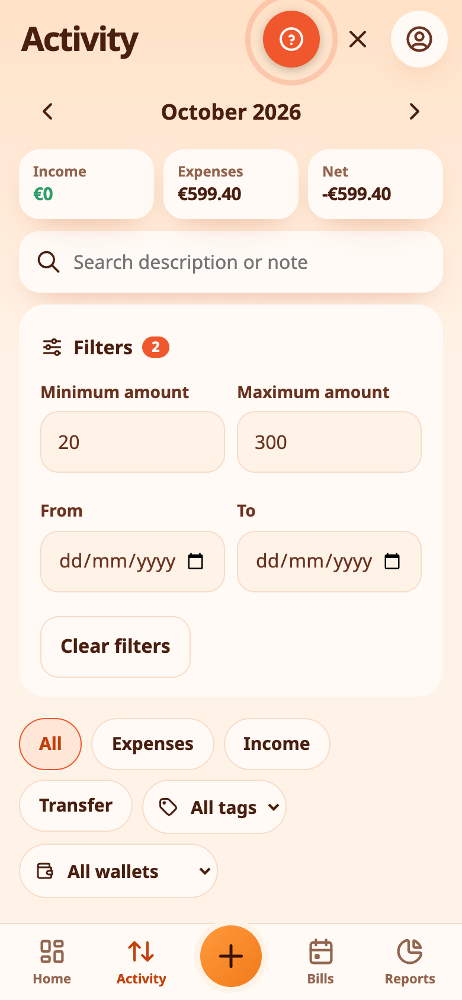
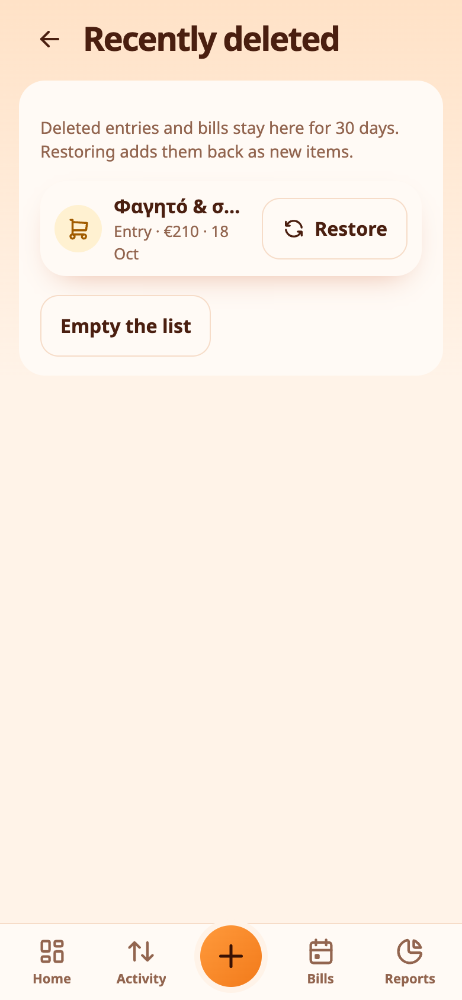
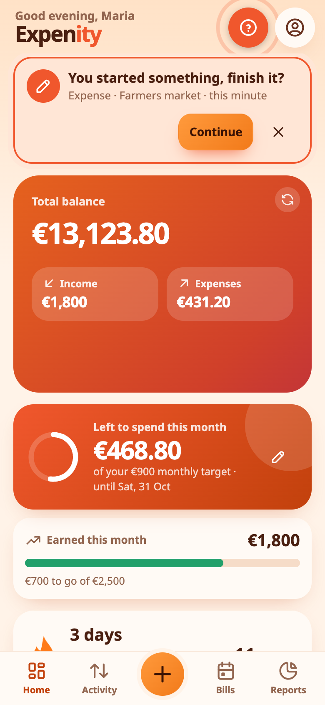

# Search, filters, drafts and recently deleted

## Search and filters

In **Activity**, tap the magnifier to search by name, note, tag or category. Under the search box, **Filters** narrows the list further:

- a **minimum and maximum amount**;
- a **date range**. When a range is set, the list covers those dates across months instead of one month at a time;
- a **tag**, and the type and wallet chips as before.

The number next to **Filters** shows how many are active, and **Clear filters** removes them all.

{{tut:filters}}

> 💡 **Real-life example** Looking for a payment, Kostas filters Activity to amounts over €100 in March and finds the dentist's bill in seconds.

## Recently deleted

Deleted an entry or bill by mistake? **More → Account & data → Recently deleted** keeps them for **30 days**. Tap **Restore** to bring one back. A restored item is added as a new one with the same details. You can also empty the list.

{{tut:trash}}

> 💡 **Real-life example** Dimitra deletes an entry by mistake. Within 30 days she restores it from Recently deleted.

## Drafts

Started an expense and your phone died, or you closed the app by accident? Expenity saves what you typed on your device as soon as you change anything, such as adding an amount. When you open the app, **Home points out the unfinished entry** with a **Continue** button, and you can dismiss it with the cross.

**More → Account & data → Drafts** lists every unfinished entry with **Continue** and **Dismiss**. Drafts stay for 24 hours and live only on the device where you started them. Continue opens the entry form with everything you had typed, ready to submit.

> 💡 **Real-life example** A phone call interrupts Nikos while he adds a payment. When he comes back, the unfinished entry is waiting for him.

## Reset account

If you want a completely clean slate, **More → Account and sync → Reset account** removes all your records, wallets, budgets, goals and photos and resets your settings, as if you had just joined. If you have an account, this happens on all your devices: each one is emptied the next time it syncs, and nothing comes back. Your account and passkeys stay. It asks for confirmation and a passkey, and you are taken through the setup again, starting with your name. The same card has a **Download a backup first** button. If you have shared wallets, Expenity shows what happens to each one. When you agree, you leave the wallets you joined and stop sharing the ones you own (the other people lose access), and then the reset continues. This cannot be undone, so [download a backup](privacy-and-your-data.md) first (the button is on the same card) if you might need your data.

> 💡 **Real-life example** Before a fresh start, Maria downloads a backup with Download a backup first and then resets her account. Every device of hers is emptied at its next sync, and her account and passkeys stay.
