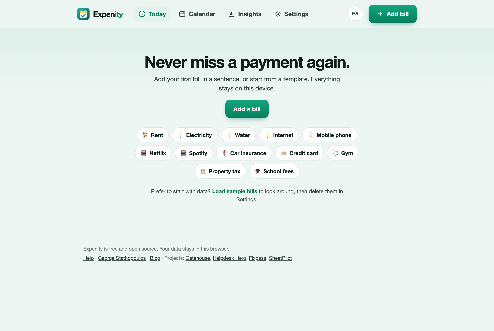
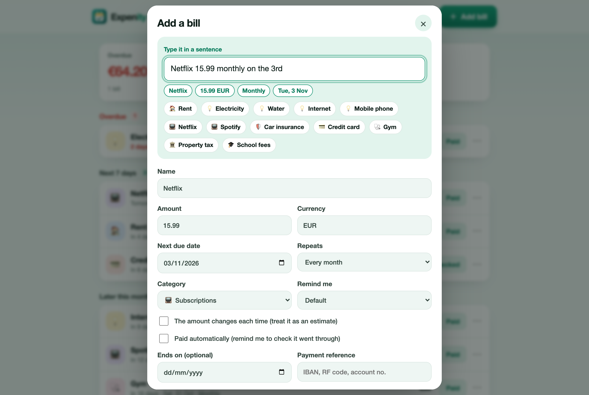
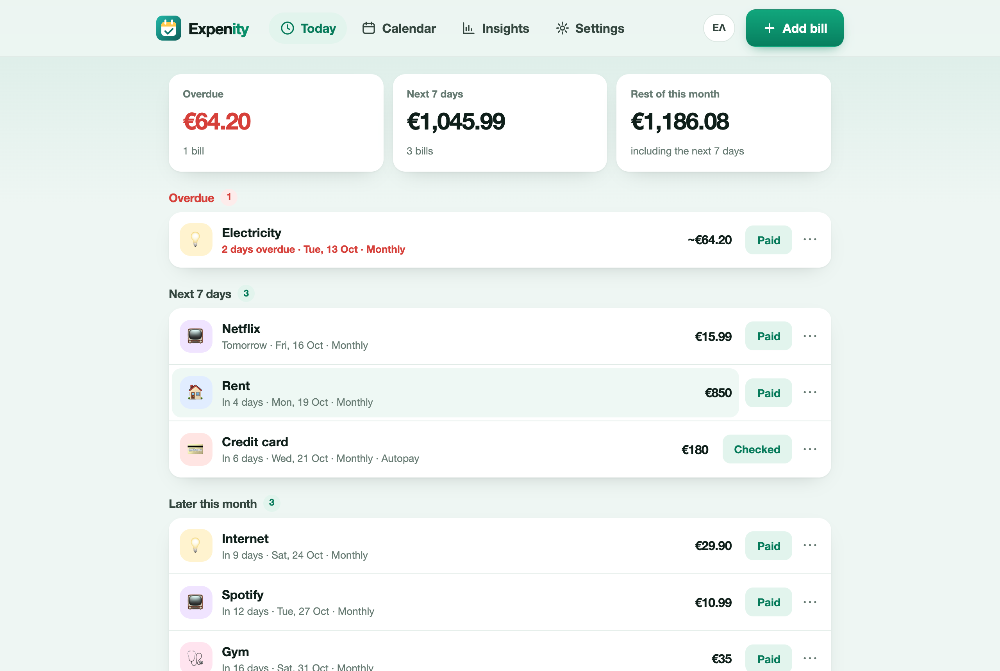

# Getting started

Expenity keeps your bills and subscriptions in one place and tells you what is coming up. This guide takes about two minutes.

## Open Expenity

Open the app at [expenity.github.io/expenity/app/](https://expenity.github.io/expenity/app/). There is nothing to install and no account to create. It works in any modern browser on a phone, tablet or computer. To keep it on your home screen like an app, see [Install on your device](install-on-your-device.md).

## Add your first bill

Press **Add bill**. You have three ways to start:

- **Type a sentence**, for example `Netflix 15.99 monthly on the 3rd`. The form below fills itself and the chips show what Expenity understood. [More examples](add-bills.md#type-a-sentence).
- **Pick a template** such as Rent, Electricity or Car insurance. It sets the name, category and how often it repeats. You add the amount.
- **Fill in the form** yourself.

Check the form and press **Save bill**. The bill appears on the Today screen.

If you want to look around first, press **Load sample bills** on the empty screen. You can delete them later with **Settings → Delete all my data**.

## The Today screen

Today shows three totals (overdue, the next 7 days, the rest of the month) and your bills grouped by when they are due. Overdue bills are red and come first.

On each bill:

- **Paid** records the payment and moves a repeating bill to its next date. [Mark paid](add-bills.md#mark-a-bill-paid).
- **⋯** opens snooze, skip, payment link, copy reference, edit and delete.
- Tapping the bill opens it for editing.

## Get reminded

Expenity reminds you in two ways, and it is worth setting up the second one: see [Reminders](reminders.md).

## Where to go next

- [Add bills](add-bills.md): sentences, templates, repeats and variable amounts
- [Reminders](reminders.md): notifications and the calendar file
- [Calendar and insights](calendar-and-insights.md): what is due, and what is coming
- [Privacy and your data](privacy-and-your-data.md): where your bills live and how to back them up
