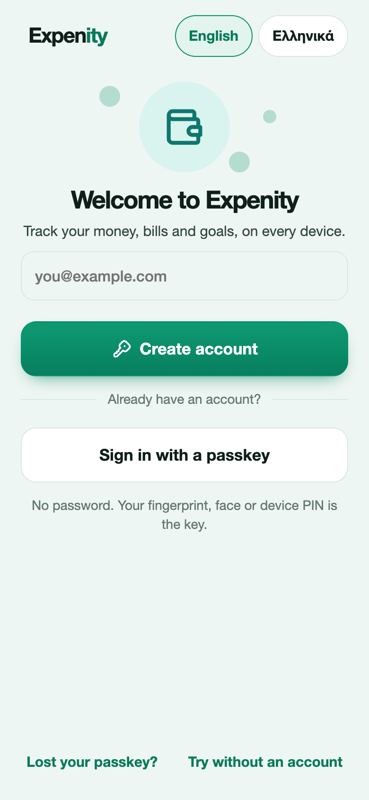
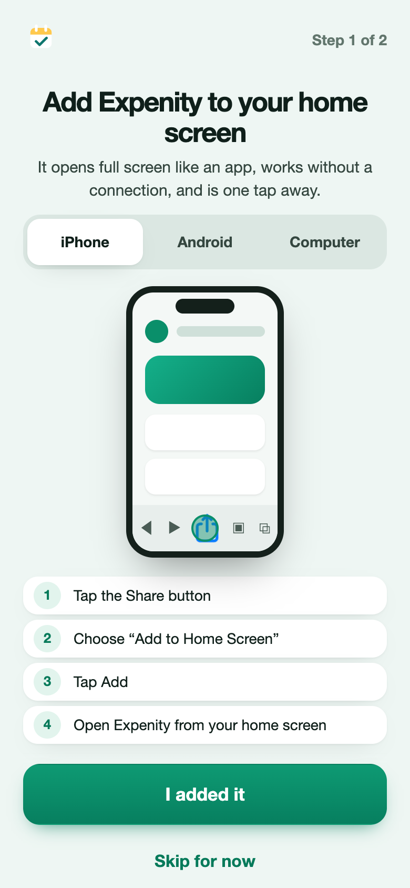
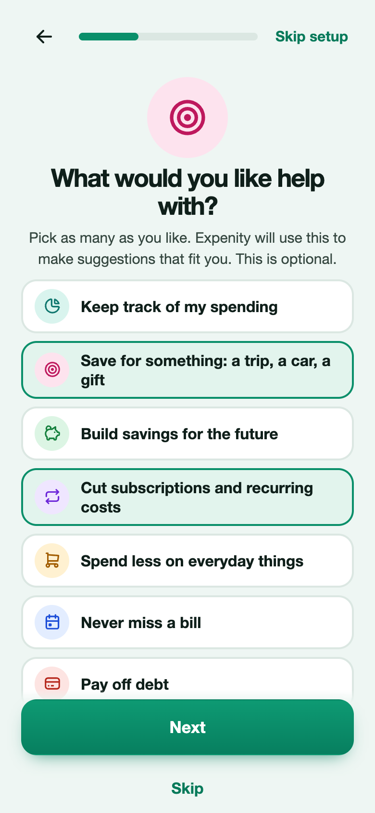
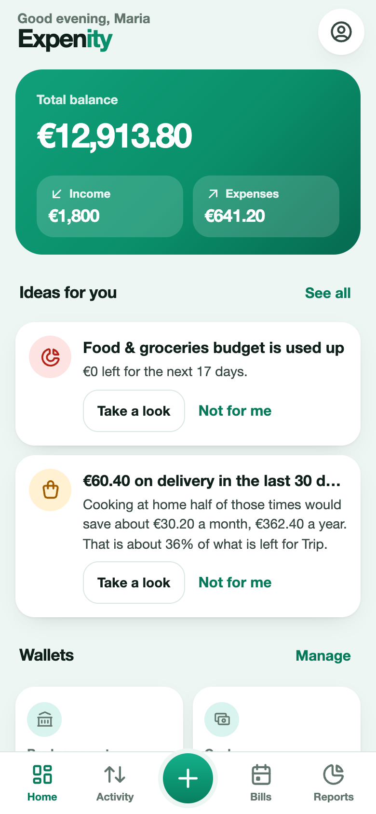

# Getting started

Expenity keeps your money, bills and goals in one place, on every device you use. This guide takes about five minutes, and every step after the account can be skipped.

## 1. Create an account (or sign in)

Open the app at [expenity.github.io/expenity/app/](https://expenity.github.io/expenity/app/). The first screen asks you to create an account or sign in. You use a **passkey**, which is your fingerprint, face or device PIN, so there is no password to remember or lose. Type your email, press **Create account**, and your device asks you to confirm.

Expenity then shows ten **recovery codes**. Save them somewhere safe. They are how you get back in if you lose your passkeys, and they are shown only once. See [Account and sync](account-and-sync.md).

Not ready for an account? Press **Try without an account**. Your data then stays in this browser only, and you can create an account later from **More**.

## 2. Add Expenity to your home screen

The next screen shows, with a short animation, how to add Expenity to your home screen on iPhone, Android or a computer, so it opens like an app. Choose your device, follow the four steps, then press **I added it**, or **Skip for now**. More in [Install on your device](install-on-your-device.md).

## 3. Set it up

A short setup asks a few questions. Each one can be skipped, and you can change every answer later.

- **Your name**, used in the greeting.
- **Your main currency**. Totals and reports use it.
- **What you want help with**, such as tracking spending, saving for a trip, or cutting subscriptions. Expenity uses this to suggest things that fit you. See [Budgets, goals and income](budgets-goals-income.md#ideas-for-you).
- **A first goal**, if you chose to save for something.
- **Your wallets**: cash, bank account, card, savings, with what is in each.
- **How it looks**: a theme and whether animations are on. See [Themes and animations](themes-and-look.md).

Until the setup is finished or skipped, the app does not let you add data, so nothing ends up in a wallet you did not choose.

## 4. Add your first expense

Press the green **+** button, choose **Expense**, type the amount on the keypad, add a description, pick a category and a wallet, and press the check mark. [More about adding money](add-money.md).

## Find your way around

- **Home**: your total balance, income and expenses this month, ideas for you, wallets, what is due soon.
- **Activity**: every transaction, by month, with search and filters.
- **Bills**: what is coming, as a list or a calendar.
- **Reports**: charts and tables. See [Reports](reports.md).
- **Plan** (tablet and computer side bar, or from Home and **More**): budgets, goals, income and ideas.
- **More**: wallets, categories, reminders, backup, themes, your account.

## Where to go next

- [Add expenses, income and bills](add-money.md)
- [Wallets and currencies](wallets-and-currencies.md)
- [Budgets, goals and income](budgets-goals-income.md)
- [Shared wallets](shared-wallets.md)
