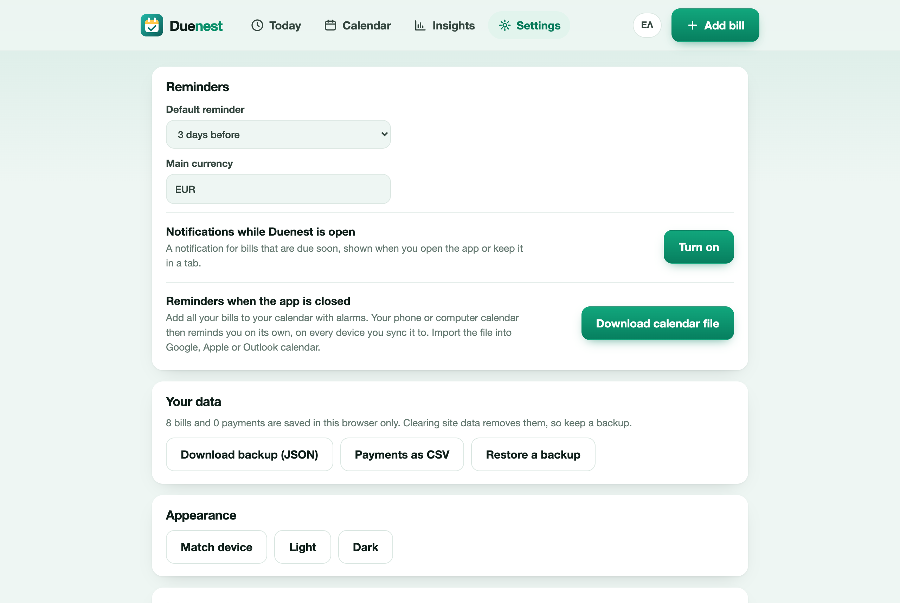

# Privacy and your data

## Your data stays on your device

Your bills and payments are saved in your browser's local storage on the device you are using. They are not sent to a server, because Duenest has no server that stores them. There is no account, no sign-in and no profile.

The website and the app count visits anonymously with Cloudflare Web Analytics: no cookies and no personal data, and never the contents of your bills.

Duenest never asks for bank details, never connects to a bank and never moves money. The payment link on a bill just opens the page you saved.

## Back up and restore

Because the data is in your browser, clearing the site's data (or losing the device) removes it. Keep a backup.

In **Settings → Your data**:

- **Download backup (JSON)** saves everything: bills, payments and settings.
- **Restore a backup** reads such a file and replaces the current data (after you confirm). This is also how you move your bills to another device.
- **Payments as CSV** exports your payment history for a spreadsheet.

## Delete everything

**Settings → Delete all my data** removes all bills and payments from this browser. It cannot be undone, so download a backup first if you might want them back.

## Notifications

If you turn notifications on, your browser asks permission and shows them locally. Nothing is sent anywhere.

## The calendar file

The calendar file you download contains your bill names, amounts and notes. When you import it into Google, Apple or Outlook calendar, it is stored by that service under its own privacy rules. Do not put sensitive details in notes if that matters to you.

## Open source

The code is public, so you can check all of this: [github.com/george-stathopoulos/duenest](https://github.com/george-stathopoulos/duenest).
