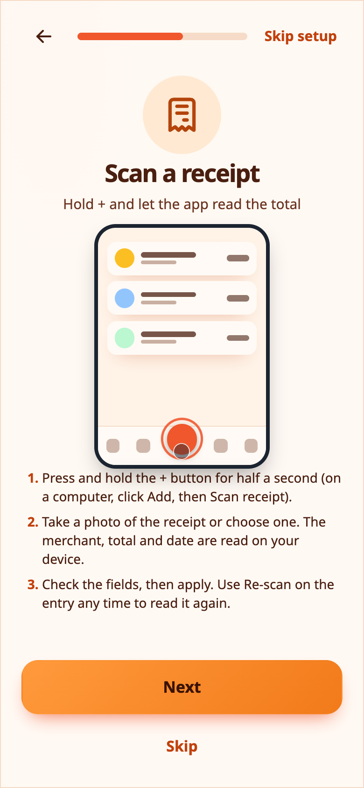
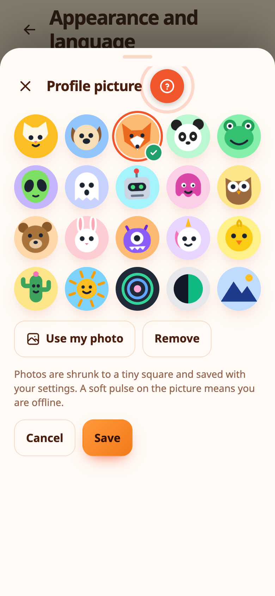

# Receipts, photos and your picture

## Scan a receipt

Photograph a receipt and Expenity reads the merchant, the total and the date **on your device**, in English and Greek. Nothing is uploaded for recognition.

- **Hold the + button** for half a second, take the photo, or choose one from your library. On a computer, open **Add**, then **Scan receipt**.
- Review the fields. You choose what to apply: the name, the amount, the currency, the date, and whether to keep the photo.
- Scanned entries show a small **receipt** icon. Open one and choose **Re-scan receipt** to read it again, for example with a better photo.

{{tut:scan}}

The scanner is part of **Advanced**, and **More → Make it yours → Receipt scanning** switches it on or off.

## Photos on entries

Attach a small reference photo or screenshot to an expense, income, bill, wallet or goal: open it, then **More → Attach photo**. Photos are shrunk to about 1000 pixels and 60 KB before upload, and a green check confirms it. An entry can show both a receipt icon and a photo icon. Tap the photo icon to view it. Photos need an account and a connection, and you can delete them all from **More → Data**.

{{tut:attach}}

## Your profile picture

Choose **More → Profile picture** to pick one of 20 characters (funny, animated or minimal) or use your own photo. Your choice is only a preview until you press **Save**, and a green check marks the one you picked. A photo is cropped to a small round picture and saved with your settings. When you are offline, the picture gets a soft pulse so you can tell.

