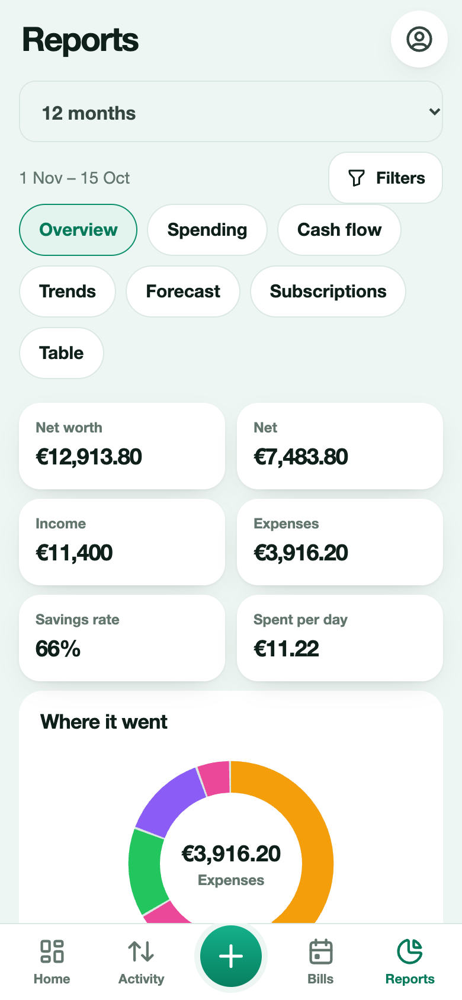
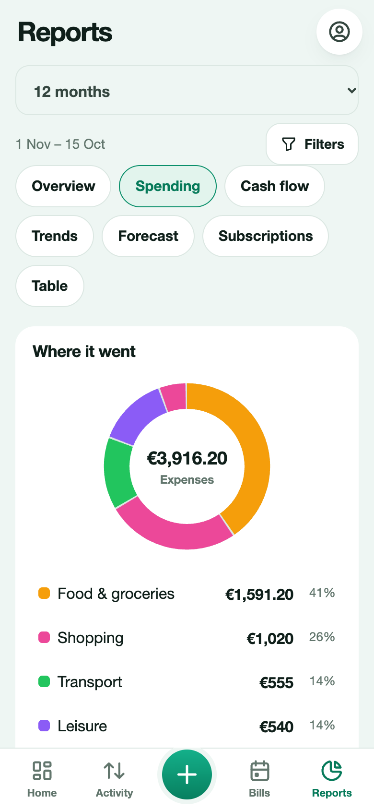
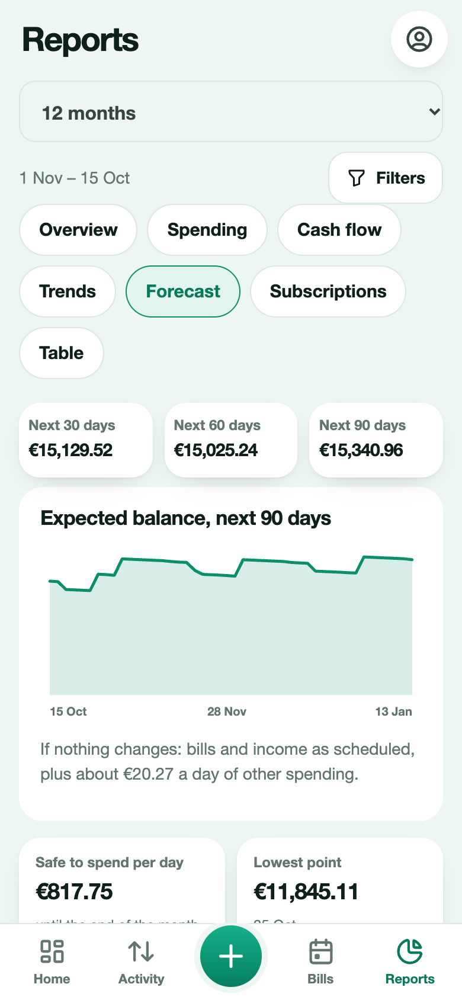
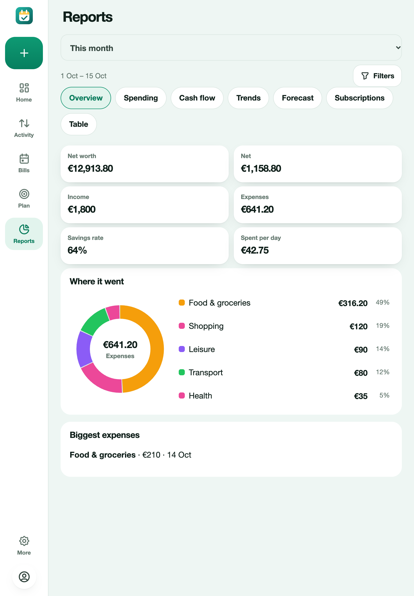

# Reports

Reports turn your transactions into charts and tables. Pick a **period** at the top (This month, Last month, 3 months, This year, 12 months, or a custom range), then a tab. **Filters** narrow everything to a wallet, a category, only expenses or only income, or a word in the description. Goal money is left out of spending.

## Overview

Net worth, net result, income, expenses, savings rate and spending per day, each with an arrow and a percentage compared with the previous period of the same length. Below, the top categories and your biggest expense.

## Spending

A donut chart by category. Tap a slice or a legend row to drill down into that category's transactions. Also: average spending by weekday, where the money goes (by description) and the biggest expenses.

## Cash flow

Income and expenses month by month, cumulative cash flow, and your savings rate by month.

## Trends

Spending by month stacked by category (the top five and the rest), and how this month compares with last month.

## Forecast

The expected balance in 30, 60 and 90 days, drawn as a line. It uses your bills, your recurring income and a typical daily spend worked out from the last 60 days, and says so under the chart. It also shows **the amount you can spend per day** until the end of the month, the lowest point your balance reaches and the biggest payments coming up.

## Subscriptions

A table of your subscriptions with the monthly and yearly cost and the next charge, the total per year, and a note when a price went up.

## Table

Every transaction in the period, in a table you can sort by clicking a heading and group by category, wallet or month, with totals. **CSV** downloads it for a spreadsheet.

Every chart has **Show as a table**, so the numbers are always available as text.

On a tablet or computer the charts and tiles use the extra room.

