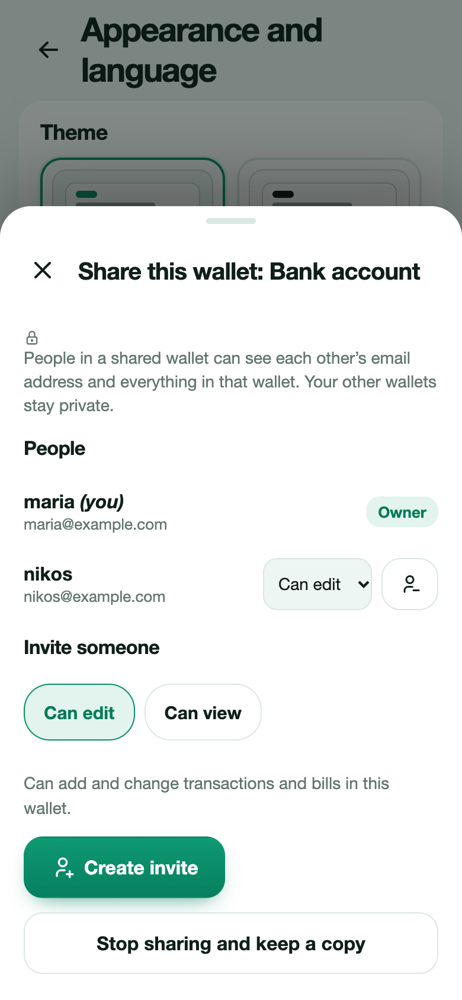

# Shared wallets

A shared wallet lets family or friends see and add to the same wallet from their own devices, for a household budget, a trip or a shared account. Only the wallet you share is visible to others: your other wallets, budgets and goals stay private.

## Share a wallet

You need an account (not guest mode).

1. Open **More → Wallets** and tap the wallet.
2. Press **Share this wallet**, then **Start sharing**.
3. Choose a role for the person you invite: **Can edit** or **Can view**.
4. Press **Create invite**. You get a code and a link. Send either one to the person, in a message or in person.

An invite works once and expires after 7 days. You can see open invites and cancel them. You can share up to 5 wallets, with up to 12 people each.

## Join a shared wallet

Open the link you were sent, or go to **More → Wallets → Join a shared wallet** and type the code. You need an account, and Expenity asks you to sign in or create one first if you do not have one. The wallet and its history then appear on your device.

## Roles

| Role | Can do |
|---|---|
| **Owner** | Everything: invite people, change roles, remove people, stop sharing |
| **Can edit** | See everything in the wallet, add and change transactions and bills |
| **Can view** | See everything in the wallet, but not change it |

The server checks the role on every change, not only the app. Each transaction and bill shows who added it.

## What is shared

The wallet, its transactions and its bills. Budgets, goals, recurring income and your settings are not shared. Transfers only work between two private wallets or between two wallets inside the same shared wallet.

## Privacy

People in a shared wallet can see each other's email address and everything in that wallet. Tell the people you invite what they will see.

## Leave, remove, stop sharing

- A member can **Leave this wallet**. It is removed from their device and the others keep it.
- The owner can **Remove** someone, who loses access and the data on their device.
- The owner can **Stop sharing and keep a copy**: everyone else loses access, and you keep the wallet and all its transactions as a private wallet.

If you delete your account, wallets you own and share are deleted for everyone.
