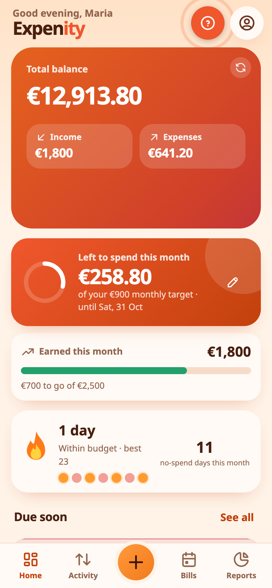
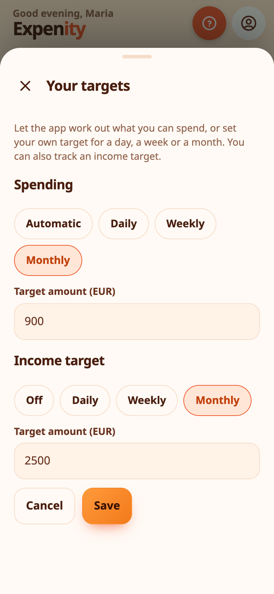

# Daily number, targets and streaks

Expenity does a little thinking for you. These helpers turn your records into something you can act on today.

## You can spend today

The **daily number** card on Home answers one question: how much can I spend today without worrying? It starts from your balance, subtracts the bills due until your next income, your budgets and any reserve you have set, then spreads what is left over the days to come. The ring empties as you spend. Tap the arrow for the full breakdown, or open the **Safe to spend** details.

## Set your own targets

The automatic figure is a suggestion. Tap the **pencil** on the card to set your own.

- **Spending:** keep **Automatic**, or choose a **Daily**, **Weekly** or **Monthly** target and an amount. The card then shows what is left to spend in that period, or how far over you are. Weeks run Monday to Sunday.
- **Income target:** optional. Choose daily, weekly or monthly and an amount, and a progress bar shows what you have earned so far, with "Target reached" when you get there.

Targets are saved with your settings, so they follow you to your other devices. They count expenses and income in your main currency, and money moved to goals is not counted as spending.

{{tut:daily}}

## Streaks

The flame counts **consecutive days within budget**. If you have no budgets, it counts days you spent nothing. The seven dots show the last week, and Expenity keeps your best streak and the number of no-spend days this month. Overspend once and the flame resets: start again tomorrow.

{{tut:streak}}

## Duplicate guard

Before saving an expense or income, Expenity checks the last few days for an identical entry: same name, amount and wallet. If it finds one, it pauses and shows you what it found, with the date. Choose **Add anyway** if it is real, or cancel.

{{tut:dup}}

## Price-change alerts

When you pay a bill and the amount is higher than the previous payment, Expenity tells you by how much, and a small red chip such as **+12%** stays on the bill so you can review it. It compares payments you recorded, so variable bills such as electricity are exactly where it helps.

{{tut:price}}

## Switching them on or off

The daily number, duplicate guard and price alerts are part of **Pro**, and streaks are part of **Advanced**. See [Features and plans](features-and-plans.md).
