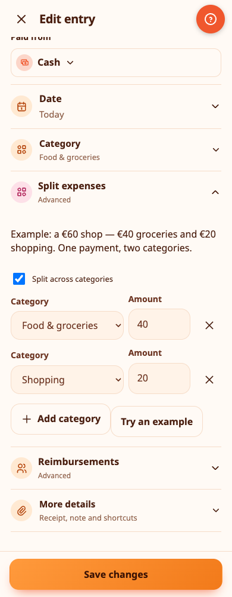
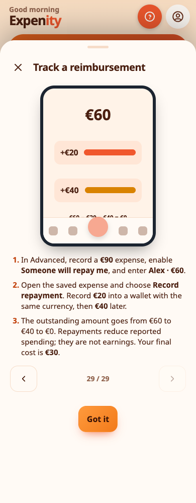

# Split expenses and reimbursements

Both features belong to **Advanced**. You can also enable them individually in a **Custom** mix under More → Features. They are free features, not paid subscriptions. Turning them off does not remove records or change their calculations.

## Split one payment between categories

Example: you spend **€60** at a supermarket: **€40** on food and **€20** on household shopping.

1. Add an Expense and enter the full **€60** payment, wallet and date.
2. Open **Split expenses** and enable **Split across categories**.
3. Set **Food & groceries · €40** and **Shopping · €20**. Add or remove category rows as needed.
4. Save. Every allocation must be positive and the amounts must add up exactly to €60. A difference of one cent prevents saving.

Your wallet decreases by **€60 once**. Activity shows one expense, with a split icon. Open it to see every category amount. Category reports and budgets use €40 and €20 respectively. The receipt/photo and tags belong to the whole payment. To change allocations, edit the original expense.

**Try an example** populates the unsaved draft. It changes the draft amount and allocations; nothing is saved until you press Save. Split details apply to recorded expenses: for a bill, record its payment and then edit that expense. They do not create several recurring schedules.

> 💡 **Real-life example** A €86 supermarket receipt includes €60 of groceries, €16 of cleaning products and €10 of pet food. Maria splits it across three categories with one payment from her wallet, and each report shows the right category.

## Track money someone will repay

This is money you paid on behalf of a person or organisation, not a refund from a shop and not salary.

Example: you pay **€90** for dinner. Alex owes you **€60**. Your eventual personal cost is **€30**.

1. Add the €90 expense. Open **Reimbursements**, enable **Someone will repay me**, enter **Alex** and the expected **€60**, and save.
2. When Alex pays €20, open the original expense → **Record repayment**. Choose the receiving wallet and date, review the amount and confirm.
3. The wallet increases by €20; the expense shows **Received €20 · Still owed €40**.
4. Record the final €40 when it actually arrives. The remaining amount becomes zero.

Find all outstanding requests from **Activity → Money owed to you**. Expected money does not increase wallet balances or safe-to-spend. You can receive it into another writable wallet with the same currency and sharing space. No exchange rate is guessed. Partial payments are supported; a new payment cannot exceed the currently known outstanding balance.

Repayments stay in Activity as linked records. Open them to find the original expense. Use the original expense's **Repayment history** to remove an incorrect repayment; the balance decreases and the amount becomes owed again. Existing undo/history/trash tools continue to work. An expense cannot be edited to expect less than repayments already recorded.

> 💡 **Real-life example** Nikos pays €120 for a team dinner and his colleagues owe him €90. He tracks what is owed, and as they repay, only his own share stays in his spending.

## Reports, dates and data safety

Reports treat repayments as **negative spending on the date received**, not earnings. For a split expense, the credit is allocated proportionally between its categories, with the final category absorbing any rounding cent. A reimbursement received in a later month reduces that later month's spending. That period can show a negative net expense; signed amounts remain available in tables.

Balances use the original payment and actual receipts once each. Deleting an original expense does not delete money already received: linked receipts keep a category snapshot and remain in history, with an explanation if the original is missing. Restore the expense from Recently deleted where available.

JSON backups retain splits, requests and receipt links. Transaction CSV includes allocation and reimbursement metadata; report CSV shows category allocations. Records use the existing account/shared-wallet sync and offline queue. Two devices recording repayments simultaneously while offline can exceed the expected amount once merged; review the receipt history and remove an incorrect receipt. The app never silently discards a received payment.

Animated, bilingual examples are in **More → Tutorials**, and the Advanced setup includes both guides. Animations respect motion preferences.

