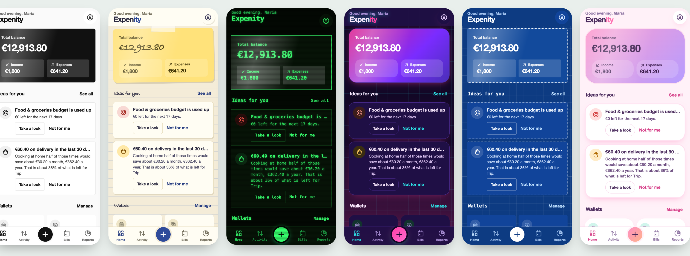
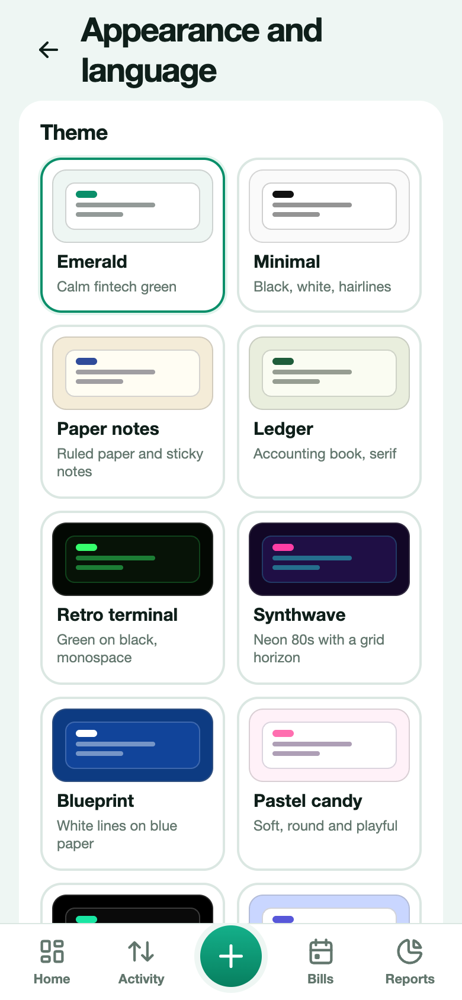
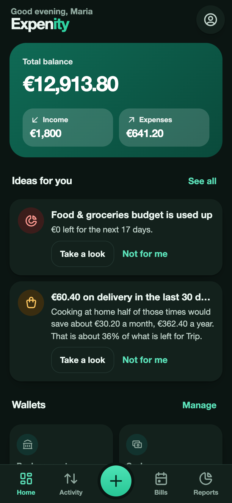

# Themes and animations

Expenity has twelve themes. A theme changes more than colour: shapes, type, borders and a few details too. Pick one in **More → Appearance and language**, or during setup.

| Theme | Look |
|---|---|
| **Emerald** | The default: calm green, soft cards |
| **Minimal** | Black, white and hairlines |
| **Paper notes** | Ruled paper, handwriting, a sticky note for your balance |
| **Ledger** | An accounting book, serif type, double rules |
| **Retro terminal** | Green on black, monospace, scanlines |
| **Synthwave** | Neon pink and cyan with a grid horizon |
| **Blueprint** | White lines on blue drawing paper |
| **Pastel candy** | Soft, round and playful |
| **Midnight** | True black for OLED screens |
| **Glass** | Frosted cards on a soft gradient |
| **Sunset** | Warm oranges and corals |
| **Chalkboard** | Chalk on a dark green board |

**Emerald** and **Minimal** also have a light and a dark version. Choose **Match device**, **Light** or **Dark** under the theme cards. The other themes keep their own look.

## Animations

Expenity moves a little: screens slide in, charts grow, buttons respond when pressed. Under **Animations** you can choose:

- **Match device**: follows your device's "reduce motion" setting.
- **Full**: all animations.
- **Reduced**: a very short version of each.
- **Off**: no animations at all.

Theme, light or dark and animations are remembered on each device. Language is too: switch it any time in More → Appearance and language, or from the welcome screen.

