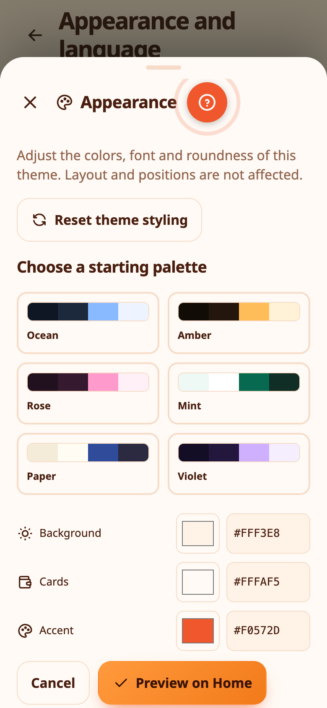
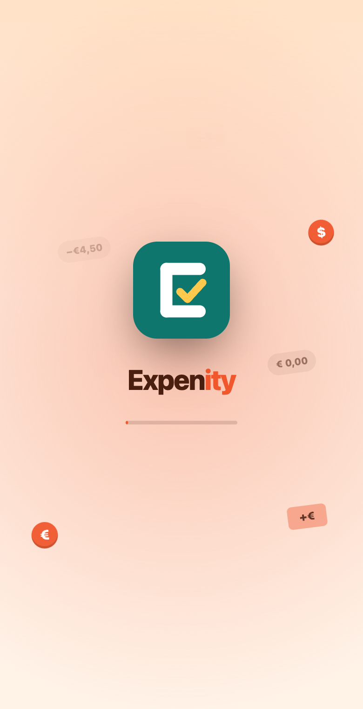
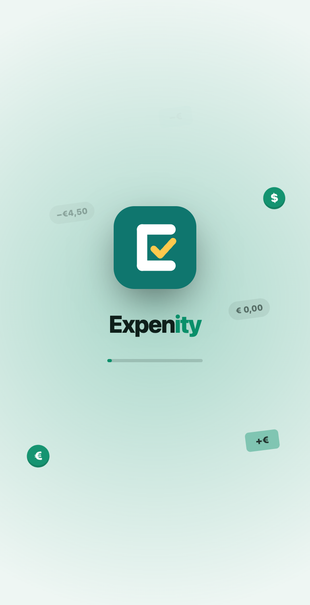
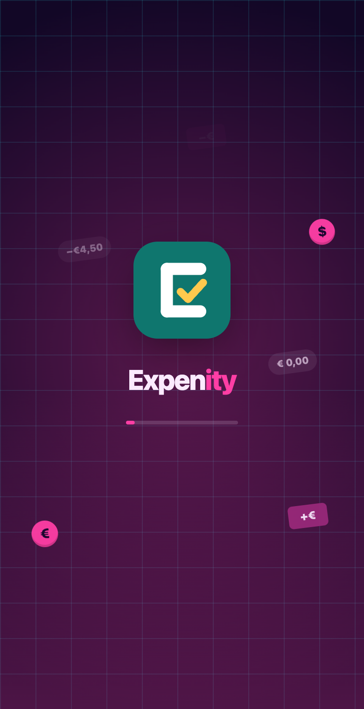
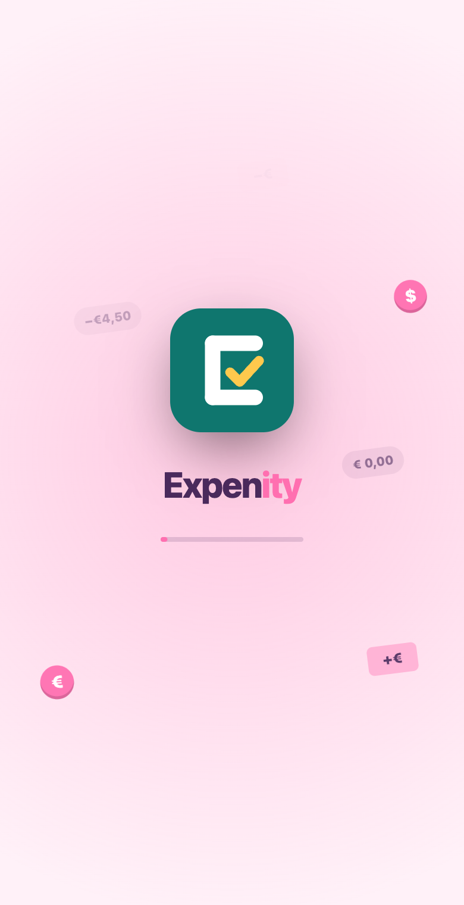

# Themes and animations

Expenity has eighteen themes, and every one has a pencil to adjust its colors, font and roundness. A theme changes more than colour: shapes, type, borders and a few details too. Pick one in **More → Appearance and language**, or during setup.

| Theme | Look |
|---|---|
| **Emerald** | The default: fresh green, soft cards |
| **Minimal** | Black, white and hairlines |
| **Paper notes** | Ruled paper, handwriting, a sticky note for your balance |
| **Ledger** | An accounting book, serif type, double rules |
| **Retro terminal** | Green on black, monospace, scanlines |
| **Synthwave** | Neon pink and cyan with a grid horizon |
| **Blueprint** | White lines on blue drawing paper |
| **Pastel candy** | Soft, round and playful |
| **Midnight** | True black for OLED screens |
| **Glass** | Frosted cards on a soft gradient |
| **Sunset** | Warm oranges and corals |
| **Chalkboard** | Chalk on a dark green board |

**Emerald** and **Minimal** also have a light and a dark version. Choose **Match device**, **Light** or **Dark** under the theme cards. The other themes keep their own look.

## Animations

Expenity moves a little. The balance card on Home **flips over** when you tap it, to show this month in short. Numbers roll up, list rows and wallet cards fade in one after another, bars, rings and donut slices draw themselves, a row you delete fades away, a tab you press bounces, and a goal you reach throws confetti. Under **Animations** you can choose:

- **Match device**: follows your device's "reduce motion" setting.
- **Full**: all animations.
- **Reduced**: a very short version of each.
- **Off**: no animations at all.

Some themes also have a little ambient motion behind the content: embers rising on Sunset, leaves drifting on Emerald, bubbles and sprinkles on Pastel candy, and falling digits on Terminal. It never gets in the way of a tap, and it stops when you choose **Reduced** or **Off**.

Theme, light or dark and animations are remembered on each device. Language is too: switch it any time in More → Appearance and language, or from the welcome screen.

> 💡 **Real-life example** Petros prefers calm, so he turns animations off in Appearance and the app stays still.

## Amberwave, Ion and your own palette

Amberwave combines amber neon with warm shadows; Ion uses electric cyan on deep blue. Together with Synthwave they have sparse falling dots with thin trails. The effect pauses when hidden and follows reduced/off motion settings. Select **Your theme → Create your theme** to choose background, cards, accent and text colours, corner shape and typography. Text must have readable contrast on both backgrounds before saving. Trails are optional. Custom theme choices are saved per device.

The balance animation begins on launch and screen navigation, stays between zero and the true amount, and ends on the exact value.

## Adjust any theme with the pencil

Every theme card has a small **pencil**. Tap it to change that theme's **colors, font and roundness**. Layout and positions never change, only the look, and your changes are saved straight away for that theme. The old separate custom theme has been replaced by this.

{{tut:themes}}

> 💡 **Real-life example** Anna keeps the Emerald theme but makes the corners rounder and the accent color purple, with the pencil.

## Preview a theme on Home

In the theme editor, **Preview on Home** shows your changes on the real Home screen. A panel with **Apply** and **Keep editing** stays above the tab bar. **Apply** saves the look. **Keep editing** takes you back to the editor with your changes. If you leave without applying, your previous theme comes back.

> 💡 **Real-life example** Before saving, Elena previews her new colors on the real Home screen to make sure the balance card is easy to read.

## Reports and sizes on Home

**Where it went** shows this month's spending by category at the bottom of Home. From **More → Make it yours → Personalise Home** you can add **Trends** and **Subscriptions** with **Cards**. Each card can be Small, Medium or Full, and only the sizes that look different are offered. Tap a report to open Reports.

> 💡 **Real-life example** Nikos makes Where it went full width and the daily number a small tile, so the top of Home shows what he checks most.

## A start screen dressed in your theme

When you open the app, the start screen takes the colours of your theme. If loading takes a moment, a playful message keeps you company. It only appears when you open the app, not when you refresh the page.

> 💡 **Real-life example** Eleni switches to a new theme for fun. The next morning, opening the app, she is greeted by her own colours before her day's numbers appear.

## Fonts

Fonts are bundled with the app so it looks the same on every phone, tablet and computer, with full Greek support.

## Your picture and sounds

Choose a character or your own photo as your picture: see [Receipts, photos and your picture](receipts-and-photos.md). Optional sound effects can be turned on in **More → Make it yours → Sounds** (part of the Advanced plan).

## Try the themes live

The [Expenity website](https://expenity.github.io/expenity/#try) has the real app in an iPhone, iPad and computer frame, so you can switch themes and see them in action before you open the app.
