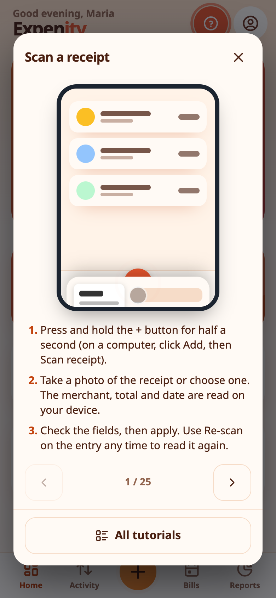
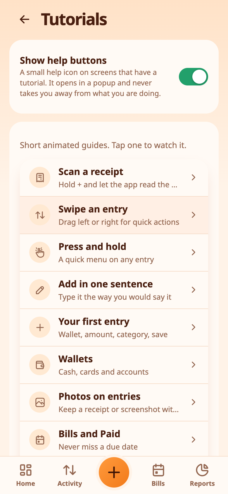
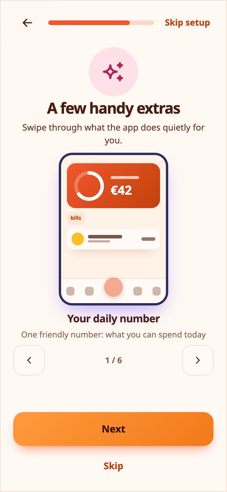
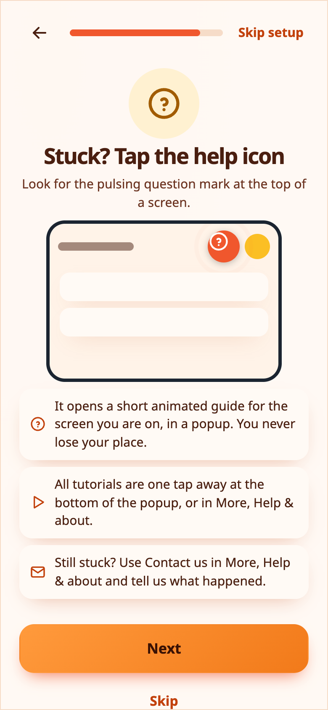

# Tutorials and help

Expenity teaches itself. Every feature has a short **animated tutorial** that you can watch at any time, and a small **help icon** that opens the right one without taking you away from what you are doing.

## The help icon

On screens that have a tutorial you will see a round, pulsing **?** at the top of the screen (and in the header of sheets such as the entry form). It rings like a bell every few seconds so it is easy to spot.

Tap it and the tutorial opens in a **popup on top of your screen**. Nothing closes and nothing is lost: if you were halfway through an expense, it is still there when you close the popup. At the bottom of the popup you can:

- open **All tutorials** and pick another one without leaving the popup, or step through them with the arrows;
- choose **Never show this help icon again**. That hides the icon on that screen only. Other screens keep theirs until you hide them too.

> 💡 **Real-life example** Stuck on filters, Maria taps the pulsing help icon and watches the short animation without leaving her screen.

## Turn help icons on or off

**More → Help & about → Help icons** has one switch for all help icons, one switch for each screen, and **Show every help icon again** to bring them all back. The same master switch is on the Tutorials page.

## The tutorials page

**More → Help & about → Tutorials** lists every tutorial with a small description. New ones carry a **NEW** badge. Open one to watch it loop, read the three steps under it, and use the arrows to go through them all in order.

Tutorials include scanning receipts, swiping rows, press and hold, adding in one sentence, your first entry, wallets, bills, repeating income, budgets and goals, reports, notifications, themes and the pencil, features and plans, profile picture, editing Home, the duplicate guard, the daily number, search and filters, recently deleted, streaks, price-change alerts, photos on entries, sync, shared wallets, and backup and reset account.

## The welcome tour

The first-run setup includes animated steps for the things people ask about most: scanning a receipt, adding an entry in one sentence, a few handy extras, and the help icon itself.

Dismiss the tour or replay it from the Tutorials page: **Replay the welcome tour**.

## What's new

After an update, a small window shows what changed. Press **Got it** to close it, or **View changes** for the full list.

## Still stuck?

Use **More → Help & about → Contact us**. See [Contact us](contact-us.md).

For split category amounts, partial repayments and worked examples, see [Split expenses and reimbursements](split-expenses-and-reimbursements.md).
