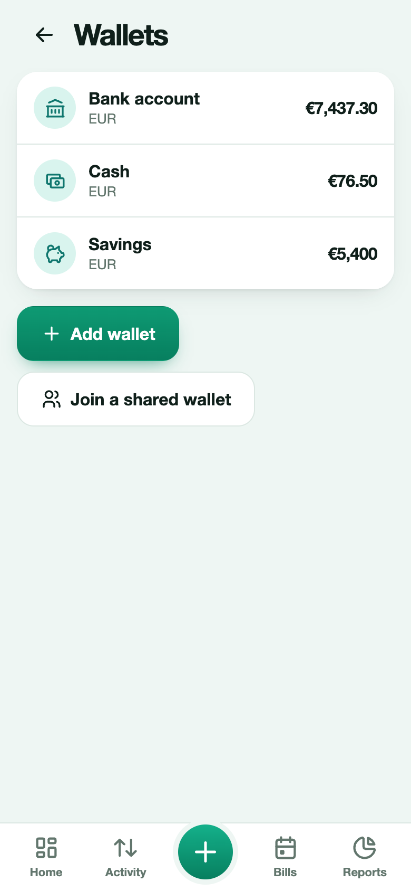

# Wallets and currencies

A wallet is a place where money is: cash, a bank account, a card, a savings account. Every transaction belongs to a wallet, and a wallet's balance is its opening balance plus income, minus expenses, with transfers in and out.

## Add and edit wallets

Open **More → Wallets**, or tap a wallet on Home. Each wallet has a name, a type (cash, bank account, card, savings, other), a currency and an **opening balance**, which is what was in it when you started. You can archive a wallet to hide it. A wallet that already has transactions is archived instead of deleted, so history is never lost.

> 💡 **Real-life example** Maria keeps a Cash wallet, a Bank wallet and a Savings wallet, each starting with the money it really holds, so every payment is recorded against the right one.

## Your main currency

You choose a **main currency** in the setup, and can change it in **More → Reminders and calendar → Main currency**. Totals on Home and in Reports are shown in it.

> 💡 **Real-life example** Dimitra lives in Greece and sets the euro as her main currency, so totals and reports are always in euros.

## Wallets in other currencies

A wallet can use any currency. A bill or transaction takes the currency of its wallet. When your wallets use several currencies, totals are converted to your main currency using daily exchange rates, and shown with **≈** to say they are approximate. Expenity never adds different currencies together as plain numbers.

Rates are the European Central Bank reference rates, fetched through the Expenity API once a day. Only the public rates are requested: nothing about you is sent. If rates cannot be loaded, other currencies are listed on their own lines instead of being converted.

> 💡 **Real-life example** Nikos has a Pound wallet for a trip to London. What he spends there is recorded in pounds and converted to euros in his totals.

## Transfers

To move money between wallets, press **+** and choose **Transfer**. If the two wallets use different currencies, you also enter the amount received. Transfers are not counted as income or expenses.

## Money set aside for goals

When you add money to a [goal](budgets-goals-income.md#goals), it is taken from a wallet you choose, so the wallet balance drops. That money is not counted as spending in your reports or budgets.

> 💡 **Real-life example** Eleni sets aside €50 a month for a holiday goal. The goal's ring fills up while that money stays separate from her everyday balance.

## Wallet colors

Every wallet has a color. By default it follows your theme: the first wallet uses the theme's accent color and the others step around the color wheel from it, so they change when you change the theme. To choose your own, open **More → Wallets**, pick a wallet and choose a color (or **Theme color** to go back to the default, or the **+** swatch for any color you like).

> 💡 **Real-life example** Anna gives her work card a blue color and her personal card a green one, so she sees at a glance which wallet an entry belongs to.
